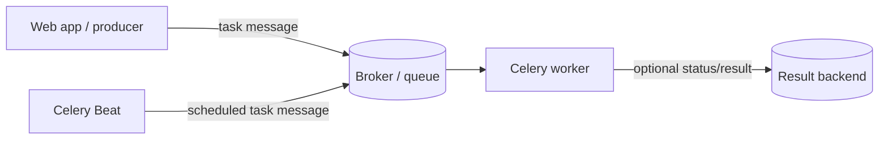

# Celery interview preparation

[Repository guide](../README.md) · Related: [Django/Flask](Django_Flask.md), [Redis](Redis.md), [pipeline design](../System_Design/Large_Data_Background_Processing.md).

Examples use Celery 5.x conventions. Broker transport, pool, acknowledgement, and backend configuration determine failure behavior. Snippets with application collaborators are fragments.

## Contents

- [Celery architecture](#celery-architecture)
- [Celery task workflows](#celery-task-workflows)
- [Retries, acknowledgement, and worker failure](#retries-acknowledgement-and-worker-failure)
- [Celery routing and worker concurrency](#celery-routing-and-worker-concurrency)
- [Celery scheduled work](#celery-scheduled-work)
- [Celery operations](#celery-operations)
- [Process-local cache and shared data](#process-local-cache-and-shared-data)
- [Django and Flask integration](#django-and-flask-integration)
- [Operational interview drills](#operational-interview-drills)
- [References](#references)

## Celery architecture

Celery runs work outside the web request process. The application publishes a task message to a **broker**; a **worker** consumes and executes it. An optional **result backend** stores task state/results. Celery Beat publishes scheduled task messages to the broker.



```python
from celery import Celery

app = Celery("shop", broker="redis://localhost:6379/0", backend="redis://localhost:6379/1")

@app.task
def send_receipt(order_id):
    ...

send_receipt.delay(123)  # enqueue; a worker executes it
```


## Celery task workflows

Celery Canvas composes tasks into workflows using signatures. A signature captures a task and its arguments; `.s()` creates a signature whose result can be passed to the next task.

```python
from celery import chain, chord, group
from shop.tasks import charge_order, create_invoice, assemble_image_report, resize_image

# Sequential: result of charge_order is passed to create_invoice
checkout = chain(charge_order.s(order_id), create_invoice.s())
checkout.delay()

# Parallel: enqueue one resize task per image
group(resize_image.s(image_id) for image_id in image_ids).delay()

# Parallel header, then callback receives the list of header results
header = group(resize_image.s(image_id) for image_id in image_ids)
workflow = chord(header, assemble_image_report.s(report_id))
workflow.delay()
```

| Primitive | What it does | Example use |
|---|---|---|
| `chain` | Runs tasks in order; passes each result forward | Charge, then create invoice, then notify |
| `group` | Runs signatures in parallel | Process many independent images |
| `chord` | Runs a group, then calls a callback with the results | Wait for all report parts, then combine them |

`assemble_image_report` receives the list of header results followed by `report_id`; the task signatures must match that call shape.

Chords need a result backend that supports them, and header tasks generally must store results. Plan for partial failure and callback retries; make every side effect idempotent. Use immutable signatures (`.si()`) when a task should not receive the previous task's result.


## Retries, acknowledgement, and worker failure

Tasks must tolerate repeated execution using stable operation identities and database uniqueness/atomicity where appropriate. Early acknowledgement occurs before task completion; late acknowledgement defers it until execution completes, subject to the failure settings below.

When a task raises an exception, Celery records it as `FAILURE` if a result backend is configured and logs the error. A normal task exception is not automatically retried. With the usual early acknowledgement behavior, the broker message has already been acknowledged, so it is not automatically put back on the queue. Use explicit retry rules for temporary errors and handle permanent errors separately.

| Situation | Typical behavior | What to do |
|---|---|---|
| Temporary failure, such as a timeout or rate limit | Task fails unless configured to retry | Retry with a limit and backoff; honor `Retry-After` when available |
| Permanent failure, such as invalid input | Retrying will likely fail again | Validate early, record the failure, and alert or send to a dead-letter/manual review path |
| Task raises while using late acknowledgement | By default, Celery still acknowledges failed/timed-out tasks | Use retry for transient errors; changing `task_acks_on_failure_or_timeout` changes this behavior |
| Worker process is lost during a task | With late ack, worker-loss requeue depends on `task_reject_on_worker_lost` and broker | Consider requeue only for idempotent tasks; repeated crashes can create a message loop |
| Task succeeds remotely but worker crashes before acknowledgement | Task may run again if redelivered | Make side effects idempotent or protect them with an idempotency key |

```python
import requests
from celery import shared_task

@shared_task(bind=True, max_retries=5)
def sync_customer(self, customer_id):
    try:
        response = requests.get(customer_url(customer_id), timeout=5)
        response.raise_for_status()
    except (requests.Timeout, requests.ConnectionError) as exc:
        raise self.retry(exc=exc, countdown=min(2 ** self.request.retries, 60))
    # Validate and process the successful response here.
```

`max_retries=5` permits five retries after the initial attempt, not five total attempts.

In production, combine bounded retries with backoff, jitter for large fleets, timeouts, structured logs containing the task ID, monitoring, and a way to inspect/replay terminal failures. Avoid infinite retry loops and do not retry every exception indiscriminately. A result backend helps inspect task state, but it is not a durable business-failure queue by itself.

Automatic retry is an alternative for narrowly classified exceptions: `autoretry_for=(TimeoutError,)`, `retry_backoff=True`, and a bounded `retry_kwargs={"max_retries": 5}`. Do not enable it for every exception.

Celery documents that even with `acks_late`, some child-process termination cases are acknowledged; `task_reject_on_worker_lost` changes selected behavior and can cause loops for deterministic crashes. Broker transport/visibility timeout also matters. [Celery task semantics](https://docs.celeryq.dev/en/stable/userguide/tasks.html).

## Celery routing and worker concurrency

Route tasks to queues based on their workload so a long-running export does not block short email or API tasks. Workers can listen to specific queues; scale or tune them separately.

```python
# celery config
task_routes = {"shop.tasks.export_report": {"queue": "exports"}}
```

```sh
celery -A shop worker -Q exports -l INFO --concurrency=2
```

| Pool / setting | Typical fit | Tradeoff |
|---|---|---|
| Prefork processes | CPU-heavy or general synchronous tasks | Process memory overhead |
| Threads | I/O-heavy tasks using blocking libraries | Python CPU work still limited by the GIL in standard CPython |
| Eventlet/gevent | Cooperative I/O with compatible libraries | Requires compatible code and monkey-patching considerations |
| Concurrency | Number of execution slots | Too high can exhaust memory, database connections, or remote service limits |

Measure task duration and resource use, set sensible prefetch behavior, and give slow and fast tasks separate queues when needed.

### Prefetch and capacity tuning

Start with measured per-task CPU, memory, I/O waits, downstream limits, and failure recovery time. Worker pool choice affects execution behavior; do not assume Python threads accelerate CPU-bound Python code. Prefetch can let workers reserve tasks ahead of execution, causing unfair distribution for long jobs.

| Control | Benefit | Cost |
|---|---|---|
| Lower prefetch | Better distribution of long tasks | Can reduce throughput for tiny tasks |
| Separate queues/pools | Protect interactive/short work from bulk jobs | Capacity allocation and routing complexity |
| Per-tenant concurrency | Prevent noisy neighbors | Fair scheduler/state required |
| Worker recycling | Contain memory growth temporarily | Warmup/replay; not a leak fix |

**Dig deeper:** total memory includes concurrent tasks × per-task peak plus worker/runtime/cached data. Is queue admission bounded, or are you just moving overload into a broker?

## Celery scheduled work

Celery Beat is a scheduler that sends due task messages to the broker; workers execute those tasks. Run one active scheduler for a schedule unless using a scheduler with coordination, or periodic jobs may be enqueued more than once.

```python
from celery.schedules import crontab

app.conf.beat_schedule = {
    "expire-old-carts-daily": {
        "task": "shop.tasks.expire_old_carts",
        "schedule": crontab(hour=2, minute=0),
    },
}
```

Scheduled tasks can overlap if one run takes longer than the interval. Make them idempotent and use a lock or other coordination if overlapping runs are unsafe.

## Celery operations

Production operations include monitoring queue depth and task age, task success/failure and retry rates, worker health, runtime, memory, and broker/backend availability. Alert on growing queues and stuck or repeatedly failing tasks.

Set timeouts for network calls, use soft/hard task time limits where appropriate, expire unneeded result records, and shut workers down gracefully so active work can finish. Keep task arguments small and avoid sending secrets or large objects through the broker; pass identifiers and load current data in the worker.

## Process-local cache and shared data

An ordinary dictionary is local to one process. Prefork workers may inherit pages initially, but updates are not a coherent shared dictionary; writes can break copy-on-write sharing. Across hosts, process memory is separate.

| Sharing method | Fit | Tradeoff |
|---|---|---|
| Process-local cache | Reuse within one process | Duplicate memory and uneven hit rates |
| Redis | Shared small metadata/results | Serialization/network/memory; not ideal for arbitrary huge datasets |
| Shared immutable file/memory mapping | Large local read-mostly data | Node scope, lifecycle, format, and platform constraints |
| Object store + manifests | Durable cross-host artifacts | Download/I/O and local caching policy |

## Django and Flask integration

For Django, enqueue after the transaction commits with `transaction.on_commit()` (or a supported convenience API). This avoids a worker reading uncommitted/missing data, but a crash after commit and before publish still needs an outbox/reconciliation design where durable delivery matters. Use the project's configured Celery app and task discovery.

For Flask, initialize tasks with the configured application dependencies; tasks needing Flask-specific context must run under the appropriate application context. Do not reuse a request object after the request ends. Pass stable IDs and load authorized current data in the task.

## Operational interview drills

- Distinguish a retry from broker redelivery and a result-backend record from business job state.
- Trace a worker crash after an external effect but before acknowledgement.
- Explain why a long task can exceed a Redis transport visibility timeout and be delivered again; tune the transport and idempotency together.
- Diagnose an ever-growing queue despite healthy worker processes using arrival rate, completion rate, oldest age, and downstream saturation.
- Separate queues for short notifications and memory-heavy reports; measure before choosing concurrency.

Full export design, manifests, progress, cancellation, and artifact publication live in [background pipeline design](../System_Design/Large_Data_Background_Processing.md). Cache invalidation/freshness lives in [caching design](../System_Design/Caching_Performance.md); Redis server mechanics live in [Redis](Redis.md).

## References

- [Celery tasks and acknowledgement](https://docs.celeryq.dev/en/stable/userguide/tasks.html)
- [Optimization and prefetch](https://docs.celeryq.dev/en/stable/userguide/optimizing.html)
- [Canvas workflows](https://docs.celeryq.dev/en/stable/userguide/canvas.html)
- [Periodic tasks](https://docs.celeryq.dev/en/stable/userguide/periodic-tasks.html)
- [Django integration](https://docs.celeryq.dev/en/stable/django/first-steps-with-django.html)
- [Flask task integration](https://flask.palletsprojects.com/en/stable/patterns/celery/)
- [Redis broker transport caveats](https://docs.celeryq.dev/en/stable/getting-started/backends-and-brokers/redis.html)
