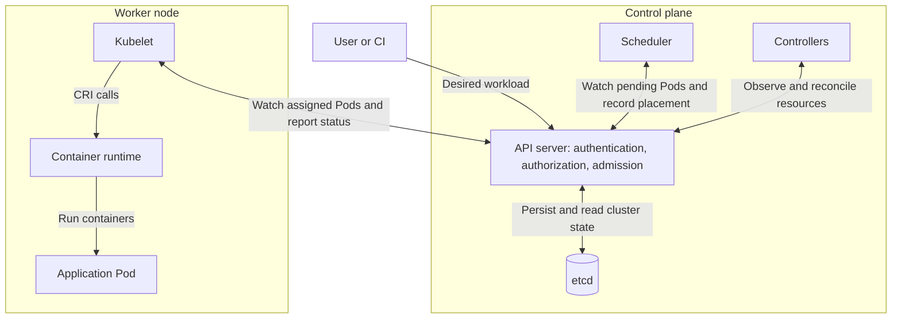
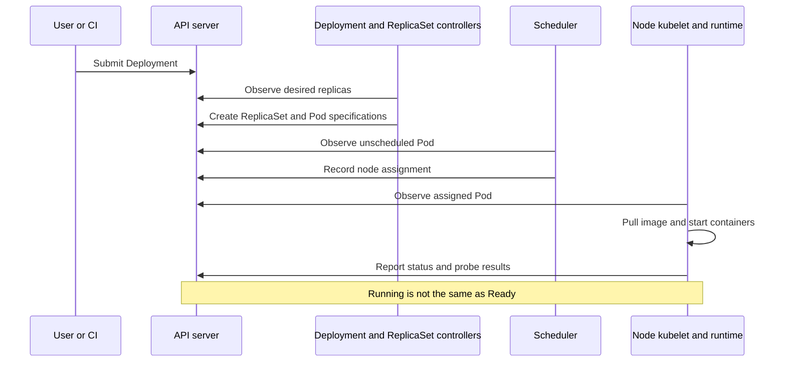
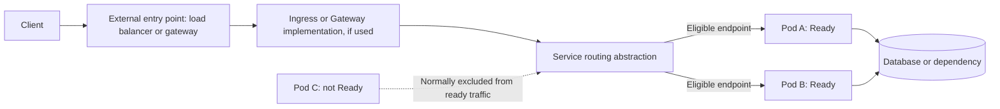

# Kubernetes interview preparation

[Repository guide](../README.md) · Related: [networking](../System_Design/Networking.md), [AWS](AWS.md), [OCI vs. AWS](OCI_vs_AWS.md), [infrastructure automation](../System_Design/Infrastructure_Automation.md), [observability](../System_Design/Observability.md).

Focus on Kubernetes workload behavior, scheduling, resources, networking, rollout, and recovery. General cloud service choices live in AWS and OCI vs. AWS. YAML is illustrative; adapt images, resources, networking, permissions, and version support before use.

## Contents

- [Container vs. VM? What persists when a container restarts?](#container-vs-vm-what-persists-when-a-container-restarts)
- [Explain Kubernetes architecture](#explain-kubernetes-architecture)
- [Pod vs. Deployment vs. StatefulSet vs. Job?](#pod-vs-deployment-vs-statefulset-vs-job)
- [Requests, limits, probes, and shutdown?](#requests-limits-probes-and-shutdown)
- [How do HPA and node autoscaling differ?](#how-do-hpa-and-node-autoscaling-differ)
- [Services, discovery, routing, and TLS](#services-discovery-routing-and-tls)
- [Rollouts and availability](#rollouts-and-availability)
- [Interview drills](#interview-drills)
- [References](#references)

## Container vs. VM? What persists when a container restarts?

Containers share the host kernel with process/resource isolation; VMs run guest kernels over virtualized hardware. An image is a packaged filesystem/configuration, not a running VM. Writable container layers are not a durable application data strategy; use appropriate volumes/external storage.

| Choice | Benefit | Risk / cost |
|---|---|---|
| Container | Fast deployment, consistent packaging | Kernel/runtime security and resource limits |
| VM | Stronger separate OS boundary and flexible guest OS | More OS management/startup/resource overhead |

**Dig deeper:** build reproducibly, scan dependencies, pin images by digest for releases, run with minimal privileges, and separate secrets from images. How do native-library leaks affect container RSS even if the application heap looks stable?

## Explain Kubernetes architecture



Control-plane components coordinate through the API. They do not forward each user request through etcd or the scheduler. Node networking and Service routing are a separate application data path.


| Component | Responsibility |
|---|---|
| API server | Cluster API and control-plane access |
| etcd | Durable cluster state store; protect backups and access |
| Scheduler | Placement using resource/constraint information |
| Controller manager | Reconciliation loops such as replica management |
| kubelet | Node agent ensuring assigned Pod containers run |
| Container runtime | Pull/run containers through supported runtime integration |
| Cluster DNS / Service dataplane | Name resolution and stable service access |

### From Deployment to a running Pod



Controllers manage desired replicas, the scheduler chooses placement, and the node runs containers. Image-pull errors, missing capacity, and failed readiness occur at different stages.

The control plane is not on every application packet's critical path. Existing workloads may continue during a control-plane outage, while scheduling/reconciliation changes can stop. [Kubernetes components](https://kubernetes.io/docs/concepts/overview/components/).

**Dig deeper:** what happens if a node dies? Which controller replaces Pods? What if etcd loses quorum? Why are an etcd snapshot and a database-volume backup different recovery artifacts?

## Pod vs. Deployment vs. StatefulSet vs. Job?

| Object | Use | Limitation |
|---|---|---|
| Pod | Co-scheduled containers sharing network/volumes | Ephemeral instance, not a rollout strategy |
| Deployment | Replicated replaceable application Pods | Does not supply application-level data consistency |
| StatefulSet | Stable identities and associated storage patterns | Does not automatically make a database correctly replicated |
| Job / CronJob | Finite / scheduled work | Duplicates/overlap/failure require idempotent job design |
| DaemonSet | Node-local agents | Node footprint and privileges |

**Dig deeper:** multiple containers in one Pod share an IP; a sidecar has coupled lifecycle/resource effects. Why shouldn't a long-lived user export depend on one specific Pod surviving?

## Requests, limits, probes, and shutdown?

```yaml
apiVersion: apps/v1
kind: Deployment
metadata:
  name: orders
spec:
  replicas: 3
  selector:
    matchLabels: {app: orders}
  template:
    metadata:
      labels: {app: orders}
    spec:
      terminationGracePeriodSeconds: 40
      containers:
        - name: api
          image: example.invalid/orders:reviewed-version
          ports:
            - containerPort: 8080
          resources:
            requests: {cpu: "250m", memory: "256Mi"}
            limits: {cpu: "1", memory: "512Mi"}
          readinessProbe:
            httpGet: {path: /ready, port: 8080}
          livenessProbe:
            httpGet: {path: /live, port: 8080}
          startupProbe:
            httpGet: {path: /live, port: 8080}
            failureThreshold: 30
            periodSeconds: 5
```

Requests inform scheduling; limits constrain consumption with resource-specific behavior. CPU limits can throttle; memory exhaustion can cause OOM termination. Readiness affects traffic eligibility, liveness restarts unhealthy containers, startup probes protect slow startup from early liveness checks.

**Dig deeper:** shared DB failure should not normally make all instances fail liveness and restart together. During termination, stop accepting new work, drain in-flight requests/tasks, and finish or relinquish jobs within the grace period. A PodDisruptionBudget addresses eligible voluntary disruptions, not all failures.

## How do HPA and node autoscaling differ?

HPA adjusts workload replica counts using configured metrics; node autoscaling adjusts infrastructure capacity. HPA does not guarantee new Pods can schedule or that the DB can absorb more clients. CPU utilization targets depend on the relevant resource requests.

```yaml
apiVersion: autoscaling/v2
kind: HorizontalPodAutoscaler
metadata:
  name: orders
spec:
  scaleTargetRef: {apiVersion: apps/v1, kind: Deployment, name: orders}
  minReplicas: 3
  maxReplicas: 10
  metrics:
    - type: Resource
      resource:
        name: cpu
        target: {type: Utilization, averageUtilization: 65}
```

For workers, backlog age/work per second may be more meaningful than CPU. Account for startup time, stabilization, scale-down drain, metric outages, and provider quotas. [HPA behavior](https://kubernetes.io/docs/concepts/workloads/autoscaling/horizontal-pod-autoscale/).

**Dig deeper:** ten Pods × twenty DB connections = up to 200 connections, before other services. How do you cap concurrency at the downstream capacity?

## Services, discovery, routing, and TLS

| Kubernetes mechanism | Responsibility | Failure to investigate |
|---|---|---|
| Pod network | Container connectivity within/across Pods through cluster networking | CNI configuration, node/network reachability |
| Service | Stable access to selected workload endpoints | Selector, endpoint, readiness, or port mismatch |
| Cluster DNS | Resolve Service names and supported workload records | Resolver health and lookup scope |
| Ingress / Gateway implementation | Application routing into workloads | Controller/provider, route, listener, and certificate configuration |



This is a logical request path. A Service is an abstraction implemented by the cluster dataplane, not necessarily an extra proxy process; some controllers route directly to Pod endpoints. Readiness normally affects endpoint eligibility, subject to Service/controller configuration. The control plane updates routing information but is not a per-request forwarding hop.

Trace client → entry point → Service/Pod → dependency. Kubernetes configuration needs its implementing network/controller components; declaring an Ingress alone does not create a working external entry point. Know where TLS terminates and whether later hops are encrypted/authenticated.

For provider-independent DNS, TCP/TLS, proxies, connection pooling, and timeout diagnosis, use [Networking](../System_Design/Networking.md). For AWS VPC routes, security groups, and NACLs, use [AWS](AWS.md#networking-and-security).

**Follow-ups:** Why can a running Pod receive no Service traffic? What if the selector is wrong or readiness fails? How do long-lived connections affect balancing and draining?

## Rollouts and availability

| Strategy | Strength | Cost / risk |
|---|---|---|
| Rolling rollout | Gradual replacement | Old/new API and schema compatibility; temporary rollout capacity |
| Blue/green | Fast traffic switch | Duplicate capacity; database changes still need compatibility |
| Canary | Limit exposure and compare signals | Traffic routing and evaluation complexity |

A Deployment coordinates workload replacement; it does not validate business correctness or undo a database migration. Test readiness, graceful termination, and behavior when old and new versions overlap. A PodDisruptionBudget covers eligible voluntary disruptions, not every node failure.

Cloud failure domains, multi-region tradeoffs, RPO/RTO, and restore planning are covered in [OCI vs. AWS availability](OCI_vs_AWS.md#8-availability-a-common-follow-up); AWS operational examples are in [AWS recovery](AWS.md#operations-recovery-and-cost). An etcd snapshot and a backup of application data serve different recovery needs.

## Interview drills

1. Explain a Pod's path from API submission through scheduling to the node runtime.
2. Diagnose a Pending Pod, an OOM-terminated container, and a running Pod with no incoming traffic.
3. Explain why scaling replicas does not guarantee sufficient nodes or database capacity.
4. Compare Deployment, StatefulSet, Job, CronJob, and DaemonSet for a real workload.
5. Walk through a rolling update with slow startup and in-flight requests.
6. Distinguish workload recovery, cluster-state recovery, and application-data recovery.

Use studied Kubernetes mechanisms as design knowledge; distinguish them from your actual production ownership.

## References

- [Kubernetes components](https://kubernetes.io/docs/concepts/overview/components/)
- [Kubernetes architecture](https://kubernetes.io/docs/concepts/architecture/)
- [Resource management](https://kubernetes.io/docs/concepts/configuration/manage-resources-containers/)
- [Probes](https://kubernetes.io/docs/concepts/configuration/liveness-readiness-startup-probes/)
- [HPA](https://kubernetes.io/docs/concepts/workloads/autoscaling/horizontal-pod-autoscale/)

- [Services and endpoint selection](https://kubernetes.io/docs/concepts/services-networking/service/)
- [Deployment rollout behavior](https://kubernetes.io/docs/concepts/workloads/controllers/deployment/)
