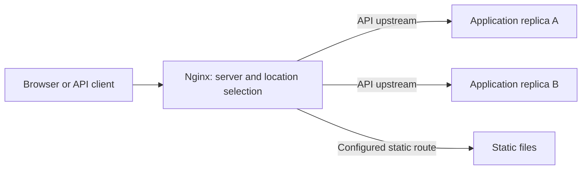

# Nginx interview preparation

[Repository guide](../README.md) · Related: [Networking](../System_Design/Networking.md#reverse-proxy-load-balancer-cdn-and-service-discovery), [microservices](../System_Design/Microservices.md), [EventOps experience](../Projects/EventOps/05_Interview_QA.md#architecture-decision-deep-dives).

This guide owns Nginx configuration, request handling, and diagnostics. General proxy/load-balancer concepts live in Networking; EventOps describes your actual routing work. Examples below are illustrative and do not establish historical production settings. Verify directives against your installed Nginx version/modules.

## Contents

- [Role and execution model](#role-and-execution-model)
- [Configuration and request routing](#configuration-and-request-routing)
- [Location matching and proxy_pass paths](#location-matching-and-proxy_pass-paths)
- [Headers and TLS](#headers-and-tls)
- [Static files and frontend routes](#static-files-and-frontend-routes)
- [Upstreams and connection reuse](#upstreams-and-connection-reuse)
- [Timeouts, buffering, and streaming](#timeouts-buffering-and-streaming)
- [WebSockets](#websockets)
- [Troubleshooting and reloads](#troubleshooting-and-reloads)
- [Interview drills](#interview-drills)

## Role and execution model

Nginx can serve files and proxy requests to application servers. Its master process manages configuration/workers; workers process connections using an event-driven model. Many open connections do not require one dedicated thread each, but CPU, connections, file descriptors, memory, and upstream capacity still impose limits. [Process model](https://nginx.org/en/docs/beginners_guide.html).



The application still handles business logic and authorization. For Django/Flask, an application server runs Python code; Nginx forwards requests to it. A second upstream replica is a design option, not a confirmed EventOps deployment.

## Configuration and request routing

`http` contains HTTP configuration, `upstream` names a backend group, `server` selects a virtual server/listener, and `location` selects URI handling. These contexts matter: a valid directive in one context may be invalid elsewhere.

Minimal local HTTP example; app processes must separately listen on ports 8000/8001. It is not a complete internet-facing deployment:

```nginx
worker_processes auto;

events {
    worker_connections 1024;
}

http {
    upstream application {
        server 127.0.0.1:8000;
        server 127.0.0.1:8001;
        keepalive 8;
    }

    server {
        listen 8080;
        server_name localhost;

        location /api/ {
            proxy_pass http://application/;
            proxy_http_version 1.1;
            proxy_set_header Connection "";
            proxy_set_header Host $host;
            proxy_set_header X-Forwarded-For $remote_addr;
            proxy_set_header X-Forwarded-Proto $scheme;
            proxy_connect_timeout 3s;
            proxy_read_timeout 30s;
            proxy_next_upstream off;
        }

        location / {
            return 404;
        }
    }
}
```

Numbers are examples. `worker_connections` includes upstream connections, not just clients. This example assumes Nginx is the first trusted HTTP proxy, so it overwrites forwarded-client information; see the header trust discussion before putting it behind another proxy.

## Location matching and proxy_pass paths

For common prefix/regex configurations, an exact `location = ...` can end selection immediately. Otherwise Nginx remembers the longest prefix; regex locations may override it unless that prefix uses `^~`. Regex ordering and nested configurations need deliberate review. Do not read the file as a simple first-match list. [Location rules](https://nginx.org/en/docs/http/ngx_http_core_module.html#location).

For a simple prefix location without variables or rewrites:

| Configuration inside `location /api/` | Request | Upstream path |
|---|---|---|
| `proxy_pass http://application/;` | `/api/events?id=7` | `/events?id=7` |
| `proxy_pass http://application;` | `/api/events?id=7` | `/api/events?id=7` |

A URI on `proxy_pass` replaces the matching normalized location prefix; omitting it preserves the request URI under the applicable rules. This is not merely a cosmetic trailing slash. Regex/named locations, variables, and rewrites have additional restrictions. [proxy_pass semantics](https://nginx.org/en/docs/http/ngx_http_proxy_module.html#proxy_pass).

**Debugging question:** if routing succeeds but the backend returns 404, compare the actual upstream path with the route expected by the application before changing timeouts.

## Headers and TLS

- `Host`: deliberately preserve the requested host or set the upstream host according to the backend contract; configure allowed hosts in the application.
- `X-Forwarded-For`: represents a proxy-chain convention, not inherently trusted identity. A directly reachable client can supply its own value.
- `X-Forwarded-Proto`: lets a trusted application proxy setup understand the original scheme, for redirects and secure URLs.

When Nginx sits behind a trusted load balancer, define which source addresses and headers it trusts; do not blindly treat arbitrary incoming forwarded headers as authoritative. Conversely, `$scheme` describes the Nginx-facing hop and may be HTTP even if the original browser used HTTPS.

For TLS termination, configure a supported SSL listener and the intended certificate/private key (`ssl_certificate`, `ssl_certificate_key`). The upstream hop needs separate HTTPS/trust configuration if encryption there is required. DNS/SNI, renewal, redirects, and certificate validation remain part of the design. See [HTTPS configuration](https://nginx.org/en/docs/http/configuring_https_servers.html) and [trusted client-address handling](https://nginx.org/en/docs/http/ngx_http_realip_module.html).

## Static files and frontend routes

`root` appends the URI to a filesystem directory; `alias` replaces the matching location path. For example, `/assets/app.js` with `root /srv/site;` maps to `/srv/site/assets/app.js`; with `location /assets/ { alias /srv/static/; }`, it maps to `/srv/static/app.js`. Handle trailing slashes and directory permissions deliberately.

An Angular/React single-page application can use `try_files` to fall back to `index.html` for client-side routes. Keep API routes separate so an API 404 does not silently return HTML. Serve versioned assets with deliberate cache headers; do not expose private uploads or source/configuration files. General freshness policy is in [caching design](../System_Design/Caching_Performance.md#how-does-a-cdn-work-and-what-belongs-in-the-cache-key).

## Upstreams and connection reuse

An `upstream` groups backend endpoints. Round-robin and alternatives such as `least_conn` select targets under configured rules. `keepalive` caches idle upstream connections per worker; it is not a global cap on all active connections. Client keep-alive and upstream reuse are separate settings. [Upstream module](https://nginx.org/en/docs/http/ngx_http_upstream_module.html).

Passive failure handling and active health checks are different capabilities; edition/modules/version matter. A live backend can still be slow or return incorrect business results. Container DNS and replaced endpoint addresses also need resolver/lifecycle configuration suited to the deployment.

Retrying a failed upstream can repeat a mutation whose response was lost. The example disables upstream retry; choose an explicit policy for the real operation rather than assuming retries are safe. Stable operation identity and recovery belong to the [idempotency design](../System_Design/REST_API_Design.md#4-how-do-you-implement-idempotency-and-concurrent-updates).

## Timeouts, buffering, and streaming

| Directive / feature | Meaning / concern |
|---|---|
| `proxy_connect_timeout` | Time allowed for establishing an upstream connection |
| `proxy_read_timeout` | Timeout between successive upstream read operations, not a total request deadline |
| `proxy_send_timeout` | Timeout between successive writes to the upstream |
| `client_max_body_size` | Request-body size limit; may explain HTTP 413 |
| `proxy_buffering` | Response buffering can protect upstreams from slow clients but delay incremental delivery |
| `proxy_request_buffering` | Controls buffering of incoming request bodies before proxying; streaming changes resource/retry behavior |

For SSE or another incremental response, examine buffering at Nginx and every later intermediary; disabling buffering alone does not make application output flush. Large uploads can involve temporary disk and body limits at multiple layers. Increasing a timeout does not add downstream capacity. Keep long-running reports asynchronous where the workflow allows it. [Proxy directives](https://nginx.org/en/docs/http/ngx_http_proxy_module.html).

## WebSockets

For HTTP/1.1 upgrade proxying, explicitly forward hop-by-hop upgrade headers. The following fragments belong inside `http` and the relevant `server`, respectively:

```nginx
# http context
map $http_upgrade $connection_upgrade {
    default upgrade;
    ''      close;
}

# inside a server block
location /socket/ {
    proxy_pass http://application;
    proxy_http_version 1.1;
    proxy_set_header Upgrade $http_upgrade;
    proxy_set_header Connection $connection_upgrade;
}
```

`application` is the upstream group from the example. The backend must support the upgrade; connection lifetime, idle timeouts, ping/pong behavior, and graceful rollout affect established sockets. A successful upgrade does not solve message authorization or reconnect recovery. [WebSocket proxying](https://nginx.org/en/docs/http/websocket.html).

## Troubleshooting and reloads

| Symptom | Nginx-specific checks |
|---|---|
| 502 Bad Gateway | Error log, upstream address/port, listening app, protocol mismatch, invalid/closed upstream response |
| 504 Gateway Timeout | Upstream timing and timeout phase, backend saturation, dependency latency |
| 413 Content Too Large | `client_max_body_size`, application limits, buffering/temp-storage behavior |
| Wrong service / backend 404 | Selected `server`/`location`, URI rewriting, `proxy_pass` path |
| API returns frontend HTML | SPA fallback intercepted an API route |
| Wrong redirects / secure-cookie behavior | Trusted forwarded scheme/host and application proxy configuration |

Correlate access/error logs with application logs. Useful variables include `$status`, `$upstream_status`, `$request_time`, `$upstream_connect_time`, and `$upstream_response_time`. Several upstream attempts can produce several timing/status values. Redact credentials and private query parameters in logging.

```sh
nginx -t
nginx -T
# After reviewing a valid configuration, an authorized deployment can reload:
nginx -s reload
```

`-t` checks configuration syntax and attempts to open referenced files; it does not prove upstream reachability or application correctness. `-T` also prints configuration and may expose sensitive values. Reload starts workers with new configuration and gracefully retires old workers; permissions, service management, long-lived connections, and rollout checks matter. These commands are examples, not actions run by this guide. [Nginx controls](https://nginx.org/en/docs/beginners_guide.html#control).

## Interview drills

1. Explain exactly what `/api/orders` becomes with and without a URI on `proxy_pass`.
2. Diagnose a healthy container that Nginx cannot reach because its service listens only on loopback inside a different container.
3. Explain why adding an upstream does not replace application/session-state design.
4. Handle WebSockets/SSE during a configuration or application rollout.
5. Investigate a 504 without immediately increasing every timeout.
6. Explain EventOps' confirmed routing use separately from studied load balancing, TLS, and other optional capabilities.

For historical configuration gaps, use the [project recall checklist](../Projects/README.md#details-to-recall); general DNS/TLS/network diagnosis stays in [Networking](../System_Design/Networking.md).
