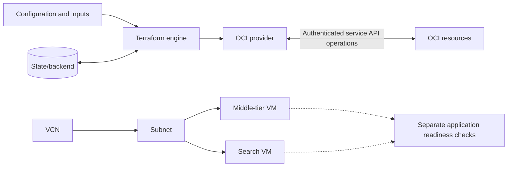

# Terraform: execution, state, OCI provisioning, and interview guide

**General infrastructure guide with OCI examples | Research reviewed 28 October 2026**

[Cloud Manager guide](../Projects/PeopleSoft/Cloud_Manager.md) · [PeopleSoft architecture](../Projects/PeopleSoft/Runtime_Architecture.md) · [Project interview Q&A](../Projects/PeopleSoft/05_Interview_QA.md)

[Technology comparisons](Technology_Comparisons.md) explains the boundaries between IaC, configuration management, machine images, containers, and product lifecycle orchestration.

This guide explains Terraform's general mechanisms and uses OCI/PeopleSoft examples. The exact Terraform/OpenTofu versions, backend, modules, authentication mode, and Cloud Manager invocation path must match your implementation. Examples are study material; no cloud resources were created to write this guide.

## Contents

1. [The short interview answer](#1-the-short-interview-answer)
2. [The moving parts](#2-the-moving-parts)
3. [Step-by-step execution](#3-step-by-step-execution)
4. [Dependencies and an OCI example](#4-dependencies-and-an-oci-example)
5. [State and resource identity](#5-state-and-resource-identity)
6. [Locks and concurrent operations](#6-locks-and-concurrent-operations)
7. [Updates, replacements, scaling, and deletion](#7-updates-replacements-scaling-and-deletion)
8. [Failures, drift, import, and recovery](#8-failures-drift-import-and-recovery)
9. [Secrets, Vault, and authentication](#9-secrets-vault-and-authentication)
10. [OCI Resource Manager and Cloud Manager](#10-oci-resource-manager-and-cloud-manager)
11. [Terraform and OpenTofu migration](#11-terraform-and-opentofu-migration)
12. [Interview questions and exercises](#12-interview-questions-and-exercises)

## 1. The short interview answer

“Terraform is declarative infrastructure as code. We describe desired resources in configuration. Terraform uses state to associate those resource addresses with real cloud objects, and providers to read and change them through cloud APIs. A plan shows proposed changes. Apply executes approved changes in dependency order and records the resulting state.

“In an OCI environment, the OCI provider manages supported compute, network, storage, and other resources. Infrastructure creation is a separate milestone from PeopleSoft application readiness. A failed apply can leave partially completed resources, so recovery requires checking both state and actual OCI resources before planning the remaining work.”

This explanation combines Terraform's [provider model](https://developer.hashicorp.com/terraform/language/providers), [state](https://developer.hashicorp.com/terraform/language/state), and [apply behavior](https://developer.hashicorp.com/terraform/cli/commands/apply).

**Distinguish three products:** Terraform is an IaC engine; OCI Vault manages keys/secrets; HashiCorp Vault is a separate secrets product. Using Terraform with OCI Vault does not mean you used HashiCorp Vault.

## 2. The moving parts

| Part | Responsibility | Example |
|---|---|---|
| Configuration | Desired resource definitions and relationships | HCL `.tf` files |
| Variables | Inputs to a configuration | Compartment, region, node settings |
| Resource | Object Terraform manages through a provider | OCI VCN or instance |
| Data source | Reads information without taking management ownership merely by reading | Existing image or subnet lookup |
| Module | Reusable collection of configuration | Network or middle-tier configuration |
| Provider | Plugin implementing resource/data-source operations | OCI provider |
| State | Maps configuration addresses to managed objects and recorded attributes | Address → OCI resource OCID |
| Backend | State storage and associated behavior | Local files or supported remote backend |
| Plan | Proposed changes for a particular run | Add subnet, update instance, replace object |
| Output | Exposed result of a configuration/module | Private IP or subnet OCID |
| Dependency lock file | Records provider selections/checksums | `.terraform.lock.hcl` |

The CLI engine and provider are separate software components. The provider interprets cloud-specific schemas and performs API operations; Terraform coordinates configuration, graph traversal, and state. Pin/test the engine and provider versions separately. [Provider documentation](https://developer.hashicorp.com/terraform/language/providers)

## 3. Step-by-step execution

### Step 0: describe intent and establish ownership

Choose which resources this configuration owns and which it references. An environment may own its middle-tier VMs while referencing shared networking, Vault secrets, or an existing Exadata database. Decide environment/state boundaries before adding resources. This is design reasoning: ownership choices determine safe deletion and recovery.

### Step 1: `terraform init`

Initializes the working directory: configures the backend, installs required providers, and retrieves modules. It uses provider constraints and the dependency lock file when selecting providers. It does not create the declared OCI application infrastructure. [Initialization tutorial](https://developer.hashicorp.com/terraform/tutorials/cli/init)

### Step 2: format and validate

`terraform fmt -check` checks formatting; `terraform validate` checks configuration syntax and internal consistency after initialization. Neither establishes OCI capacity, all IAM permissions, network reachability, or application correctness. A successful validation is one check before planning, not deployment readiness. [Validate command](https://developer.hashicorp.com/terraform/cli/commands/validate)

### Step 3: provide inputs and authenticate

Select region, compartment, topology-related inputs, and the correct state/backend context. Configure a supported OCI authentication mechanism. Do not confuse provider authentication to OCI with the database password needed by PeopleSoft. Credentials establish identity; IAM policies determine authorization.

### Step 4: `terraform plan`

By default, Terraform reads managed remote objects through providers, evaluates the configuration against recorded/refreshed information, and proposes changes. Some values remain unknown until resources exist. Plan previews proposed resource changes; it does not execute them. A saved plan can be applied later, while a speculative plan is only a preview. [Plan command](https://developer.hashicorp.com/terraform/cli/commands/plan)

Review creates, updates, replacements, and deletions. In particular, confirm environment/compartment, state identity, important database/storage changes, and unexpected replacements. A valid plan is not a reservation of cloud capacity or a guarantee that apply will succeed.

### Step 5: `terraform apply`

Without a saved plan, apply makes a new plan and normally requests approval. With a saved plan, it executes that plan without another interactive approval prompt. Providers perform the cloud operations. A successful result means the declared infrastructure operations completed according to provider behavior, not that PeopleSoft business functionality passed. [Apply command](https://developer.hashicorp.com/terraform/cli/commands/apply)

### Step 6: persist results and expose outputs

Terraform records resource identities and observed attributes in state. Outputs expose selected values to operators or downstream automation. Output values may be unknown during planning and become available after creation. Preserve state and correlate it with the environment and operation that owns it. [Terraform state](https://developer.hashicorp.com/terraform/language/state)

### Step 7: validate the application separately

For a PeopleSoft deployment, verify target access, mounts, database connectivity, domain startup, login, batch registration, search configuration, and representative functional checks. Oracle's Cloud Manager installation explicitly performs bootstrap work after the Resource Manager Apply job succeeds. [Cloud Manager installation workflow](https://docs.oracle.com/en/applications/peoplesoft/cloud-manager/tutorial-install-with-resource-manager/)

### Command sequence for a reviewed workflow

```sh
terraform init
terraform fmt -check
terraform validate
terraform plan -out=reviewed.tfplan
terraform show reviewed.tfplan
terraform apply reviewed.tfplan
terraform output
```

These are illustrative commands, not instructions to run on an unspecified customer environment. Saved plans and outputs can contain sensitive information; protect their storage and access. Applying a saved plan is a mutation and must follow the actual deployment/review process.

## 4. Dependencies and an OCI example

Terraform builds a dependency graph. A reference from one resource to another creates an implicit relationship; `depends_on` expresses a dependency not otherwise captured through values. Independent graph nodes can run concurrently. HCL file order is not the execution order. [Dependency graph](https://developer.hashicorp.com/terraform/internals/graph)



The lower graph illustrates infrastructure dependencies; it does not assert the exact topology or Terraform module design used in Cloud Manager.

### Small HCL example: infer subnet dependency from a reference

```hcl
variable "compartment_ocid" {
  type = string
}

resource "oci_core_vcn" "environment" {
  compartment_id = var.compartment_ocid
  cidr_block     = "10.42.0.0/16"
  display_name   = "study-vcn"
}

resource "oci_core_subnet" "middle_tier" {
  compartment_id             = var.compartment_ocid
  vcn_id                     = oci_core_vcn.environment.id
  cidr_block                 = "10.42.1.0/24"
  prohibit_public_ip_on_vnic  = true
  display_name               = "study-middle-tier"
}

output "middle_tier_subnet_ocid" {
  value = oci_core_subnet.middle_tier.id
}
```

This is an illustrative resource fragment, not a complete deployment: it omits provider/backend configuration, authentication, routes, security controls, and other environment requirements. Validate the resource schema against the pinned OCI provider. The subnet's `vcn_id` reference establishes the dependency; a duplicate `depends_on` is unnecessary for that relationship. [OCI subnet resource schema](https://docs.oracle.com/en-us/iaas/tools/terraform-provider-oci/latest/docs/r/core_subnet.html)

### Dependency is not application readiness

An instance resource can complete when the provider's infrastructure criteria are met, while cloud-init, bootstrap, or software deployment is still running. Referencing the VM's ID does not wait for PeopleSoft login to work. Add explicit application validation to the lifecycle workflow instead of assuming the resource graph knows business readiness.

## 5. State and resource identity

Conceptually, state links an address such as `oci_core_instance.middle_tier["app-a"]` to a real object such as an OCI instance OCID. It also contains attributes and metadata. This is why Terraform can update an existing object instead of creating a new one on every run. State is not a full database backup or a copy of all managed VM contents. [State documentation](https://developer.hashicorp.com/terraform/language/state)

| Artifact | Stores | Must distinguish from |
|---|---|---|
| `.tf` configuration | Desired definitions | Current cloud reality |
| `.terraform.lock.hcl` | Provider selections/checksums | State concurrency lock |
| State | Object mappings and recorded data | Guaranteed live inventory of all OCI resources |
| Saved plan | Proposed operations and associated planning data | Reusable template safe forever |
| Cloud Manager metadata | Product environment/operation information | Automatically identical copy of Terraform state |

**Three inputs to reasoning:** desired configuration, recorded state, and current provider observations. A manual OCI change can make them disagree. State does not continuously update itself when no Terraform operation is running.

Remote state can support team workflows, but encryption, IAM, locking, versioning, and recovery depend on the backend. Do not say “remote” automatically means encrypted or locked. Protect state backups as carefully as the current state. [Sensitive-state guidance](https://developer.hashicorp.com/terraform/plugin/best-practices/sensitive-state)

### Module and state boundaries

Choose boundaries by lifecycle, deployment ownership, permissions, and blast radius rather than resource type alone. One giant state increases contention and recovery scope; many small states add orchestration/dependency overhead. Modules should expose stable, meaningful inputs/outputs, not mechanically mirror every provider argument. Dependent states need scoped discovery, not broad access to sensitive state.

## 6. Locks and concurrent operations

Where the backend supports it, Terraform locks state for operations that could write it. This prevents cooperating runs from concurrently corrupting or conflicting over the same state. Not every backend supports locking. A lock does not stop an administrator changing OCI directly or another state file managing the same object. [State locking](https://developer.hashicorp.com/terraform/language/state/locking)

**Example:** two lifecycle jobs try to scale the same environment. A shared state lock can serialize Terraform operations. It does not by itself serialize a parallel credential-rotation script or database upgrade outside Terraform. Cloud Manager may need an additional environment-level operation policy.

The dependency lock file and state lock are unrelated: one selects provider packages; the other coordinates concurrent state access. Force-unlock is recovery for an established abandoned lock, not a way to bypass a genuinely active operation. Keep ownership and run-status evidence before intervening. [State locking details](https://developer.hashicorp.com/terraform/language/state/locking)

## 7. Updates, replacements, scaling, and deletion

### Update versus replace

A changed argument can produce an in-place update or require replacement according to the provider/resource schema. Review the plan; a small textual edit can still imply destructive replacement. Lifecycle rules can influence ordering and protection, but cannot make an unsupported cloud API update possible. [Lifecycle rules](https://developer.hashicorp.com/terraform/language/meta-arguments/lifecycle)

- `create_before_destroy`: requests replacement creation first where feasible; capacity, names, and application cutover still matter.
- `prevent_destroy`: rejects planned destruction while the rule applies; it does not prevent all out-of-band deletion or protect a resource whose configuration was removed entirely.
- `ignore_changes`: deliberately delegates selected attributes to another management path; broad use can hide important drift.

### Scaling design exercise

For a set of named nodes, stable `for_each` keys can express identity more clearly than positional list indexes. Removing one item from an indexed list can shift addresses and cause unintended changes. The exact result depends on the configuration and provider. For an existing refactor, preserve identity using supported moved/import/state mechanisms rather than assuming a renamed block is the same object. [Instance identity and count](https://developer.hashicorp.com/terraform/language/meta-arguments/count), [resource refactoring](https://developer.hashicorp.com/terraform/language/modules/develop/refactoring)

Scaling a PeopleSoft middle tier also needs software configuration, domain connectivity, credentials, traffic admission, and eventually safe draining. Search scale-down additionally requires protecting shard copies and coordination. A resource-count change alone is not a complete application scaling workflow.

### Deletion scope

Destroy uses the current configuration/state context to identify managed resources. It does not mean “delete every OCI resource in this tenancy.” Conversely, a shared object accidentally owned by this state can fall within its destruction scope. Shared Exadata infrastructure and shared networking require deliberate ownership boundaries. [Terraform provisioning workflow](https://developer.hashicorp.com/terraform/cli/run)

## 8. Failures, drift, import, and recovery

### Partial apply is not a database rollback

Suppose VCN and subnet creation succeed, one VM succeeds, and another VM fails for lack of capacity. Terraform normally preserves recorded successful changes and reports failure; it does not automatically roll back everything. Resolve the cause, inspect resources/state, and create a fresh reviewed plan. [Apply failure behavior](https://developer.hashicorp.com/terraform/tutorials/cli/apply)

**Recovery reasoning:** identify what completed, what remains, and any unknown outcomes. If a failed operation created an object that was not recorded, a blind rerun may not safely adopt it. Investigate the provider error and OCI identity, then use supported recovery/import or cleanup as appropriate. Never delete state simply to make an error disappear.

### Drift

Someone changes a managed VM manually. A subsequent normal plan refreshes observations and can propose reconciling that difference. Whether to restore the declared configuration or change the configuration depends on intent. A refresh-only operation records observed changes in state; it does not itself restore desired infrastructure. [Planning modes](https://developer.hashicorp.com/terraform/cli/commands/plan)

### Import

Import associates an existing supported cloud object with a Terraform resource address. It does not create that object, automatically import every dependency, or prove the configuration matches it. After import, review a plan for unintended updates/replacements. One real object should not be independently managed by multiple resource addresses/states. [Import documentation](https://developer.hashicorp.com/terraform/cli/import)

### State loss

First attempt recovery through backend history or a protected backup. Reconstructing ownership through imports may be necessary when no usable state exists. A fresh empty state with the old configuration can propose duplicates because the mappings are missing. State manipulation should use supported operations and protected backups. [State maintenance](https://developer.hashicorp.com/terraform/cli/state)

| Failure | Investigate | Recovery direction |
|---|---|---|
| Permission denied | Principal, policy, region, compartment | Fix access; replan |
| Quota/capacity | Provider error, service limits, requested placement | Correct capacity/inputs; replan remaining work |
| API timeout | Actual object existence and provider state | Resolve unknown outcome before duplicate creation |
| State lock busy | Active job and lock ownership | Wait or resolve established abandoned run |
| Unexpected replacement | Changed argument, provider version, address refactor | Explain before applying |
| Apply succeeds, PeopleSoft fails | Bootstrap/application dependencies | Repair deployment/readiness; infrastructure success is separate |
| State persistence fails | Backend and any recovery state artifact | Preserve recoverable state; avoid concurrent mutations |

These are diagnostic exercises, not confirmed incidents from your work.

## 9. Secrets, Vault, and authentication

**Important:** `sensitive = true` masks normal presentation but does not by itself remove a value from state or plan. Reading a Vault password through a normal data source and passing it into a persisted resource argument can still persist the credential. Protect state/plan artifacts and inspect the exact provider schema. [Sensitive data handling](https://developer.hashicorp.com/terraform/language/manage-sensitive-data)

Supported Terraform versions provide ephemeral values/resources and write-only resource arguments for selected cases. Their use depends on both engine version and provider support. Do not assume the OCI provider or your deployed version supports a desired mechanism merely because current Terraform supports the language feature. [Write-only resource arguments](https://developer.hashicorp.com/terraform/language/manage-sensitive-data/ephemeral)

For project reasoning, prefer passing a secret reference where the downstream system can retrieve it securely without Terraform materializing its content. That works only if the receiving API/application accepts such a reference. A secret OCID cannot simply replace a plaintext password in an API that requires the password itself.

Keep these identities separate:

- Provider identity authenticating API requests to OCI.
- IAM permissions authorizing the identity's operations.
- Target OS/database/search credentials used during configuration/runtime.
- KMS master encryption key protecting secrets/data.

See [OCI Vault security and credential rotation](../Projects/PeopleSoft/Cloud_Manager.md#how-oci-vault-protects-credentials) for key protection, HSMs, secret retrieval, and why key rotation differs from password rotation.

## 10. OCI Resource Manager and Cloud Manager

OCI Resource Manager is a managed execution/state-management service for Terraform-based infrastructure workflows. A **stack** contains configuration and associated settings; **jobs** perform actions such as plan and apply. Resource Manager maintains stack state and locks it so only one job runs on a stack at a time. [Resource Manager overview](https://docs.oracle.com/en-us/iaas/Content/ResourceManager/Concepts/resourcemanager.htm)

For the product installation sequence and the integration story to prepare, see [Cloud Manager installation context](../Projects/PeopleSoft/Cloud_Manager.md#terraform-installation-context).

## 11. Terraform and OpenTofu migration

OpenTofu and Terraform are distinct engines with shared history. Compatibility depends on source/target versions, providers, state, backend features, and language use. “Replace the executable and everything is identical” is too broad.

Prepare a migration story around protected state/configuration backups, pinned versions, provider registry/package behavior, backend access, a controlled initial plan, validation, and the cutover of automation. Do not run two writers against one state. Interdependent configurations and remote-state consumers require their own compatibility analysis. [OpenTofu migration guide](https://opentofu.org/docs/intro/migration/migration-guide/), [interdependent configuration migration](https://opentofu.org/docs/intro/migration/multiple-configurations/)

Changing engine or provider versions can change plan/state behavior. Do not promise that downgrading the binary or restoring only an old state snapshot rolls back infrastructure already changed in OCI. [Terraform version/state compatibility](https://developer.hashicorp.com/terraform/tutorials/configuration-language/versions)

## 12. Interview questions and exercises

### 1. How does Terraform know an object already exists?

State associates the configuration's resource address with the cloud object's identity. The provider reads the object. A matching display name alone does not automatically bring an unmanaged object under Terraform ownership.

### 2. What happens internally during apply?

Terraform evaluates the plan/dependency graph, coordinates provider operations, and updates state. The provider performs cloud-specific calls and handles its resource's behavior. Independent work may run concurrently; application readiness remains a separate check.

### 3. Is it idempotent?

With unchanged desired configuration and matching managed resources, a plan generally proposes no changes. This is convergence through state and provider behavior, not a global exactly-once guarantee for arbitrary scripts, provisioners, or unknown API outcomes.

### 4. Why use a provider instead of calling OCI APIs directly?

The provider supplies reusable resource schemas and lifecycle behavior within Terraform's plan/state/dependency model. Direct API code offers other forms of control but requires you to implement ownership, reconciliation, and lifecycle logic yourself. Use the actual project tradeoff.

### 5. What happens if the second of three VM creations fails?

Completed resources can remain and are normally recorded. Inspect state and OCI, fix the failure, then review a fresh plan. Do not promise automatic rollback or blindly restart every create operation.

### 6. Does state locking prevent every conflicting operation?

No. It coordinates participating operations using that backend/state. Console changes, another state file, and external credential/database operations require additional ownership and coordination.

### 7. Why do you need state if OCI already has resource inventory?

Inventory shows cloud objects. Terraform needs the mapping between a desired configuration address and the particular object it owns, plus planning metadata. It does not automatically manage every discovered resource.

### 8. Can a small configuration change delete a VM?

Yes, if the provider requires replacement, an address changes without migration, or the object is removed from the managed configuration. Review plan actions and application/data recovery implications.

### 9. Is a password safe because it came from OCI Vault?

Vault protects storage/retrieval, but a normal Terraform data flow may put the retrieved value into state or a plan. Inspect the provider behavior, use supported nonpersistent mechanisms where available, and protect artifacts.

### 10. How does Terraform make PeopleSoft ready?

It manages declared resource behavior. PeopleSoft installation and readiness may occur through additional bootstrap/configuration/lifecycle steps. A successful apply is not sufficient evidence of working login, batch, integrations, or search.

### 11. Does Terraform continuously repair drift?

The CLI does not act as a continuously running controller by default. A later plan/run can detect relevant managed-resource drift; scheduling and deciding how to remediate are operational choices.

### 12. How would you explain your 25% cost reduction?

“We received monthly OCI cost reports. Comparing the pre-implementation baseline with post-implementation spending showed a 25% reduction.” Explain the actual automation changes behind it. Terraform alone is not a cost-reduction mechanism: configuration and resource lifecycle decisions determine spending.

### Whiteboard exercises

1. Draw configuration → engine → provider → OCI, with state to the side; trace `init`, `plan`, and `apply`.
2. Add network → subnet → two VMs. Identify parallel work and application-readiness gaps.
3. Lose an API response after creation. Explain how to investigate cloud identity and state before retrying.
4. Run scale-out and credential rotation together. Identify what a state lock protects and what it does not.
5. Refactor resource addresses without replacing live resources. Explain the review and supported migration path.
6. Find a secret in a plan artifact. Explain why `sensitive` was insufficient and how the data path must change.

The official sources above describe general engine/service behavior. Use your actual project versions and implementation evidence when answering ownership questions.
