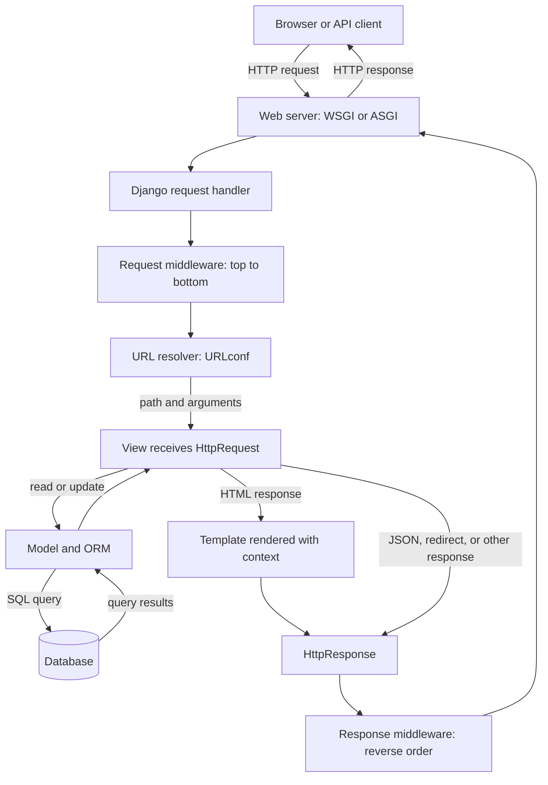
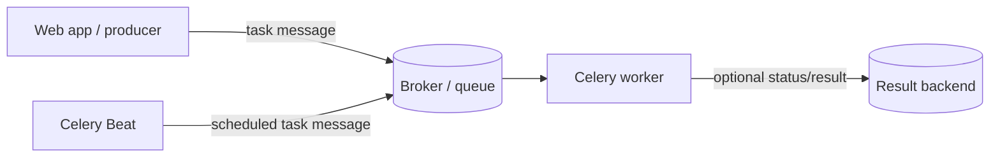

# Django and Flask Interview Cheat Sheet

Code-first notes for common Django, Django REST Framework, Flask, and FastAPI interview questions. Examples use current common APIs; check the framework version and installed extensions in a real project.

## Contents

- [Django, Flask, and FastAPI comparison](#django-flask-and-fastapi)
- [Django MVT request flow](#django-mvt-architecture)
- [WSGI vs. ASGI](#wsgi-vs-asgi)
- [Django ORM: models, `get`, and `filter`](#django-orm-models-get-and-filter)
- [Django pagination](#django-pagination)
- [Advanced Django ORM queries](#advanced-django-orm-queries)
- [Django database migrations](#django-database-migrations)
- [Django indexing: practical interview questions](#django-indexing-practical-interview-questions)
- [SQL joins and Django relationships](#sql-joins-and-django-relationships)
- [N+1 queries, `select_related`, and `prefetch_related`](#n1-queries-select_related-and-prefetch_related)
- [CSRF and SQL injection protection](#csrf-and-sql-injection-protection-in-django)
- [Django transactions and race conditions](#django-transactions-and-race-conditions)
- [Django authentication and permissions](#django-authentication-and-permissions)
- [Role-based access control in Django APIs](#role-based-access-control-in-django-apis)
- [Django middleware and custom middleware](#django-middleware)
- [Django signals](#django-signals)
- [Django admin](#django-admin)
- [Django caching](#django-caching)
- [Django testing and performance](#django-testing-and-performance)
- [Django REST Framework serializers](#django-rest-framework-serializers)
- [DRF `APIView` vs. `ViewSet`](#drf-apiview-vs-viewset)
- [Flask blueprints](#flask-blueprints)
- [Flask application factory](#flask-application-factory)
- [Flask request lifecycle and hooks](#flask-request-lifecycle-and-hooks)
- [Flask application context vs. request context](#flask-application-context-vs-request-context)
- [Celery architecture](#celery-architecture)
- [Celery task workflows](#celery-task-workflows)
- [Celery retries and reliability](#celery-retries-and-reliability)
- [Handling failed Celery tasks](#handling-failed-celery-tasks)
- [Celery routing and worker concurrency](#celery-routing-and-worker-concurrency)
- [Celery scheduled work](#celery-scheduled-work)
- [Celery operations](#celery-operations)
- [References](#references)

## Django, Flask, and FastAPI

| Topic | Django | Flask | FastAPI |
|---|---|---|---|
| Main style | Full-featured web framework | Small, flexible web framework | API-focused framework |
| Routing | URL configuration maps paths to views | Routes are often declared with decorators | Routes are often declared with decorators |
| Database | Built-in ORM and migrations | Choose an extension or database library | Choose a database library; works with async options |
| Validation / schemas | Forms; DRF adds serializers for APIs | Usually added with extensions or application code | Uses Python type hints and validation models |
| Admin UI | Built-in model admin | No built-in admin | No built-in admin |
| API docs | Add a tool/library | Add a tool/library | Generates OpenAPI docs from routes and types |
| Good fit | Applications needing built-in components and conventions | Small services or teams that want to choose components | APIs that benefit from type-driven validation and async support |

**How to choose:** Django provides more pieces out of the box and conventions for a full application. Flask gives more freedom but leaves more choices to the team. FastAPI is centered on APIs, type-based request validation, and OpenAPI. None is automatically the best or fastest choice for every workload; compare the team's needs, libraries, deployment, and support requirements.

## Django MVT architecture

Django is commonly described as **Model–View–Template (MVT)**. A request travels through URL routing and middleware to a view. The view uses models and other application logic, then returns a response, often by rendering a template.



The view is the part that coordinates the work. It may read or update models, call services, and choose a response. Templates are optional: an API view can return JSON without rendering HTML. Middleware wraps the request/response path, while URLconf selects the view for the path.

| Part | Responsibility | Example |
|---|---|---|
| Model | Data structure and database behavior | `Book`, `Author` |
| View | Handles the request and decides what response to return | `book_list(request)` |
| Template | Formats HTML for a browser | `books/list.html` |
| URLconf | Connects a URL pattern to a view | `path("books/", views.book_list)` |

Django's “view” is closer to the controller role in many MVC descriptions. The framework handles much of the routing and request/response coordination.

## WSGI vs. ASGI

**WSGI** means Web Server Gateway Interface. **ASGI** means Asynchronous Server Gateway Interface. They define how a Python web server hands requests to an application. Django's `wsgi.py` and `asgi.py` expose the application entry points.

| | WSGI | ASGI |
|---|---|---|
| Request handling | Synchronous request/response | Supports async applications and synchronous apps |
| Good fit | Traditional synchronous Django applications | Async views, many concurrent I/O waits, and long-lived connections such as WebSockets (with suitable support) |
| Entry point | `wsgi.py` | `asgi.py` |
| Common servers | Gunicorn, uWSGI | Uvicorn, Daphne, Hypercorn |

ASGI does not make CPU-heavy work run in parallel, and it does not automatically make an application faster. Async benefits require async-compatible code and middleware; blocking calls can still block the event loop.

```python
# myproject/wsgi.py
from django.core.wsgi import get_wsgi_application

application = get_wsgi_application()
```

```python
# myproject/asgi.py
from django.core.asgi import get_asgi_application

application = get_asgi_application()
```

## Django ORM: models, `get`, and `filter`

The ORM lets Python code describe tables and queries. Django translates QuerySets into SQL when they are evaluated.

## Advanced Django ORM queries

Use `Q` for `OR`/`NOT` logic, `F` to compare or update using a database column, and aggregation to calculate values in SQL rather than loading every row into Python.

```python
from django.db.models import Count, F, Q
from shop.models import Order

# OR condition
recent = Order.objects.filter(Q(status="paid") | Q(status="shipped"))

# Atomic column update; avoids read-modify-write race for this update
Order.objects.filter(pk=order_id).update(stock=F("stock") - 1)

# annotate adds a value to each returned row; aggregate returns one summary
by_customer = Order.objects.values("customer_id").annotate(order_count=Count("id"))
summary = Order.objects.aggregate(total=Count("id"))
```

| Tool | Result | Typical use |
|---|---|---|
| `Q(...)` | Composable condition | `OR`, nested conditions, negation with `~Q(...)` |
| `F("field")` | Database-side field reference | Compare columns or update without first reading the row |
| `annotate()` | Adds computed value to each row | Count related rows per customer |
| `aggregate()` | One summary dictionary | Total count, sum, average |
| Custom `QuerySet` / manager | Reusable query methods | Share domain queries across views and services |

For multi-step invariants, use a transaction and, when needed, row locking; an `F` expression only makes the specific database update atomic.

```python
from django.db import models

class Author(models.Model):
    name = models.CharField(max_length=100)

class Book(models.Model):
    title = models.CharField(max_length=200)
    author = models.ForeignKey(Author, on_delete=models.CASCADE, related_name="books")
    published = models.BooleanField(default=False)
```

Common lookups:

```python
book = Book.objects.get(pk=1)  # exactly one row; raises if missing or multiple

published = Book.objects.filter(published=True)  # zero or more rows
recent = Book.objects.filter(title__icontains="python", published=True)
```

| Query | Returns | If no row matches |
|---|---|---|
| `get(...)` | One model instance | Raises `DoesNotExist`; also raises `MultipleObjectsReturned` if more than one matches |
| `filter(...)` | A QuerySet, which may contain zero, one, or many rows | Returns an empty QuerySet |

QuerySets are lazy: building `Book.objects.filter(...)` usually does not run SQL yet. Iterating, converting to a list, or accessing results evaluates the query. Chaining filters builds a query:

```python
books = Book.objects.filter(published=True).order_by("title")[:20]
```

Lookup suffixes include `__exact`, `__contains`, `__icontains`, `__in`, `__gte`, and `__isnull`. Use `get_object_or_404()` in views when a missing object should become an HTTP 404.

## Django indexing: practical interview questions

### Can Django create database indexes?

**Yes.** The ORM declares them; migrations create them in the actual database. Database indexes help ORM queries and raw SQL alike. A new QuerySet does not build an index.

```python
from django.db import models

class Order(models.Model):
    # ForeignKey normally receives a database index automatically.
    customer = models.ForeignKey("Customer", on_delete=models.PROTECT)
    status = models.CharField(max_length=20)
    created_at = models.DateTimeField(auto_now_add=True)
    # Simple single-column example; only add when its queries justify it.
    external_reference = models.CharField(max_length=100, db_index=True)

    class Meta:
        indexes = [
            models.Index(
                fields=["customer", "status", "-created_at", "-id"],
                name="order_cust_stat_recent",
            ),
        ]
```

The composite candidate matches this access pattern:

```python
qs = (Order.objects
      .filter(customer_id=42, status="paid")
      .order_by("-created_at", "-id")[:50])
print(qs.query)
print(qs.explain())
# PostgreSQL; executes the SELECT, so use representative controlled conditions.
print(qs.explain(analyze=True, buffers=True))
```

Do not add redundant `db_index=True` for primary keys or fields already indexed by `unique=True`. A foreign key's automatic single-column index is not the same as a composite filter/order index. See [field index behavior](https://docs.djangoproject.com/en/5.2/ref/models/fields/#db-index) and [model indexes](https://docs.djangoproject.com/en/5.2/ref/models/indexes/).

### What are the tradeoffs of the available declarations?

| Syntax / technique | Practical fit | Tradeoff |
|---|---|---|
| `field = models.CharField(..., db_index=True)` | Simple field lookup | Additional storage and write work |
| `models.Index(fields=["a", "b"])` | Common combined filter/order | Order and workload matter |
| `unique=True` / `UniqueConstraint` | Enforce business uniqueness | Existing duplicates must be handled; uniqueness semantics depend on DB |
| Conditional index | Frequently accessed small subset | Backend support and query predicate matching |
| Expression index | Function-based lookup matching query expression | Backend/function restrictions |
| PostgreSQL `GinIndex` | Supported JSON/array/search operators | Specialized operator choices and higher write/storage cost |

Optional PostgreSQL-oriented examples; add only the ones justified by queries:

```python
from django.db.models import Q
from django.db.models.functions import Lower

# Place applicable definitions in Meta.indexes:
models.Index(
    fields=["customer", "-created_at"],
    condition=Q(status="paid"),
    name="order_paid_recent",
)
models.Index(Lower("email"), name="customer_email_lower") # on Customer

# Matching expression lookup on Customer; inspect generated SQL and the plan.
Customer.objects.alias(email_lower=Lower("email")).filter(email_lower="ada@example.com")
```

Do not assume `email__iexact` produces the same expression as a `Lower("email")` index across backends. Verify emitted SQL. See [Django database optimization](https://docs.djangoproject.com/en/5.2/topics/db/optimization/).

### How do I apply an index and review what Django will run?

```sh
# Replace shop and migration number with your application's values.
python manage.py makemigrations shop
python manage.py sqlmigrate shop 0007
python manage.py migrate shop
```

Review generated SQL, existing indexes, table size, available disk, lock behavior, and rollout compatibility. `makemigrations` creates the migration file; it does not apply the index. Keep schema state and Django's migration state aligned.

For a large PostgreSQL table, replace the generated ordinary `AddIndex` with `AddIndexConcurrently` in a **non-atomic** migration, retaining the same index declaration in the model:

```python
from django.db import migrations, models
from django.contrib.postgres.operations import AddIndexConcurrently

class Migration(migrations.Migration):
    atomic = False
    dependencies = [("shop", "0006_previous")]
    operations = [
        AddIndexConcurrently(
            model_name="order",
            index=models.Index(
                fields=["customer", "status", "-created_at", "-id"],
                name="order_cust_stat_recent",
            ),
        ),
    ]
```

This is an alternative to the ordinary operation, not a second migration creating the same index again. Concurrent creation reduces write blocking but needs more work/time; it is not zero-impact. A failed build can leave an invalid index requiring inspection and deliberate cleanup before retry. See [PostgreSQL migration operations](https://docs.djangoproject.com/en/5.2/ref/contrib/postgres/operations/).

### What will an interviewer ask next?

| Follow-up | Practical response |
|---|---|
| “Why didn't the index improve performance?” | Check actual SQL/plan, data distribution, stale statistics, small tables, wide result sets, and time outside SQL |
| “Why this composite column order?” | Explain the real equality predicates, ordering/range requirements, and other queries you need to support |
| “Why not index every field?” | Every extra index uses disk/cache and adds write and maintenance cost |
| “What about N+1?” | An index does not remove repeated round trips; use appropriate `select_related`/`prefetch_related` and check query counts |
| “Did you measure it?” | Compare representative before/after plans and endpoint latency; report only actual observations |
| “Have you worked with indexing?” | Distinguish using existing indexes, defining migrations, and owning production tuning; do not invent ownership or numbers |

For the full decision framework and honest recruiter-answer templates, see [database scaling and indexing questions](Database_CheatSheet.md#practical-sql-scaling-and-isolation-questions).

## Django database migrations

Django migrations are version-controlled steps that move a database schema (and sometimes its data) from one state to another. `makemigrations` compares model definitions and creates migration files; `migrate` applies unapplied migrations and records their state in `django_migrations`. Commit migration files with the code that needs them, and apply them as part of deployment.

| Command | Purpose |
|---|---|
| `python manage.py makemigrations` | Create migration files from model changes |
| `python manage.py makemigrations --check --dry-run` | Fail/check if model changes are missing migrations |
| `python manage.py showmigrations` | Show migrations and which are applied |
| `python manage.py sqlmigrate app 0002` | Inspect SQL for a migration |
| `python manage.py migrate` | Apply pending migrations |

Schema migrations can add/remove fields, tables, constraints, and indexes. Data migrations use `RunPython` (or `RunSQL` for carefully parameterized database-specific work). Use historical models from `apps.get_model()` in migration code, rather than importing the current model, so old migrations keep working as code changes.

```python
from django.db import migrations

# In a migration file: transform existing rows using the historical model.
def mark_legacy_products(apps, schema_editor):
    Product = apps.get_model("shop", "Product")
    db_alias = schema_editor.connection.alias
    Product.objects.using(db_alias).filter(category__isnull=True).update(category="legacy")

class Migration(migrations.Migration):
    dependencies = [("shop", "0001_initial")]
    operations = [migrations.RunPython(mark_legacy_products, migrations.RunPython.noop)]
```

`RunPython.noop` means this example cannot restore the old data on reverse; use a real reverse function when the transformation can be safely undone.

For a large or live table, use an **expand and contract** rollout: add a nullable/backward-compatible field, deploy code that can handle both old and new schema, backfill in batches, switch reads/writes, then remove the old field in a later release. Review generated SQL and lock impact for large indexes or table rewrites. Keep migrations small and avoid irreversible data changes unless there is a deliberate recovery plan.

| Common issue | Response |
|---|---|
| Two branches create migrations from the same parent | Create and review a merge migration; verify the dependency graph |
| Migration fails partway | Check whether the backend runs it atomically, inspect schema/data state, then repair deliberately before retrying |
| Considering `--fake` | Use only when the database schema already matches the migration; it changes migration history without applying SQL |

## Django pagination

Pagination returns a bounded slice of a large result set instead of loading every row at once. Django's `Paginator` works with QuerySets and lists. Apply a stable ordering first so rows do not jump unpredictably between pages.

```python
from django.core.paginator import Paginator
from django.shortcuts import render
from shop.models import Book

def book_list(request):
    books = Book.objects.filter(published=True).order_by("-published_at", "-pk")
    page_obj = Paginator(books, 25).get_page(request.GET.get("page"))
    return render(request, "books/list.html", {"page_obj": page_obj})
```

`get_page()` handles invalid or out-of-range page values by returning a valid page; `page()` raises `PageNotAnInteger` or `EmptyPage`. Templates can use `page_obj.has_previous`, `page_obj.previous_page_number`, `page_obj.has_next`, and `page_obj.next_page_number`.

| API pagination style | Client sends | Good fit | Tradeoff |
|---|---|---|---|
| Page number | `?page=3` | Human navigation and simple APIs | Large offsets can become costly; total count may need a query |
| Limit/offset | `?limit=25&offset=50` | Flexible data APIs | Deep offsets can be slow and rows may shift as data changes |
| Cursor | Opaque cursor token | Large, frequently changing feeds | Requires stable ordering; not suited to jumping to arbitrary pages |

For Django REST Framework APIs, choose a pagination class such as `PageNumberPagination`, `LimitOffsetPagination`, or `CursorPagination`. Cap client-controlled page sizes, use deterministic ordering, and consider cursor pagination for large feeds with frequent inserts.

## SQL joins and Django relationships

A **join** combines rows from related tables using a relationship key. For example, a book row stores `author_id`; joining to the author table lets a query return both the book and its author.

```sql
SELECT book.title, author.name
FROM book
JOIN author ON book.author_id = author.id
WHERE author.name = 'Asha';
```

In Django, relationship lookups use double underscores:

```python
books = Book.objects.filter(author__name="Asha")
```

The ORM builds the join. You can follow more than one relationship, for example `order__customer__name`. Django relationship fields commonly include `ForeignKey` (many-to-one), `OneToOneField` (one-to-one), and `ManyToManyField` (many-to-many).

**SQL join types:** an inner `JOIN` returns matching rows; a `LEFT JOIN` keeps every row from the left table and fills missing right-side values with `NULL`. Django ORM filters and relationship traversal generally build the required joins for you. Use raw SQL only when needed, and parameterize values.

## N+1 queries, `select_related`, and `prefetch_related`

The N+1 problem happens when code fetches a list in one query, then issues another query for a related object for every row. For 100 books, that can mean one query for books plus 100 author queries.

```python
# Potential N+1: accessing book.author may query once per book.
books = Book.objects.all()
for book in books:
    print(book.author.name)
```

Use eager loading when you know a response needs related data. With the `Book` and `Author` models above:

```python
# One SQL query joins books to their single author.
books = Book.objects.select_related("author")
for book in books:
    print(book.title, book.author.name)  # no extra author query

# Two SQL queries: authors, then all matching books in a batch.
authors = Author.objects.prefetch_related("books")
for author in authors:
    print(author.name, [book.title for book in author.books.all()])
```

| Method | How it fetches related rows | Best for |
|---|---|---|
| `select_related("author")` | One SQL statement with a join; Django builds the related model from those columns | Single-valued relations: `ForeignKey`, `OneToOneField` |
| `prefetch_related("books")` | Main query plus a batched related query; Django matches rows in Python | Many-valued relations: reverse foreign keys, many-to-many |

`select_related` is limited to one-to-one and many-to-one paths because joining a collection can multiply result rows. `prefetch_related` works with collections because it fetches them separately, but it uses more than one SQL query and holds the prefetched objects in memory.

The query-count improvement is usually:

| Access pattern | Without eager loading | With eager loading |
|---|---:|---:|
| N books, each reading its author | 1 + N queries | 1 query with `select_related` |
| N authors, each reading their books | 1 + N queries | 2 queries with `prefetch_related` |

Example for a many-to-many relation:

```python
restaurants = Restaurant.objects.prefetch_related("pizzas__toppings")
for restaurant in restaurants:
    for pizza in restaurant.pizzas.all():
        print(pizza.name, [t.name for t in pizza.toppings.all()])
```

For combined paths, Django can use both:

```python
restaurants = Restaurant.objects.select_related("owner").prefetch_related("pizzas")
```

Use `Prefetch` to customize a related query or store filtered results separately:

```python
from django.db.models import Prefetch

authors = Author.objects.prefetch_related(
    Prefetch("books", queryset=Book.objects.filter(published=True), to_attr="published_books")
)
for author in authors:
    print([book.title for book in author.published_books])
```

This avoids redundant queries when the code accesses those relationships. A later call such as `author.books.filter(...)` can issue a new query rather than reuse the prefetched `.all()` cache. Inspect query counts and profile real endpoints; prefetching loads related objects into memory.

### Is a Django ORM join slower than a direct SQL join?

Not by definition. `select_related()` generates SQL that uses a join, and the database executes that SQL. For the same SQL, values, indexes, and database plan, the database does not know whether the query was written by Django or by hand.

Raw SQL can be faster in a particular case when it selects fewer columns, returns rows instead of fully constructed model instances, uses database-specific features the ORM does not express cleanly, or avoids extra ORM queries. But a raw query can also be slower or unsafe. The first thing to compare is the actual SQL and execution plan, not “ORM versus SQL” as labels.

```python
queryset = Book.objects.filter(author__name="Asha").values(
    "title", "author__name"
)

print(queryset.query)   # inspect generated SQL
print(queryset.explain())  # ask the database how it plans to run it
```

If only a few fields are needed, `values()` or `values_list()` avoids building full model objects. If profiling shows the ORM query is still a poor fit, use parameterized raw SQL and compare results and plans:

```python
from django.db import connection

with connection.cursor() as cursor:
    cursor.execute(
        """SELECT b.title, a.name
           FROM app_book AS b
           JOIN app_author AS a ON b.author_id = a.id
           WHERE a.name = %s""",
        ["Asha"],
    )
    rows = cursor.fetchall()
```

The table names above are examples; Django's actual table names depend on the app and model. Keep `%s` as a placeholder and pass values separately. Never interpolate user input into SQL. A strong interview answer is: **measure both end to end, inspect the SQL and `EXPLAIN` plan, then optimize the proven bottleneck.**

## CSRF and SQL injection protection in Django

### CSRF

Cross-site request forgery (CSRF) tricks a logged-in browser into submitting an unwanted request. Django's `CsrfViewMiddleware` checks unsafe requests (such as POST) for a valid token. In a template form, include ``:

```html
<form method="post">
  
  <input name="title">
  <button type="submit">Save</button>
</form>
```

Keep the middleware enabled for browser/session-based forms. Do not add `@csrf_exempt` casually. API endpoints using cookie/session authentication also need CSRF protection; token-based APIs have different threat and authentication considerations.

### SQL injection

Django ORM lookups pass values separately from SQL, so user input is treated as data rather than SQL code:

```python
books = Book.objects.filter(title=user_supplied_title)
```

Avoid building SQL with string formatting:

```python
# Unsafe: user input is inserted into SQL text.
sql = f"SELECT * FROM book WHERE title = '{user_supplied_title}'"
```

If raw SQL is needed, pass user values as query parameters. Also allow-list dynamic table/column names, since SQL parameters are for values, not SQL identifiers.

## Django transactions and race conditions

`transaction.atomic()` makes a group of database changes commit together or roll back together. Use `select_for_update()` inside a transaction when competing requests must serialize updates to selected rows. Use `transaction.on_commit()` for work that should happen only after a successful commit, such as publishing a job message.

```python
from django.db import transaction
from shop.models import Inventory

@transaction.atomic
def reserve_one(item_id):
    item = Inventory.objects.select_for_update().get(pk=item_id)
    if item.available <= 0:
        raise ValueError("Out of stock")
    item.available -= 1
    item.save(update_fields=["available"])
    transaction.on_commit(lambda: print("Reservation committed"))
```

`select_for_update()` support and behavior depend on the database. Keep transactions short and handle expected conflicts explicitly.

## Django authentication and permissions

Authentication answers **who is the user?** Authorization answers **what may that user do?** Django provides users, groups, permissions, authentication backends, and request-level access checks. A custom user model is easiest to choose at the start of a project; changing later can require complex migrations.

```python
from django.contrib.auth.decorators import login_required, permission_required

@login_required
@permission_required("orders.change_order", raise_exception=True)
def edit_order(request, order_id):
    ...
```

For APIs, enforce access in DRF authentication and permission settings or view classes; hiding a button in the UI is not authorization.

### Django session authentication flow

With Django's built-in browser login, `authenticate()` checks the credentials using configured authentication backends. Passwords are stored as salted hashes, not plaintext. `login()` stores the user's ID and backend in the session; the browser receives a session cookie. On later requests, `SessionMiddleware` loads the session and `AuthenticationMiddleware` makes the user available as `request.user`. `logout()` clears the session.

```python
from django.contrib.auth import authenticate, login, logout
from django.shortcuts import redirect

def sign_in(request):
    user = authenticate(request, username=request.POST["username"], password=request.POST["password"])
    if user is None:
        return render(request, "login.html", {"error": "Invalid credentials"})
    login(request, user)  # session cookie is set on the response
    return redirect("home")

def sign_out(request):
    logout(request)  # invalidates the current session
    return redirect("login")
```

This is session authentication, not access/refresh tokens. For browser apps, keep session cookies `Secure`, `HttpOnly`, and an appropriate `SameSite` value, and retain CSRF protection for unsafe requests.

### API token authentication and refresh

DRF's built-in `TokenAuthentication` issues a persistent key for a user; it does not provide token expiry or a refresh-token flow by itself. JWT access/refresh pairs are commonly added with a package such as Simple JWT. The login endpoint validates credentials and returns a short-lived access token plus a longer-lived refresh token. The client sends the access token as `Authorization: Bearer <access>`; when it expires, it sends the refresh token to the refresh endpoint to obtain a new access token. Rotation and blacklisting can be configured for stronger revocation control.

```python
# urls.py (Django REST Framework + Simple JWT)
from django.urls import path
from rest_framework_simplejwt.views import TokenObtainPairView, TokenRefreshView

urlpatterns = [
    path("api/token/", TokenObtainPairView.as_view(), name="token_obtain_pair"),
    path("api/token/refresh/", TokenRefreshView.as_view(), name="token_refresh"),
]
```

| Credential | Sent with | Purpose | Key point |
|---|---|---|---|
| Session cookie | Automatically by browser | Browser login state | Server-side session; protect unsafe requests with CSRF |
| DRF token | `Authorization: Token ...` | Simple API authentication | Built-in token is long-lived and has no refresh flow |
| JWT access token | `Authorization: Bearer ...` | Authenticate API calls | Short-lived signed claims; normally not encrypted |
| JWT refresh token | Refresh endpoint only | Obtain a new access token | Store carefully; rotation/blacklisting depends on configuration |

JWTs are usually validated from their signature and claims, so revoking one before expiry needs a denylist/blacklist or another server-side strategy. Keep tokens out of URLs and logs; use HTTPS and define expiration, storage, and logout/revocation behavior deliberately.

## Role-based access control in Django APIs

In role-based access control (RBAC), users are assigned roles and roles grant capabilities. In a Django app, **Groups** are a common way to represent roles, while Django model permissions represent capabilities. DRF permission classes enforce those rules on every request. Authentication identifies the caller first; permissions decide whether that caller may perform the action.

For standard model actions, assign Django permissions to groups and check them with `user.has_perm("app_label.permission_codename")`. For API-specific rules, write a DRF `BasePermission` class:

```python
from rest_framework.permissions import BasePermission, SAFE_METHODS

class CanEditArticles(BasePermission):
    def has_permission(self, request, view):
        if not request.user or not request.user.is_authenticated:
            return False
        if request.method in SAFE_METHODS:
            return True  # Any authenticated user may read
        return request.user.has_perm("blog.change_article") or request.user.groups.filter(name="Admin").exists()

    def has_object_permission(self, request, view, article):
        if request.method in SAFE_METHODS:
            return True
        return request.user.has_perm("blog.change_article") or request.user.groups.filter(name="Admin").exists()
```

`has_permission()` gates access to the endpoint; `has_object_permission()` checks a specific object. DRF does not run object permission checks for every object in list responses, so filter the queryset to prevent data leaks. For complex systems, prefer capability permissions (`has_perm`) over scattering role-name checks throughout views, and test allowed and denied cases for each role and action.

## Django middleware

Middleware is a chain of hooks around request handling. It can inspect or change a request before the view, and inspect or change a response after the view. Built-in examples handle sessions, authentication, CSRF, security headers, and common request behavior. Order matters because each middleware wraps the ones after it.

### Create a simple custom middleware

```python
# myapp/middleware.py
import uuid

class AddRequestIdMiddleware:
    def __init__(self, get_response):
        self.get_response = get_response

    def __call__(self, request):
        request.request_id = request.headers.get("X-Request-ID") or uuid.uuid4().hex
        response = self.get_response(request)
        response["X-Request-ID"] = request.request_id
        return response
```

Enable it by adding its dotted path to `settings.py`:

```python
MIDDLEWARE = [
    # ...Django middleware...
    "myapp.middleware.AddRequestIdMiddleware",
]
```

`__init__` runs once when the middleware is loaded. `__call__` runs for each request. The code before `get_response()` is the request phase; the code after it is the response phase. This example is synchronous; async middleware needs an async-compatible `__call__` and must await `get_response`.

## Django signals

A signal lets one part of a program notify registered receiver functions that an event occurred. For example, `post_save` runs after a model save.

### Common built-in signal types

| Type | Signals | When they run |
|---|---|---|
| Model lifecycle | `pre_init`, `post_init`, `pre_save`, `post_save`, `pre_delete`, `post_delete`, `m2m_changed` | Around model construction, saving, deletion, or many-to-many changes |
| Migration | `pre_migrate`, `post_migrate` | Before or after an app's migrations run |
| Request/response | `request_started`, `request_finished`, `got_request_exception` | At request start/end or when request processing raises an exception |
| Database connection | `connection_created` | When Django creates a database connection |
| Testing | `setting_changed`, `template_rendered` | When tests override settings or render templates |

These are examples of built-in signals, not different receiver mechanisms: each uses `connect()` or `@receiver` to register a handler. Django groups them in modules such as `django.db.models.signals`, `django.core.signals`, `django.db.backends.signals`, and `django.test.signals`.

```python
# myapp/signals.py
from django.db.models.signals import post_save
from django.dispatch import receiver
from .models import Order

@receiver(post_save, sender=Order)
def order_saved(sender, instance, created, **kwargs):
    if created:
        print("New order:", instance.pk)
```

Import signal handlers from the app config's `ready()` so they are registered:

```python
# myapp/apps.py
from django.apps import AppConfig

class MyAppConfig(AppConfig):
    name = "myapp"

    def ready(self):
        from . import signals
```

Signals are useful for decoupled reactions, but can hide control flow and are easy to register more than once if wired carelessly. If both the sender and receiver are part of your code and the call is central to the workflow, a direct function call is often clearer. Avoid placing slow external work directly in a signal handler; queue it or schedule it after a successful transaction where appropriate.

## Django admin

Django admin creates a staff-facing interface for trusted users to manage model data. Register a model and customize its list/detail screens:

```python
from django.contrib import admin
from .models import Book

@admin.register(Book)
class BookAdmin(admin.ModelAdmin):
    list_display = ("title", "author", "published")
    list_filter = ("published",)
    search_fields = ("title", "author__name")
    readonly_fields = ("created_at",)
```

Common admin features:

- Browse, search, filter, sort, add, edit, and delete registered models.
- Control fields and field layout, mark fields read-only, and group fields into sections.
- Edit related records inline on a parent page.
- Add bulk actions, pagination, custom permissions, and custom admin views.
- Optimize change lists with `list_select_related` when displaying foreign-key fields.

Admin access is permission-controlled. It is a useful internal tool, not a replacement for a carefully designed public application UI or API.

## Django caching

Django can cache an entire site, individual views, template fragments, or application data. A shared backend such as Redis or Memcached is generally needed when multiple application processes must see the same cache.

```python
from django.core.cache import cache

value = cache.get("product:42")
if value is None:
    value = load_product(42)
    cache.set("product:42", value, timeout=300)
```

| Level | Example | Main concern |
|---|---|---|
| Per-site / per-view | Cache a rendered response | Vary correctly by user, language, headers, and URL |
| Template fragment | Cache a costly page fragment | Key must reflect the fragment's inputs |
| Low-level data | `cache.get()` / `cache.set()` | Invalidation and stale values |

Caching trades repeated work for freshness complexity. Define cache keys, expiration, and invalidation alongside the data's update path.

## Django testing and performance

Test behavior at the layer where it matters: model/service logic with focused tests, and full request behavior with Django's test client. For slow endpoints, inspect query counts and timings before optimizing; use `QuerySet.explain()` and database profiling to find the bottleneck.

To catch an N+1 regression, assert a query budget in a test for the endpoint and inspect generated SQL when the count grows.

## Django REST Framework serializers

A serializer converts model instances or QuerySets into simple data (such as dictionaries ready for JSON output). It can also validate incoming data and convert it into Python values for creating or updating objects.

```python
from rest_framework import serializers
from .models import Book

class BookSerializer(serializers.ModelSerializer):
    class Meta:
        model = Book
        fields = ["id", "title", "author", "published"]
```

Serialize a model instance:

```python
book = Book.objects.get(pk=1)
data = BookSerializer(book).data
```

Validate and save incoming data:

```python
serializer = BookSerializer(data=request.data)
serializer.is_valid(raise_exception=True)
book = serializer.save()
```

Use an explicit `fields` list so adding a model field later does not expose it unintentionally. A serializer is not the same thing as a Django model: it defines API representation and validation, and can customize `create()` and `update()`.

## DRF `APIView` vs. `ViewSet`

Both are Django REST Framework tools for handling API requests. `APIView` gives explicit HTTP method handlers. A `ViewSet` groups common resource actions and is often connected to URLs using a router.

```python
from rest_framework.response import Response
from rest_framework.views import APIView

class BookList(APIView):
    def get(self, request):
        books = Book.objects.all()
        return Response(BookSerializer(books, many=True).data)
```

```python
from rest_framework import viewsets

class BookViewSet(viewsets.ModelViewSet):
    queryset = Book.objects.all()
    serializer_class = BookSerializer
```

| Type | You implement | URL setup | Best for |
|---|---|---|---|
| `APIView` | Methods such as `get()` and `post()` | Explicit URL patterns | Custom endpoint behavior and full control |
| `ViewSet` | Actions such as `list()` and `create()`; `ModelViewSet` supplies common CRUD actions | Commonly registered with a router | Consistent CRUD APIs with less repeated routing |

Use `APIView` when the endpoint is unusual or explicit method-by-method behavior is valuable. Use a ViewSet when the endpoint maps cleanly to resource actions. Routers generate routes for standard actions; extra actions can be added with DRF's `@action` decorator.

## Flask blueprints

A blueprint groups routes and related handlers so a Flask app can be split into modules. It is not a separate application; register it with the main app, often under a URL prefix.

```python
# users.py
from flask import Blueprint, jsonify

users = Blueprint("users", __name__)

@users.get("/<int:user_id>")
def get_user(user_id):
    return jsonify({"id": user_id})
```

```python
# app.py
from flask import Flask
from users import users

app = Flask(__name__)
app.register_blueprint(users, url_prefix="/users")
```

The route above is available at `/users/<user_id>`. A blueprint can also group error handlers, templates, static files, and request hooks. It shares the app's configuration once registered.

## Flask application factory

An application factory builds and configures the app when called instead of creating one global app at import time. This makes it easier to test with different settings and to create multiple app instances.

```python
# extensions.py
from flask_sqlalchemy import SQLAlchemy

db = SQLAlchemy()  # Create extension without binding it to one app
```

```python
# app.py
from flask import Flask
from .extensions import db

def create_app(test_config=None):
    app = Flask(__name__)
    app.config.from_mapping(SECRET_KEY="change-me", SQLALCHEMY_DATABASE_URI="sqlite:///app.db")
    if test_config:
        app.config.update(test_config)
    db.init_app(app)

    from .users import users
    app.register_blueprint(users, url_prefix="/users")
    return app
```

Extensions are often created unbound, then initialized with `init_app(app)`. This avoids import cycles and supports separate production and test configuration.

## Flask request lifecycle and hooks

For a normal request, Flask creates/pushes contexts, runs request hooks, matches and dispatches the route, converts the return value to a response, runs response hooks, and then runs teardown handlers while contexts are removed. Error handlers can turn exceptions into appropriate responses.

| Hook | Typical use |
|---|---|
| `before_request` | Authenticate, load request-scoped data, reject early |
| `after_request` | Add headers or adjust the response; must return a response |
| `teardown_request` | Release request resources; runs even when an exception occurred |
| `errorhandler` | Convert a known exception or status into a response |

```python
from flask import Flask, g

app = Flask(__name__)

@app.before_request
def load_user():
    g.user = get_user_from_request()

@app.after_request
def add_header(response):
    response.headers["X-App"] = "interview-demo"
    return response

@app.teardown_request
def close_resources(error=None):
    close_request_resources()
```

Keep cleanup in teardown hooks and avoid relying on an `after_request` hook for cleanup: response processing may fail before it runs.

## Flask application context vs. request context

Flask uses contexts to make the current app and request available without passing them through every function. During normal request handling, Flask pushes both contexts automatically. When the request ends, it removes them.

| Context | Main proxies | Holds | Typical lifetime |
|---|---|---|---|
| Application context | `current_app`, `g` | Current app and data shared during this context | Often one request; also used by CLI commands |
| Request context | `request`, `session` | Current HTTP request and user session | One request |

`g` is temporary context data, not storage across requests. Use a database or session for data that must persist.

Outside a request, push an app context for app-level work:

```python
from flask import current_app

with app.app_context():
    print(current_app.config["DATABASE_URL"])
```

In a test, use `app.test_request_context()` when code needs a request object without running the full server. Do not pass Flask's `request` proxy to a different thread; that worker has its own context.

## Celery architecture

Celery runs work outside the web request process. The application publishes a task message to a **broker**; a **worker** consumes and executes it. An optional **result backend** stores task state/results. Celery Beat publishes scheduled task messages to the broker.



```python
from celery import Celery

app = Celery("shop", broker="redis://localhost:6379/0", backend="redis://localhost:6379/1")

@app.task
def send_receipt(order_id):
    ...

send_receipt.delay(123)  # enqueue; a worker executes it
```

The broker transports jobs; the result backend stores task state. They solve different problems, and a result backend is optional when callers do not need task results.

## Celery task workflows

Celery Canvas composes tasks into workflows using signatures. A signature captures a task and its arguments; `.s()` creates a signature whose result can be passed to the next task.

```python
from celery import chain, chord, group
from shop.tasks import charge_order, create_invoice, email_invoice, resize_image

# Sequential: result of charge_order is passed to create_invoice
checkout = chain(charge_order.s(order_id), create_invoice.s())
checkout.delay()

# Parallel: enqueue one resize task per image
group(resize_image.s(image_id) for image_id in image_ids).delay()

# Parallel header, then callback receives the list of header results
header = group(resize_image.s(image_id) for image_id in image_ids)
workflow = chord(header, email_invoice.s(order_id))
workflow.delay()
```

| Primitive | What it does | Example use |
|---|---|---|
| `chain` | Runs tasks in order; passes each result forward | Charge, then create invoice, then notify |
| `group` | Runs signatures in parallel | Process many independent images |
| `chord` | Runs a group, then calls a callback with the results | Wait for all report parts, then combine them |

Chords need a result backend that supports them, and header tasks generally must store results. Plan for partial failure and callback retries; make every side effect idempotent. Use immutable signatures (`.si()`) when a task should not receive the previous task's result.

## Celery retries and reliability

Tasks can fail after partially doing work, and brokers may redeliver messages. Design tasks to be **idempotent**: repeating the same task should not create duplicate charges, emails, or records. Use a stable operation key or a uniqueness constraint where needed.

```python
@app.task(bind=True, autoretry_for=(TimeoutError,), retry_backoff=True, retry_kwargs={"max_retries": 5})
def sync_customer(self, customer_id):
    call_remote_service(customer_id)
```

| Setting / idea | Meaning |
|---|---|
| Automatic retry | Retry configured exception types, with delay/backoff and a retry limit |
| Early acknowledgement (default behavior) | Message is acknowledged before task completion; a worker crash may lose in-progress work |
| `acks_late=True` | Acknowledge after task returns; can cause redelivery, so task must be idempotent |
| `transaction.on_commit()` | Enqueue only once the database transaction commits |

Retries provide repeated attempts, not exactly-once side effects. Use timeouts, bounded retries, idempotency, and dead-letter or failure handling appropriate to the broker.

## Handling failed Celery tasks

When a task raises an exception, Celery records it as `FAILURE` if a result backend is configured and logs the error. A normal task exception is not automatically retried. With the usual early acknowledgement behavior, the broker message has already been acknowledged, so it is not automatically put back on the queue. Use explicit retry rules for temporary errors and handle permanent errors separately.

| Situation | Typical behavior | What to do |
|---|---|---|
| Temporary failure, such as a timeout or rate limit | Task fails unless configured to retry | Retry with a limit and backoff; honor `Retry-After` when available |
| Permanent failure, such as invalid input | Retrying will likely fail again | Validate early, record the failure, and alert or send to a dead-letter/manual review path |
| Task raises while using late acknowledgement | By default, Celery still acknowledges failed/timed-out tasks | Use retry for transient errors; changing `task_acks_on_failure_or_timeout` changes this behavior |
| Worker process is lost during a task | With late ack, worker-loss requeue depends on `task_reject_on_worker_lost` and broker | Consider requeue only for idempotent tasks; repeated crashes can create a message loop |
| Task succeeds remotely but worker crashes before acknowledgement | Task may run again if redelivered | Make side effects idempotent or protect them with an idempotency key |

```python
import requests
from celery import shared_task

@shared_task(bind=True, max_retries=5)
def sync_customer(self, customer_id):
    try:
        response = requests.get(customer_url(customer_id), timeout=5)
        response.raise_for_status()
    except (requests.Timeout, requests.ConnectionError) as exc:
        raise self.retry(exc=exc, countdown=min(2 ** self.request.retries, 60))
    # Validate and process the successful response here.
```

In production, combine bounded retries with backoff, jitter for large fleets, timeouts, structured logs containing the task ID, monitoring, and a way to inspect/replay terminal failures. Avoid infinite retry loops and do not retry every exception indiscriminately. A result backend helps inspect task state, but it is not a durable business-failure queue by itself.

## Celery routing and worker concurrency

Route tasks to queues based on their workload so a long-running export does not block short email or API tasks. Workers can listen to specific queues; scale or tune them separately.

```python
# celery config
task_routes = {"shop.tasks.export_report": {"queue": "exports"}}
```

```sh
celery -A shop worker -Q exports -l INFO --concurrency=2
```

| Pool / setting | Typical fit | Tradeoff |
|---|---|---|
| Prefork processes | CPU-heavy or general synchronous tasks | Process memory overhead |
| Threads | I/O-heavy tasks using blocking libraries | Python CPU work still limited by the GIL in standard CPython |
| Eventlet/gevent | Cooperative I/O with compatible libraries | Requires compatible code and monkey-patching considerations |
| Concurrency | Number of execution slots | Too high can exhaust memory, database connections, or remote service limits |

Measure task duration and resource use, set sensible prefetch behavior, and give slow and fast tasks separate queues when needed.

## Celery scheduled work

Celery Beat is a scheduler that sends due task messages to the broker; workers execute those tasks. Run one active scheduler for a schedule unless using a scheduler with coordination, or periodic jobs may be enqueued more than once.

```python
from celery.schedules import crontab

app.conf.beat_schedule = {
    "expire-old-carts-daily": {
        "task": "shop.tasks.expire_old_carts",
        "schedule": crontab(hour=2, minute=0),
    },
}
```

Scheduled tasks can overlap if one run takes longer than the interval. Make them idempotent and use a lock or other coordination if overlapping runs are unsafe.

## Celery operations

Production operations include monitoring queue depth and task age, task success/failure and retry rates, worker health, runtime, memory, and broker/backend availability. Alert on growing queues and stuck or repeatedly failing tasks.

Set timeouts for network calls, use soft/hard task time limits where appropriate, expire unneeded result records, and shut workers down gracefully so active work can finish. Keep task arguments small and avoid sending secrets or large objects through the broker; pass identifiers and load current data in the worker.

## References

- [Django overview and request/response flow](https://docs.djangoproject.com/en/6.1/intro/overview/)
- [Django WSGI deployment](https://docs.djangoproject.com/en/6.1/howto/deployment/wsgi/)
- [Django ASGI deployment](https://docs.djangoproject.com/en/6.1/howto/deployment/asgi/)
- [Django async support](https://docs.djangoproject.com/en/6.1/topics/async/)
- [Django QuerySets: `get`, `filter`, and relationships](https://docs.djangoproject.com/en/6.1/topics/db/queries/)
- [Django migrations](https://docs.djangoproject.com/en/6.1/topics/migrations/)
- [Writing Django migrations](https://docs.djangoproject.com/en/6.1/howto/writing-migrations/)
- [Django pagination](https://docs.djangoproject.com/en/6.1/topics/pagination/)
- [Django database transactions](https://docs.djangoproject.com/en/6.1/topics/db/transactions/)
- [Django query expressions (`Q`, `F`)](https://docs.djangoproject.com/en/6.1/ref/models/expressions/)
- [Django aggregation](https://docs.djangoproject.com/en/6.1/topics/db/aggregation/)
- [Django cache framework](https://docs.djangoproject.com/en/6.1/topics/cache/)
- [Django authentication](https://docs.djangoproject.com/en/6.1/topics/auth/)
- [Django sessions](https://docs.djangoproject.com/en/6.1/topics/http/sessions/)
- [Django testing tools](https://docs.djangoproject.com/en/6.1/topics/testing/tools/)
- [Django `select_related` and `prefetch_related`](https://docs.djangoproject.com/en/6.1/ref/models/querysets/)
- [Django database optimization and profiling](https://docs.djangoproject.com/en/6.1/topics/db/optimization/)
- [Django raw SQL](https://docs.djangoproject.com/en/6.1/topics/db/sql/)
- [Django security: CSRF and SQL injection](https://docs.djangoproject.com/en/6.1/topics/security/)
- [Django middleware](https://docs.djangoproject.com/en/6.1/topics/http/middleware/)
- [Django signals](https://docs.djangoproject.com/en/6.1/topics/signals/)
- [Django admin](https://docs.djangoproject.com/en/6.1/ref/contrib/admin/)
- [Django REST Framework serializers](https://www.django-rest-framework.org/api-guide/serializers/)
- [Django REST Framework authentication](https://www.django-rest-framework.org/api-guide/authentication/)
- [Django REST Framework permissions](https://www.django-rest-framework.org/api-guide/permissions/)
- [Simple JWT documentation](https://django-rest-framework-simplejwt.readthedocs.io/en/latest/)
- [Django REST Framework pagination](https://www.django-rest-framework.org/api-guide/pagination/)
- [Django REST Framework API views](https://www.django-rest-framework.org/api-guide/views/)
- [Django REST Framework ViewSets](https://www.django-rest-framework.org/api-guide/viewsets/)
- [Flask blueprints](https://flask.palletsprojects.com/en/stable/blueprints/)
- [Flask application factories](https://flask.palletsprojects.com/en/stable/patterns/appfactories/)
- [Flask request lifecycle](https://flask.palletsprojects.com/en/stable/lifecycle/)
- [Flask testing](https://flask.palletsprojects.com/en/stable/testing/)
- [Flask application context](https://flask.palletsprojects.com/en/stable/appcontext/)
- [Flask request context](https://flask.palletsprojects.com/en/stable/reqcontext/)
- [FastAPI documentation](https://fastapi.tiangolo.com/)
- [Celery tasks, retries, and acknowledgements](https://docs.celeryq.dev/en/stable/userguide/tasks.html)
- [Celery Canvas workflows](https://docs.celeryq.dev/en/stable/userguide/canvas.html)
- [Celery acknowledgement and worker-loss settings](https://docs.celeryq.dev/en/stable/userguide/configuration.html#task-acks-late)
- [Celery workers](https://docs.celeryq.dev/en/stable/userguide/workers.html)
- [Celery routing](https://docs.celeryq.dev/en/stable/userguide/routing.html)
- [Celery periodic tasks](https://docs.celeryq.dev/en/stable/userguide/periodic-tasks.html)
- [Celery monitoring](https://docs.celeryq.dev/en/stable/userguide/monitoring.html)
- [Django deployment checklist](https://docs.djangoproject.com/en/6.1/howto/deployment/checklist/)
- [Django static-file deployment](https://docs.djangoproject.com/en/6.1/howto/static-files/deployment/)
- [Django model indexes](https://docs.djangoproject.com/en/6.1/ref/models/indexes/)
- [Django model constraints](https://docs.djangoproject.com/en/6.1/ref/models/constraints/)
- [DRF throttling](https://www.django-rest-framework.org/api-guide/throttling/)
- [DRF versioning](https://www.django-rest-framework.org/api-guide/versioning/)
- [Flask production deployment](https://flask.palletsprojects.com/en/stable/deploying/)
- [Flask web security](https://flask.palletsprojects.com/en/stable/web-security/)
- [Flask sessions](https://flask.palletsprojects.com/en/stable/quickstart/#sessions)
