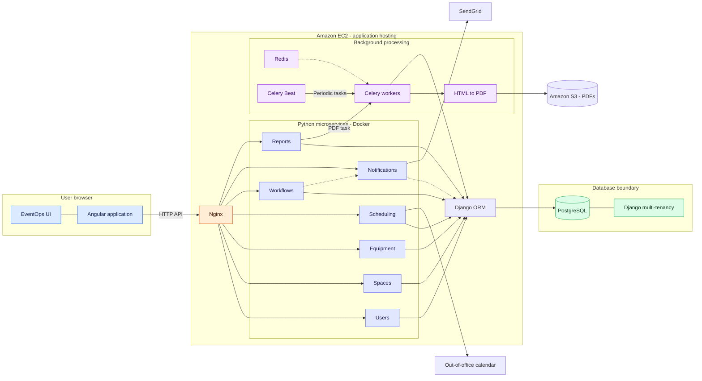
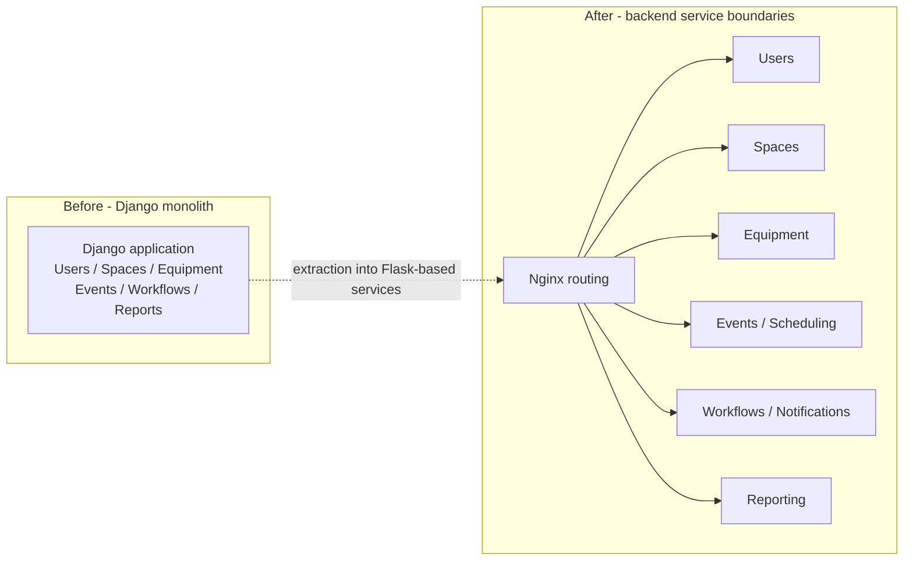
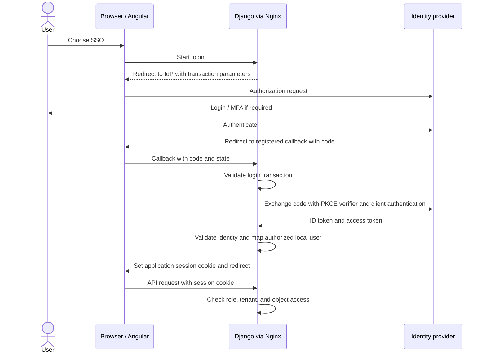
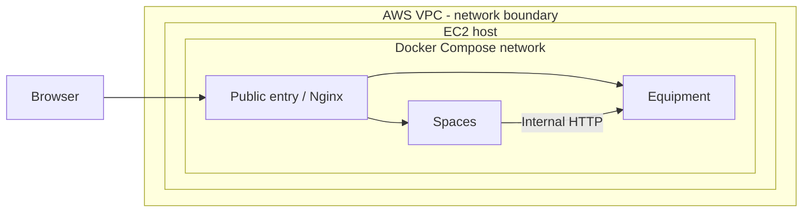
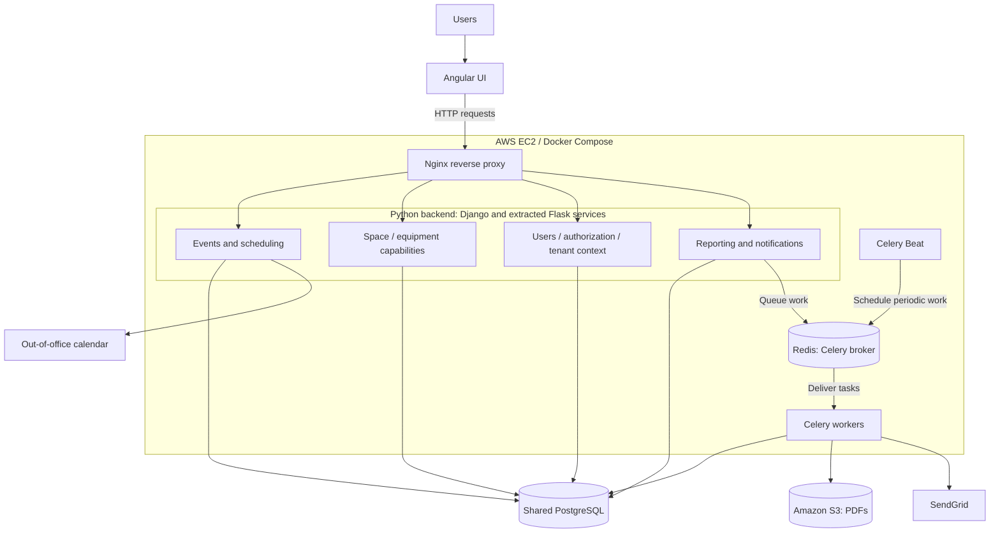
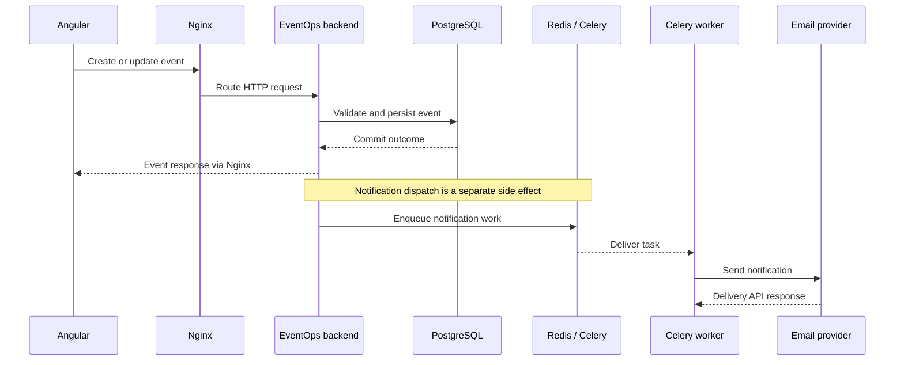
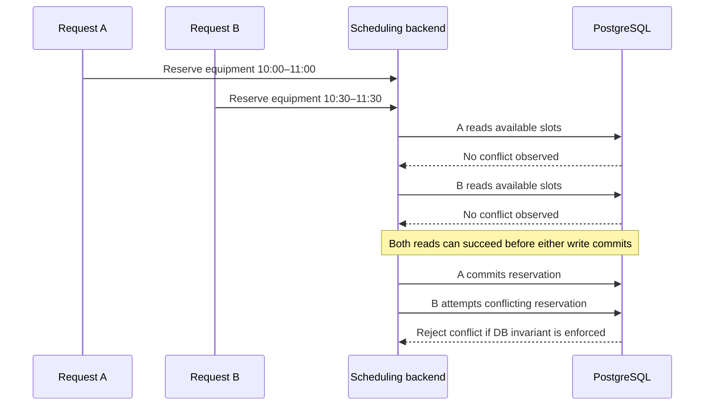
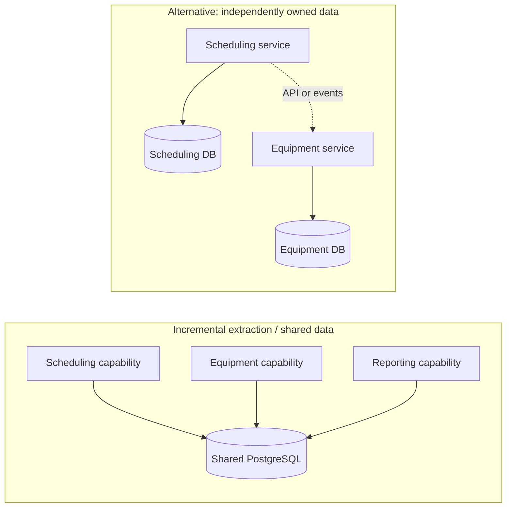

# EventOps — architecture and data flows

## 1. Project architecture

EventOps managed events together with the users, spaces, and equipment needed to run them. Users could modify availability, schedule events, receive email notifications, and generate detailed PDF reports. The application evolved from a Django monolith toward Flask-based microservices, with Angular in the browser, Nginx routing on the backend, Docker-packaged services, and a common PostgreSQL database.

### System architecture



**Reading the diagram:** the browser contains Angular; the server contains Nginx, backend services, and background processing; PostgreSQL is shown as a separate database boundary. The server box groups backend responsibilities and does not assert that every component ran on one physical machine. The ORM box summarizes database access; it is not a separate deployed service. Django ORM was the main access mechanism, but the exact integration used by each Flask service remains unknown. EC2 hosting is confirmed; PostgreSQL placement and the number of EC2 instances are not.

**Reconstruction scope:** user, space, equipment, availability, scheduling, email, and reporting capabilities are confirmed. They are shown as functional microservice boundaries to explain the architecture requested here. Their exact original deployment names, specific deployed service names and split between Django and Flask remain unverified. A separate Docker image per service is confirmed. Workflow and notification connections shown with dotted lines are illustrative. SendGrid email delivery, Django multi-tenancy, and Celery Beat periodic scheduling are confirmed. Redis's exact role and schema-level isolation remain uncertain. The calendar provider is unspecified.

### Service responsibilities and routing

The route prefixes below illustrate Nginx routing; they are not recovered production URLs.

| Service | Responsibility | Availability / data handled | Illustrative route |
|---|---|---|---|
| User management | Maintain users and role-related operations | User details and user availability modifications | `/api/users/` |
| Space management | Maintain event spaces and their availability | Space details and availability modifications | `/api/spaces/` |
| Equipment management | Maintain event equipment and its availability | Equipment details and availability modifications | `/api/equipment/` |
| Event and scheduling | Manage event scheduling and relevant resource allocation | Event timing, participants, space/equipment requirements; out-of-office checks | `/api/events/`, `/api/scheduling/` |
| Workflow | Apply conditions and generate follow-up tasks | Triggers, conditions, task assignments | `/api/workflows/` |
| Notifications | Prepare and send event-related email | Recipient and notification content; persistence unspecified | `/api/notifications/` |
| Reporting | Accept event report requests and dispatch PDF work | Event report inputs and HTML-template content | `/api/reports/` |

Availability modifications belong with the entity being managed: user availability with users, space availability with spaces, and equipment availability with equipment. Scheduling consumes the relevant availability information. The historical mechanism for obtaining resource availability across service boundaries is not yet recalled; the shared database does not establish whether scheduling queried tables directly or called service APIs.

### Request and background execution paths

A space-availability update starts in Angular, reaches Nginx, and is routed to the space capability. The backend validates the request and permissions, updates the relevant PostgreSQL data, and returns the result to the browser. This is a reconstructed request path using the confirmed technology stack; actual endpoints and permission middleware remain unspecified. Equipment and user availability follow the same responsibility model.

Scheduling combines the proposed event timing and relevant availability data. Participant availability came from an out-of-office calendar. Space and equipment availability were also managed, but the exact rules for combining all three availability sources in one scheduling decision remain to be recalled.

Reporting uses a different execution path: the reporting capability dispatches PDF generation as a Celery task; the task populates an HTML template with event contents and renders the PDF. The generation mechanism is confirmed, while PDF upload to an S3 bucket is confirmed; job-status tracking, object naming, and authorized download delivery remain unspecified.

### Evolution from the original monolith



The migration changed application boundaries while retaining a common database. This supported modular development but preserved database coupling: schema changes and competing writes could still affect multiple services. The capability grouping above is a reconstruction, not a verified extraction sequence.

Tenant isolation was probably implemented through separate PostgreSQL schemas within the common database. Customer isolation and service ownership are separate concerns: tenant schemas would separate customers, while services could still share the same customer's data.


---

## 4. Backend migration: Django monolith to Flask services

Merin was a main contributor to converting the original Django application toward Flask-based microservices. Docker supported service packaging and Nginx mainly provided routing. The immediate drivers were increasing feature-management complexity, changes introducing regressions in other areas, and growing difficulty testing the application. Individual extracted service names and the rollout sequence remain to be recalled.

### Why the monolith was split

As EventOps accumulated user, space, equipment, availability, workflow, notification, and reporting features, managing them within one application became difficult. Changes in one area introduced regressions elsewhere, and testing became harder because changes had a wider impact. These are the confirmed reasons for moving toward smaller service boundaries.

| Observed problem | Intended architectural response | Important limit |
|---|---|---|
| Too many features to manage together | Group functionality behind clearer capability boundaries | Separate processes do not automatically remove code/data coupling |
| Changes caused regressions in other areas | Make interfaces and responsibilities explicit, reducing unintended cross-feature changes | Shared PostgreSQL schema changes can still affect several services |
| Testing became difficult | Test bounded service behavior and its contracts more directly | End-to-end and integration testing become more important across services |

Additional possible benefits include clearer ownership, smaller release units, easier fault localization, and workload-specific deployment or scaling. These are reasonable motivations to discuss, not confirmed EventOps outcomes. Independent releases or scaling require supporting deployment and data boundaries; they do not follow from Flask or Docker alone.

The tradeoff was additional network communication, configuration, service integration, and failure handling. A modular monolith was another possible response to feature coupling. The migration is best explained as an engineering choice made to manage growing complexity, not a claim that microservices always outperform monoliths.

### Application boundaries and contracts

A monolith can call internal modules directly and coordinate work inside one application. Extracted services introduce explicit interfaces and network boundaries. Request data, response formats, validation, authorization, and error behavior become part of the contract between the frontend and backend components.

Django and Flask are frameworks rather than architecture categories. Flask supports lightweight service construction, but is not inherently more scalable than Django. The architectural change was the separation of capabilities and routing, not simply a framework substitution.

### Common database and coordination

The backend services used a common PostgreSQL database. Exact shared tables and write ownership remain unknown. A common database simplifies access to existing data during extraction but couples services through schema and transaction behavior. Two separate requests using the same database are not automatically one atomic transaction.

### Packaging and routing

Docker packaged service code with its runtime dependencies. Nginx mainly routed incoming requests to different backend components; replica load balancing is not a confirmed EventOps use. Authentication and permission checks still belonged in the application or an explicitly configured identity layer; routing alone did not establish user authorization.

### Inter-service communication

Nginx primarily routed frontend requests to the appropriate service. Merin tentatively recalls REST calls for inter-service communication. These are different paths: a browser request reaching a service through Nginx does not establish that every internal call also passed through Nginx.

Synchronous REST lets a service obtain an immediate answer from another capability, at the cost of network latency and dependency failures. Celery supported work that could execute later, including PDF generation. The exact internal HTTP endpoints, clients, authentication propagation, tenant propagation, and timeout/retry settings remain unverified. The shared database is confirmed, but direct access by one service to another capability's tables is not established.

### Migration mechanics: reference explanation

A gradual extraction can preserve existing behavior while moving a bounded capability to a separate service: characterize the existing workflow, define its contract, implement the service, verify behavior and permissions, and change the relevant route. This is a reference migration method; the exact EventOps extraction order and rollout strategy have not been established. Routing rollback also requires database compatibility to be effective.


---

## 9. Persistence, tenant isolation, and access control

### Shared PostgreSQL database

The common database served the backend services. This describes the database boundary, not the exact table ownership or migration process. A service extraction can retain shared data while introducing application-level interfaces, with the tradeoff that schema compatibility still affects several components.

### Database communication through Django ORM

Django ORM was the main mechanism for communicating with PostgreSQL. Application code expressed reads and writes through models and QuerySets rather than primarily hand-written SQL. Merin used `Q` objects and `F` expressions for more complex queries. The exact ORM bootstrap or integration used inside Flask services is not yet recalled; Flask does not provide Django ORM automatically.

`Q` builds composable boolean predicates such as AND, OR, and NOT. `F` refers to database field values within expressions, allowing field comparisons or updates without first loading a value into Python. The following examples illustrate the APIs; model/field names and business conditions are not recovered EventOps code.

```python
from django.db.models import Q, F

# Illustrative OR condition; tenant_queryset is already correctly scoped.
events = tenant_queryset.filter(
    Q(status="planned") | Q(status="confirmed")
)

# Illustrative field-to-field comparison.
over_budget = tenant_queryset.filter(actual_cost__gt=F("budget"))
```

QuerySets are generally evaluated when results are consumed, not when a filter is constructed. ORM use does not eliminate the need to examine generated queries, indexes, transaction boundaries, or relation loading. The actual prefetch load-test regression below is an example of why access patterns matter. See [Django queries](https://docs.djangoproject.com/en/5.2/topics/db/queries/) and [query expressions](https://docs.djangoproject.com/en/5.2/ref/models/expressions/).

### Tentative schema-per-tenant model

EventOps used a Django-based multi-tenant architecture, now confirmed by Merin. The exact package name is not identified. Schema-level tenant separation remains a tentative recollection; if confirmed, the conceptual structure would be:

```text
Common PostgreSQL database
  |-- Tenant A schema: customer-owned tables
  |-- Tenant B schema: customer-owned tables
  |-- Other tenant schemas
```

This is a tentative model, not a recovered schema listing. Schema-per-tenant implementations need controlled tenant selection, context restoration on reused connections, and equivalent context handling in background jobs. Celery does not automatically preserve Django request context. Separate schemas also do not prove database-enforced isolation if one role can access every schema.

### Authentication and authorization

EventOps offered both **SSO login** and a **manual login** mechanism. Django authentication mechanisms were used for application user authentication. Admin-specific APIs were protected with decorators in the backend code. Merin also worked on role-based access control. The exact login/session/token configuration, decorator implementations, and role names have not been identified.

Authentication established the user identity; authorization controlled which API operations that user could perform. An authenticated user was not automatically allowed to invoke admin APIs. Decorators placed checks around protected view functions before privileged logic executed. Whether the project used built-in decorators, custom decorators, or a combination remains unspecified.

A reference authorization sequence is authenticated identity → verified tenant scope → required role/permission → access to the specific object. The tenant/object checks are design requirements to verify, not evidence that a particular decorator implemented all four layers. Backend protection applies even when an unauthorized user calls the API directly rather than through Angular.

Django supports authentication and permission facilities, including view decorators; exact behavior depends on the chosen implementation. See [Django authentication documentation](https://docs.djangoproject.com/en/5.2/topics/auth/default/). A login check alone is not an admin permission check, and a staff flag need not represent a tenant-scoped business-administrator role.

### SSO and out-of-office calendar access

SSO login and manual login were both supported for initial application access. Earlier recollection associated SSO with obtaining out-of-office data, but the exact calendar integration is not remembered. The confirmed scheduling behavior is checking out-of-office availability; SSO login alone does not establish how calendar data was retrieved or how internal service calls were authenticated. The historical identity provider, protocol, API credentials, delegated access, and refresh mechanism remain unknown.

```text
Application login options: SSO or manual login
Application authentication: Django authentication
Admin API access: backend decorator checks
Calendar access: out-of-office source; exact mechanism unverified
Tenant isolation: Django multi-tenancy
```

SSO identifies a user; reading calendar data additionally depends on the integration's granted access. No OAuth/OIDC, SAML, Microsoft/Google integration, or JWT propagation is asserted without confirmation. Failed calendar access should not be treated as proof of participant availability; actual failure behavior remains to be recalled.

UI controls reflect permissions; backend checks enforce them. Reports, exports, related-object access, and background work need the same scope discipline as primary APIs. How Django identity and authorization were validated in the extracted Flask services remains an important unresolved boundary.

### SSO behind the scenes: reference walkthrough

**Confirmed for EventOps:** SSO login and manual login were both available, Django authentication was used, and decorators protected admin APIs. The identity provider, SSO protocol, session backend, and integration package remain unknown. The following server-side OIDC flow explains a possible implementation, not recovered EventOps code.

#### Components and trust

| Component | Responsibility in the reference design |
|---|---|
| Angular / browser | Starts login and follows redirects |
| Nginx | Routes requests to the application; does not itself prove identity |
| Django / SSO integration | Starts authentication, validates the response, maps the identity, establishes application login |
| Identity provider, or IdP | Authenticates the user, potentially with MFA and an existing organizational session |
| Application user and tenant records | Determine EventOps membership, access, and permissions |

SSO means applications trust an identity provider's authenticated result rather than independently asking for the corporate password. Each application can still maintain its own session. The user is not automatically an administrator simply because corporate login succeeded.

#### Visual flow: OIDC authorization code example



The arrows describe logical endpoints. Nginx forwards browser requests; the backend's token exchange need not pass through the browser. A server-side client keeps its credentials and provider tokens on the server in this reference design.

#### 1. Start a login transaction

The application redirects the browser to the provider with a client identifier, registered callback, requested scopes, and transaction state. After authentication, the provider returns a short-lived code; the backend exchanges it at the token endpoint. This is the authorization-code pattern, not sending the corporate password to EventOps. See [OAuth 2.0 authorization code flow](https://datatracker.ietf.org/doc/html/rfc6749#section-4.1).

The browser may already have a valid provider session from another company application. The provider can then complete authentication without another password prompt, subject to its policies. This is the visible “single sign-on” effect; the provider and EventOps still have separate session lifecycles.

#### 2. Bind the callback to the attempted login

`state` correlates the callback with the initiating browser transaction and helps prevent login CSRF. PKCE uses a per-login verifier and a derived challenge; the code exchange must present the verifier. The verifier should not be exposed as the authorization-request challenge. PKCE protects against intercepted-code misuse. See [RFC 7636](https://datatracker.ietf.org/doc/html/rfc7636).

An OIDC request can also include `nonce`, which must match the returned ID token when supplied. It binds the identity response to the login transaction. State, nonce, and PKCE serve different checks; none substitutes for validating the provider and token.

#### 3. Validate the identity response

OIDC adds an ID token containing identity claims. Validation includes the signature, expected issuer, audience/client, expiry, and applicable transaction checks. Use the issuer and subject as the external identity key; email alone is not a reliable account-linking key. An ID token identifies a login; an access token authorizes access to its intended resource. See [OIDC Core](https://openid.net/specs/openid-connect-core-1_0.html).

Provider metadata can publish authorization/token endpoints and the signing-key location, often exposed as JWKS. Trust comes from the configured issuer, HTTPS, and correct validation—not merely decoding a JWT or following a key URL supplied by an untrusted token. See [OIDC Discovery](https://openid.net/specs/openid-connect-discovery-1_0.html).

#### 4. Establish the local user and application session

The reference backend maps the validated identity to an authorized local user, then uses Django login/session handling. Manual login validates credentials through the configured Django authentication backend. Both paths can converge on the same local permission checks. Actual EventOps provisioning and account-linking behavior are unknown.

For a server-side session design, the browser holds a session identifier cookie; requests resolve it to local identity. HttpOnly restricts JavaScript access, Secure restricts transmission to HTTPS, and cookie-based state-changing requests require CSRF protection. SSO login does not remove those application concerns. See [Django authentication](https://docs.djangoproject.com/en/5.2/topics/auth/default/).

Django's application session is not automatically understood by Flask. Shared session validation, an internal identity check, or appropriately validated access tokens are possible service-boundary mechanisms. The historical mechanism remains unverified.

#### 5. Distinguish application logout from provider logout

Logging out of EventOps should terminate its application session. The provider session may remain active, allowing a later SSO attempt to log in again without a password. Ending the provider session is a separate flow and can affect other applications. [OIDC RP-initiated logout](https://openid.net/specs/openid-connect-rpinitiated-1_0.html) is one modern specification; it became final in 2022 and is not evidence of EventOps' 2019-2021 implementation.

#### SAML: an alternative historical implementation

SAML browser SSO uses an identity assertion, commonly delivered to the application's assertion-consumer endpoint, rather than the OIDC code/token sequence above. The application validates signature, issuer, intended audience, destination, timing, request correlation, and replay protection before creating local login state. Use a maintained integration library. See [OWASP SAML guidance](https://cheatsheetseries.owasp.org/cheatsheets/SAML_Security_Cheat_Sheet.html).

| Memory clue | Possible protocol |
|---|---|
| Authorization/token endpoints, `openid` scope, ID token | OIDC |
| XML metadata, assertion, ACS URL, `SAMLResponse` | SAML |
| A corporate login page or MFA prompt alone | Insufficient to distinguish protocols |

Neither protocol is confirmed for EventOps. Current documentation explains concepts; its latest features and versions are not historical project claims.


---

## 13. Outcomes and engineering tradeoffs

| Outcome | Evidence and interpretation |
|---|---|
| Load-test regression resolved | Personally added prefetch to reduce DB calls; load testing exposed an approximately 10-second loading delay; personally fixed it with conditional fetching in a later call; after-fix timing unspecified |
| Test coverage: 40% to 70% | Directly confirmed; +30 percentage points, equivalent to 75% relative growth |
| Approximately 20% operational/manual-effort improvement | Career materials; baseline and measurement method remain unspecified |
| Approximately 15% efficiency improvement | Portfolio performance/debugging claim; metric definition remains unspecified |
| CEO appreciation | Documented recognition for EventOps contribution |

The most concrete numerical result is the coverage baseline and final value. The approximate efficiency figures should not be interpreted as API latency, throughput, or cloud-cost improvements without supporting measurement.

| Design choice | Benefit | Cost or constraint |
|---|---|---|
| Flask service extraction | More modular application boundaries | Network contracts and distributed debugging |
| Common database | Continued access to existing application data | Shared schema/write coupling |
| Celery background work | Moves suitable slow work outside request execution | Queue delay, retries, delayed outcomes |
| HTML report templates | Separates content from reusable presentation | Rendering dependencies and pagination complexity |
| Mocked unit tests | Fast isolated behavior checks | Requires integration tests for real wiring |
| Schema-per-tenant, if confirmed | Customer namespace separation | Migration and connection-context complexity |

Operational diagnosis separates request latency, queue waiting time, task duration, and downstream errors. Useful reference signals include task failure rate, oldest waiting-task age, overdue scheduled work, rendering duration, and report memory consumption. Historical EventOps monitoring details are not yet known.

### Actual load-testing regression: eager data loading

I added Django `prefetch_related()` to reduce database calls and expected faster loading. Load testing exposed an approximately 10-second data-loading delay. I also fixed the code by removing prefetch from the initial load and fetching the additional data conditionally in a subsequent call. This kept optional related-data loading off the initial critical path, at the cost of another call when needed.

The exact relation, dominant cost, and after-fix timing are not yet recalled. The observation demonstrates the importance of matching fetch strategy to actual data use, rather than assuming eager loading always improves performance. A detailed incident answer and suggested verification checks are in the [interview document](05_Interview_QA.md#actual-load-testing-regression-eager-prefetch-delayed-initial-loading).

### Hosting and deployment on EC2

The application was hosted on Amazon EC2. Docker was used for deployment, with a separate image for each service. Images were built using Docker build commands, then used to run service containers. Nginx routed requests to the backend services.

```text
Service source + Dockerfile
        |
    docker build
        |
Versioned service image
        |
Container deployment on EC2
        |
Nginx routes requests to service
```

This describes the confirmed build/deployment mechanism. Version tagging is a recommended practice in the illustration; the actual tag convention, registry, build location, image transfer, exact Compose configuration, and release automation are unknown. Docker Compose is recalled as the multi-container deployment mechanism. A command such as `docker build -t eventops-spaces:example ./spaces` is an illustrative build, not a historical command or a command executed here. See [Docker build concepts](https://docs.docker.com/build/concepts/overview/); current build internals do not establish the 2019-2021 builder configuration.

Images package code and dependencies; containers run those images. Environment-specific configuration belongs at runtime, and secrets should not be baked into image layers. Updating a container does not itself run safe schema migrations, drain Celery work, or provide zero-downtime rollback. Reference release checks include service readiness, route verification, backward-compatible migrations, and preserving a usable previous image. Exact historical controls remain unverified.

### Docker Compose: running the services together

Merin recalls Docker Compose as the mechanism for describing and starting the multi-container application. Each service had its own Docker image; Compose described how containers were started together, connected, and configured. A YAML file removes the need to maintain a separate long `docker run` command for every component. The exact historical YAML and Compose version are not available.

An image packages a service; a container is a running instance; Compose defines the collection of services, networks, volumes, and runtime settings. Several services can also use the same image with different commands—for example a worker and Beat scheduler, if their code supports that. See [Compose application model](https://docs.docker.com/compose/intro/compose-application-model/).

#### Illustrative Compose YAML

This is a teaching example, not a recovered or runnable EventOps deployment. It uses placeholder image names and application commands. Nginx configuration, Dockerfiles, actual secrets/configuration, PostgreSQL location, and application code must be supplied. The example shows two API services to keep the structure readable; other capabilities follow the same pattern.

```yaml
services:
  nginx:
    image: nginx:example-version
    ports:
      - "80:80"
    volumes:
      - ./nginx.conf:/etc/nginx/nginx.conf:ro
    networks: [backend]
    depends_on: [spaces, equipment]

  spaces:
    build: ./services/spaces
    image: eventops-spaces:example-version
    environment:
      EQUIPMENT_URL: http://equipment:8000
    networks: [backend]

  equipment:
    build: ./services/equipment
    image: eventops-equipment:example-version
    networks: [backend]

  redis:
    image: redis:example-version
    networks: [backend]

  worker:
    image: eventops-tasks:example-version
    command: celery -A example_tasks worker --loglevel=info
    networks: [backend]
    depends_on: [redis]

  beat:
    image: eventops-tasks:example-version
    command: celery -A example_tasks beat --loglevel=info
    networks: [backend]
    depends_on: [redis]

networks:
  backend:
    driver: bridge
```

`build` selects a source build context; `image` names the built or fetched artifact; `command` selects the container process. `ports` publishes a port on the host. Only Nginx is published in this example; the API services use container ports on the shared network. Each API process must listen on its container interface, such as `0.0.0.0:8000`, rather than only loopback.

`depends_on` here controls startup order, not application readiness. Health checks with appropriate conditions can gate initial startup; application clients still need runtime reconnection and bounded retries when dependencies fail later. See [Compose startup behavior](https://docs.docker.com/compose/how-tos/startup-order/).

Useful commands include `docker compose config` to validate/resolve configuration, `docker compose build` to build, `docker compose up -d` to create/start, `docker compose ps` to inspect, and `docker compose logs <service>` to diagnose. Older Compose installations used `docker-compose`; the historical EventOps command spelling is unverified. These commands are examples, not executed here.

#### Common Docker Compose commands

Commands below are study examples, not executed here. They use modern `docker compose`; older installations commonly used `docker-compose`. Service names refer to the illustrative YAML above. Run from the Compose-file directory or select a file with `-f`. See the [Compose CLI reference](https://docs.docker.com/reference/cli/docker/compose/).

| Task | Command |
|---|---|
| Version | `docker compose version` |
| Validate YAML/configuration | `docker compose config --quiet` |
| List configured services | `docker compose config --services` |
| Build images | `docker compose build` |
| Build one service | `docker compose build spaces` |
| Rebuild without layer cache | `docker compose build --no-cache spaces` |
| Start in background | `docker compose up -d` |
| Build and start | `docker compose up -d --build` |
| Update one service | `docker compose up -d --build --no-deps spaces` |
| List containers/status | `docker compose ps -a` |
| Follow recent service logs | `docker compose logs -f --tail=100 spaces` |
| Open a running container's shell | `docker compose exec spaces sh` |
| One-off container command | `docker compose run --rm spaces python --version` |
| Pull configured images | `docker compose pull` |
| Restart existing container | `docker compose restart spaces` |
| Stop, retain containers | `docker compose stop` |
| Start stopped containers | `docker compose start` |
| Remove application containers/networks | `docker compose down` |
| Select file/project | `docker compose -f compose.yaml -p eventops up -d` |

`restart` does not rebuild an image or apply changed Compose environment settings; use `up` to reconcile changes. `--no-deps` skips dependency startup, so use it only when existing dependencies remain suitable. `run --rm` creates a one-off container; `exec` uses a running one. Migrations are application commands and need a deliberate release plan, not an automatic command to run in every replica.

`down` normally retains named volumes. `docker compose down -v` additionally removes declared named volumes and attached anonymous volumes; this can delete persisted data and is not a routine production cleanup step. External volumes are managed separately.

A reference troubleshooting sequence is status → service logs → runtime configuration → dependency connectivity/readiness. Full `docker compose config` output may reveal interpolated values; do not paste secrets from it into logs or interviews.

#### Reading the YAML contents

| YAML key | Meaning in the example |
|---|---|
| `services` | Defines container workloads |
| Service name, e.g. `spaces` | Compose identity and network discovery name |
| `build` | Build context containing source/Dockerfile |
| `image` | Image name and tag |
| `command` | Overrides the image's default command |
| `environment` | Runtime variables; not a secret vault |
| `ports` | Host-to-container port mapping |
| `volumes` | Mounts host paths or persistent volumes |
| `networks` | Connects services to declared networks |
| `depends_on` | Declares startup dependencies |
| `healthcheck` | Defines a container health probe |
| `restart` | Container restart policy |

These are Compose concepts, not claims that every key appeared in EventOps. See the [service configuration reference](https://docs.docker.com/reference/compose-file/services/).

For example, `"8080:80"` means host port 8080 forwards to container port 80; a peer container normally calls the service's container port. The Nginx read-only bind mount supplies routing configuration from the host. A named volume serves a different purpose: persistent data independent of a particular container.

A minimal example of the latter keys is:

```yaml
services:
  redis:
    image: redis:example-version
    restart: unless-stopped
    healthcheck:
      test: ["CMD", "redis-cli", "ping"]
      interval: 10s
      timeout: 3s
      retries: 5
    volumes:
      - redis-data:/data

  worker:
    image: eventops-tasks:example-version
    command: celery -A example_tasks worker --loglevel=info
    depends_on:
      redis:
        condition: service_healthy

volumes:
  redis-data:
```

This separate teaching fragment uses the default Compose network. It is not a drop-in replacement for the earlier file: those services explicitly join `backend`. Image tags and task modules remain placeholders. A volume mount does not itself configure Redis durability; persistence policy still matters. A health check reports health, while a restart policy responds to process/container exit conditions—not simply an unhealthy status. Historical health checks, restart settings, and volume configuration remain unknown.

#### Container networking versus VPC networking

On a shared Compose network, containers can discover services by name: `http://equipment:8000` addresses the equipment service's container port. `localhost` inside a container addresses that container, not the EC2 host or another service. The network name `backend` is only a label; it does not authenticate callers. See [Compose networking](https://docs.docker.com/compose/how-tos/networking/).

A Compose bridge typically connects containers on one Docker host. It does not automatically span EC2 instances. Cross-host calls need appropriate private addressing, routing, discovery, and access rules. Browser-to-Nginx routing and internal service-to-service calls are distinct paths.



This diagram illustrates layers, not the verified subnet/host topology. Merin recalls the VPC as the explanation for internal connectivity/trust; exact security-group rules, subnet placement, and internal request credentials are unknown.

A VPC supplies the AWS network boundary; security groups control permitted traffic to/from associated resources. Restricting ingress to approved sources and ports reduces exposure, but does not prove the identity of an application caller. See [AWS security groups](https://docs.aws.amazon.com/vpc/latest/userguide/vpc-security-groups.html).

#### Explaining internal calls without per-request authentication

A historically plausible design trusted callers on a restricted private network rather than authenticating each internal request. That is an explicit trust assumption: a compromised allowed host/container may reach the same endpoints. Private connectivity does not supply encryption, tenant authorization, or service identity by itself.

If this matches the actual implementation, explain it as “internal access was restricted at the network layer,” rather than “VPC authenticated our services.” User/tenant context and admin permissions still need protection. Stronger designs can add scoped service credentials or mutual TLS plus authorization. These are possible improvements, not confirmed EventOps features.

Compose simplifies a multi-container deployment, but ordinary single-host use does not supply multi-host failover, automatic placement, or zero-downtime release guarantees. A failed host can affect all co-located services; the actual EventOps host count and recovery arrangement remain unknown.

### PDF persistence in Amazon S3

After PDF generation, the generated report was uploaded to an S3 bucket. This separated report storage from the lifecycle of a service container. EC2 supplied application compute; S3 stored report objects; PostgreSQL stored application data. Whether report object keys or status were recorded in PostgreSQL is not yet known.

A reference upload flow is render PDF → upload object → confirm upload success → expose the report as ready. Rendering success and upload success are separate outcomes. A database status update and an S3 upload also do not share a normal database transaction; retry-safe keys and reconciliation are possible controls, not confirmed EventOps mechanisms.

For a reference secure download design, the backend checks user/tenant access before streaming the object or issuing a short-lived presigned URL. Presigned URLs grant time-limited access using the signer's permissions and must be treated as bearer links. Historical URL generation, bucket access settings, credential source, encryption configuration, and retention policy remain unknown. See [S3 presigned URL documentation](https://docs.aws.amazon.com/AmazonS3/latest/userguide/ShareObjectPreSignedURL.html).


---


---

## Distributed architecture diagrams

[Project guide](Project_Reference.md) · [Challenge scenarios](03_Engineering_Challenges.md) · [Interview Q&A](05_Interview_QA.md)

These diagrams separate the **project architecture** from **interview scenarios**. The system used Angular, Nginx, Django/Flask, Docker Compose on EC2, shared PostgreSQL, Celery/Redis, and external calendar/email integrations. The individual service boxes are **logical capabilities**, not a claim that every box was deployed as an independent service.

## 1. High-level architecture: what runs where?



**Explain in an interview:** Nginx routes requests to backend capabilities; it is not the application runtime. Redis carries asynchronous work, while PostgreSQL stores transactional application data. The shared database is a significant coupling point even when Python components are deployed separately. Docker Compose manages container configuration and startup; it does not guarantee application readiness or distributed high availability.

**Scale discussion:** Multiple stateless backend replicas can increase request capacity, but the database, worker throughput, external APIs, and proxy become separate bottlenecks. Scaling Celery consumers increases background concurrency, not HTTP throughput. Adding replicas requires consistent authorization and tenant handling.

## 2. Request flow versus asynchronous side effects



**Distributed-systems question:** What if the database commits but enqueue fails? The event exists but notification may be missing. Discuss an outbox as a hardening option. What if the email succeeds but the worker crashes before acknowledging? A retry may send twice; use a stable notification identity and delivery-state checks.

## 3. Concurrent resource reservation: read-check-write race



**Interview design:** Enforce the no-overlap invariant at the authoritative database boundary, e.g. PostgreSQL exclusion constraints for suitable interval schemas or a serialized resource-row lock plus check. Ordinary application-level availability checks alone do not prevent races.

**Follow-ups:** Multi-resource bookings, deadlocks and lock order, retry after timeout, transaction isolation, calendar staleness, tenant scoping.

## 4. Shared database versus service-owned databases



**Trade-off:** Shared data simplifies cross-feature queries and incremental migration but couples schema changes and can undermine service ownership. Database-per-service improves autonomy but requires explicit consistency, contract, and reporting designs. A modular monolith can also be a valid intermediate choice.

## 5. Failure and scaling drills

| Interviewer asks | What to explain |
|---|---|
| Nginx returns 502 | Route, upstream container address, process health, timeout, and logs |
| One service is slow | Trace downstream calls and database query time; bound timeouts |
| Database connection pool is exhausted | Replica count × per-instance connections; pooling and backpressure |
| Celery queue grows | Arrival rate versus worker service rate, task duration, retries, and worker concurrency |
| Two Beat schedulers run | Duplicate scheduling risk and idempotent task processing |
| Tenant data leaks across services | Consistent tenant context, authorization at each boundary, and cross-tenant tests |
| One service deploys before a schema migration | Expand/contract schema compatibility |
| Calendar API is down | Separate unknown availability from confirmed free slots; define fallback |

