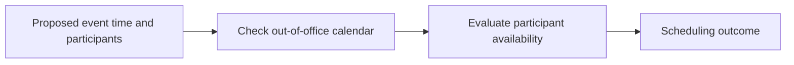
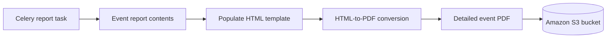

# EventOps — engineering challenges and decisions

## 5. Event scheduling and participant availability

Event scheduling used an **out-of-office calendar** to check participant availability. This establishes absence-based availability checking, rather than necessarily a complete meeting-calendar free/busy integration. SSO was used for application login, alongside manual login; the exact mechanism used to retrieve calendar data is not currently remembered. The identity/calendar provider, SSO protocol, calendar-access API, permissions/scopes, and representation of availability remain unverified. SSO establishes identity; the data integration still needs appropriate authorization to read calendar information.



The confirmed workflow checked availability. Whether it searched for alternative slots or validated a selected slot is not yet known.

### Interval overlap: reference algorithm

For half-open intervals `[start, end)`, a calendar interval overlaps a proposed event when:

```text
calendar_start < event_end AND calendar_end > event_start
```

For example, an absence from 10:00 to 12:00 conflicts with an event from 11:00 to 11:30, while an event beginning at 12:00 is adjacent under this convention. All-day absences and time zones require explicit interpretation. This algorithm is a reference explanation, not recovered EventOps code.

### Concurrent scheduling

An availability query followed by an unprotected save can race with another request. A reference booking design serializes conflicting decisions and rechecks relevant constraints inside the protected operation. A unique start-time constraint alone cannot prevent arbitrary interval overlap. The actual EventOps concurrency mechanism remains unknown.


---

## 6. Conditional workflows and email notifications

EventOps included rule-based triggers, conditional task generation, and automated email notifications. Merin contributed to these automation capabilities and access controls.

| Workflow element | Responsibility | Illustrative example |
|---|---|---|
| Trigger | Identify a business occurrence | Event enters an approved state |
| Condition | Determine whether action is applicable | A planner has been assigned |
| Action | Perform business work | Create an assigned follow-up task |
| Notification | Communicate the result | Email the responsible person |

The example illustrates the model; it is not a recalled EventOps rule. SendGrid sent the emails. The real rule format, configuration mechanism, recipients, and SendGrid API/SMTP integration details remain unspecified.

SendGrid provided email delivery. The notification capability prepared the message and handed it to SendGrid; whether the integration used its HTTP API or SMTP, and whether delivery webhooks were tracked, remain unspecified.

Business state changes, task generation, and email delivery have different failure boundaries. An email failure need not undo an already-created business task. Retrying notification delivery should not recreate business work unintentionally.

### Transaction and delivery reliability: reference design

For Django code, dispatching through `transaction.on_commit()` can prevent a worker from observing a change that subsequently rolls back. It does not eliminate the crash window between commit and publication. A transactional outbox is one stronger approach to durable dispatch, but is not a confirmed EventOps feature. See [Django transactions](https://docs.djangoproject.com/en/5.2/topics/db/transactions/).

Repeated execution requires an identity for each logical action occurrence and safe state transitions. Exactly-once external email delivery cannot be inferred from a local completion flag: a provider may accept an email before the worker records success. The historical retry/deduplication mechanisms remain unknown.


---

## 7. Background processing with Celery and Redis

Celery and Redis supported background processing, and Celery Beat scheduled periodic tasks. PDF generation is a confirmed Celery workload. The assignment of email work to Celery, Redis's exact role, retry settings, and acknowledgment settings have not been recalled.

Background execution separates request handling from slower work. It introduces queue waiting time, worker execution time, and a later success/failure outcome. Celery relocates work; it does not make the PDF renderer intrinsically faster.

Celery Beat determined when periodic work became due and dispatched it for Celery workers to execute. Beat was the scheduler; workers performed the work. A broker carries tasks, while a result backend can store task outcomes. Upcoming-event reminders are a confirmed periodic use case. The exact Redis role, schedule storage, reminder interval, and other periodic tasks remain unspecified. See the [Celery task guide](https://docs.celeryq.dev/en/stable/userguide/tasks.html).

### Periodic example: upcoming-event reminders

Upcoming-event reminders were part of EventOps periodic processing. Beat scheduled periodic work, Celery workers executed it, and SendGrid provided email delivery. The exact reminder lead time, scan interval, and task decomposition remain unverified.

A reference implementation scans for reminders that are due, rechecks that the associated event is still eligible, and dispatches the notification. It records a logical reminder occurrence to support safe retries. This scan/deduplication design illustrates the confirmed feature; the historical query, status fields, and duplicate-prevention method are not recalled. Cancellation, rescheduling, time zones, and overdue work after downtime are useful test cases.


---

## 8. Detailed event PDF reporting

Merin worked on PDF reports containing extensive event details. Generation ran as a **Celery task**. Event contents were added by formatting/populating an **HTML template**, and the populated HTML was converted to PDF.



The template separated stable report structure from variable event content. Stable structure can include headings, tables, branding, and print styles. Variable content contains the selected event's fields and detail rows. Generated PDFs were uploaded to an Amazon S3 bucket. Exact report fields, template formatting API, object naming, and download delivery remain unverified.

### WeasyPrint implementation walkthrough

WeasyPrint is the chosen implementation example because Merin uses it personally. The historical EventOps renderer remains unverified; the earlier pdfkit recollection was tentative.

In this reference implementation, scoped event data becomes a presentation context, a template engine produces HTML, and WeasyPrint converts that HTML into PDF bytes. A controlled base URL resolves relative stylesheets, fonts, and images.

```python
from weasyprint import HTML


def render_event_pdf(rendered_html, asset_base_url):
    return HTML(
        string=rendered_html,
        base_url=asset_base_url,
    ).write_pdf()
```

This is the rendering step, not a complete Celery task. With no output target, `write_pdf()` returns PDF bytes. Django templates or Jinja are possible template engines; the historical choice is unknown. The [WeasyPrint documentation](https://doc.courtbouillon.org/weasyprint/latest/first_steps.html) describes the API and setup.

### Template formatting and layout

Formatting an HTML template does not establish use of Python `str.format()` or f-strings. A template engine can provide repetition, conditionals, and escaping. For a reference implementation, ordinary event text should be escaped appropriately rather than inserted as trusted HTML.

Print styles govern page size, margins, table layout, and pagination. Long tables, missing fonts, image paths, and page breaks are material report-quality concerns. Worker images must include the renderer's version-appropriate dependencies and fonts. Resource fetching and rendering limits matter when inputs or URLs are untrusted. See [WeasyPrint web application considerations](https://doc.courtbouillon.org/weasyprint/stable/common_use_cases.html).

### Report consistency and performance

A report assembled through several queries can combine data from different moments unless the application defines a snapshot strategy. Generation access and later download access are also separate authorization boundaries. These are design considerations; the historical implementation is not yet established.

There is no EventOps benchmark proving a renderer fastest or most memory efficient. WeasyPrint suits HTML/CSS template workflows; ReportLab is an alternative for directly programmed document layout. Representative report size, images, fonts, latency, peak memory, and worker concurrency determine efficiency.


---

# EventOps — project-specific architecture, challenges, and scenarios

[Project architecture](Interview_Guide.md) · [Detailed interview Q&A](Interview_Questions_and_Answers.md)

## Interview opening (90 seconds)

“EventOps managed organizational events, participants, spaces, equipment, availability, workflows, notifications, and reporting. I contributed to migrating a Django monolith toward Flask-based services, Docker-based deployment on EC2 with Nginx routing, scheduling and email workflows, detailed PDF reporting, and backend testing. The application used PostgreSQL, Django ORM, Celery/Redis, and Angular. I also improved important-area pytest coverage from roughly 40% to 70%. The most interesting engineering discussions are service boundaries, consistency in scheduling, background work, tenant isolation, and the trade-offs of keeping a shared database during migration.”

## 1. Challenge: splitting a Django monolith into Flask services

**Why the change:** Feature changes in the monolith were increasingly difficult to isolate, regressions affected other areas, and testing became harder.

**Architecture:** Angular → Nginx reverse proxy → Docker-packaged Python services → PostgreSQL. Celery workers and Redis support background execution; Docker Compose coordinates local/multi-container startup.

**Interviewer:** “Why Flask? Why not keep Django or create a modular monolith?”

Flask allows focused services with explicit dependencies and routes, but introduces work around consistent authentication, tenancy, validation, configuration, and deployment. Django can also be used for services; framework choice alone does not create independence. A modular monolith avoids network and distributed-deployment overhead. The meaningful trade-off is boundary ownership versus operational complexity.

**Follow-ups:** How did you select extraction boundaries? How were models and migrations handled with a shared database? How did Nginx route traffic? How were deployments coordinated? How did you keep cross-service contracts stable?

## 2. Challenge: shared PostgreSQL during service extraction

**Interviewer:** “Are these really independent microservices if they use the same database?”

Separate deployment is not the same as independent data ownership. A shared database simplifies migration and transactions across related entities but couples schema evolution and can let one service bypass another service's business rules. A service-per-database design improves autonomy but makes cross-service workflows and reporting harder.

**Trade-off:** Incremental extraction reduces migration risk; strict independence costs more and may not be justified for the product's size and constraints.

**Scenario:** A schema migration changes a column consumed by multiple services. Explain expand/contract migrations: add compatible fields, deploy readers/writers safely, migrate data, then remove the old field only after consumers have moved.

## 3. Challenge: preventing double-booking of equipment or space

**Interviewer:** “Two users reserve the same equipment at the same time. Both read it as available. How do you prevent a conflict?”

**Invariant:** For a resource, two confirmed reservations must not overlap in time.

**Race:** Both requests can pass a read-then-check in application code before either commits. An ordinary availability query is not a concurrency guarantee.

**Design answer:** Enforce the invariant at the database transaction boundary. Depending on the schema, use row locking on the resource with a serialized availability check, or a PostgreSQL exclusion constraint for overlapping time ranges. Handle constraint failures as business conflicts. For multiple resources, establish a consistent locking order to reduce deadlocks.

**Trade-offs:** Application locks are flexible but depend on every writer respecting them. Database constraints give a stronger centralized invariant but require an appropriate data model and migration. Distributed locks are usually unnecessary when PostgreSQL is the authoritative store.

**Follow-ups:** What if an event is rescheduled? How do time zones and recurring events affect overlap? What if the user retries after a timeout? How do you test simultaneous reservations?

## 4. Challenge: participant availability and external calendars

**Interviewer:** “How do you schedule an event when participants' availability comes from an external calendar?”

Define whether external availability is authoritative, cached, or advisory. Fetch within bounded timeouts and distinguish unavailable calendar data from a genuinely free time slot. Combine participant availability with room/equipment constraints and event time zones. Revalidate close to commitment if the external data can change.

**Trade-off:** Real-time checks improve freshness but increase latency and external dependency risk. Caching improves speed but introduces stale availability. Graceful degradation must not silently book a resource known to be unavailable.

## 5. Challenge: event notification reliability

**Project components:** Rule-based triggers, automated email, SendGrid, Celery, Redis, and periodic Celery Beat tasks.

**Interviewer:** “The event is saved, but the email service is down. Should the event creation fail?”

Separate the core event transaction from the notification side effect. An asynchronous task allows the user-facing operation to complete without waiting for email delivery. However, publishing a task and committing a database transaction are separate actions; the interviewer may ask about a transactional outbox, retries, duplicate notifications, and idempotency keys.

**Trade-off:** Direct synchronous email is simpler but couples availability and latency. Queued email improves responsiveness and recovery but adds eventual delivery and operational complexity.

**Follow-ups:** What if Celery retries after sending the email? What if Beat runs twice? How would you implement deduplication? How do you observe a stuck notification?

## 6. Challenge: report generation and storage

**Project components:** Detailed event PDF reports, HTML-based templates, background processing, and S3 storage.

**Interviewer:** “A report takes a long time, the user refreshes the page, and the job finishes twice. What should happen?”

Model the report as a job with status and stable identity. Return a job ID and let the UI poll or receive a completion notification. Keep the generated artifact in object storage and authorize access. If a retry repeats rendering, avoid exposing duplicate or conflicting final artifacts. Decide whether the report represents a snapshot at request time or the latest event state at execution time.

**Trade-off:** Synchronous generation is easy for small reports; asynchronous generation adds job management but avoids long HTTP requests. A cached report reduces CPU work but needs an invalidation strategy when event details change.

## 7. Challenge: tenant isolation in a shared application

**Project component:** Django multi-tenancy and role-based access control.

**Interviewer:** “A developer forgets a tenant filter in one query. What prevents data leakage?”

Tenant isolation should be systematic, not dependent on every endpoint remembering an ad hoc filter. Centralize tenant context and query scoping, validate tenant ownership on writes, and test cross-tenant reads and updates. RBAC answers what a user may do; tenancy answers which organization's records they may access.

**Trade-offs:** Schema-based isolation can simplify some boundaries but increases migration and operational overhead. Shared-table isolation is operationally simpler but demands disciplined filtering and testing.

## 8. Real challenge: increasing pytest coverage from 40% to 70%

**Project contribution:** Expanded backend test coverage, including mocking and multi-tenancy-related test infrastructure.

**Interviewer:** “How did you make testing more reliable while the application was being split?”

Explain test boundaries: pure business logic tests, ORM/database integration tests, tenant-isolation tests, and HTTP contract tests. Mock external services such as email/calendar APIs, but avoid mocking away the database behavior you need to validate. Distinguish a 30-percentage-point coverage improvement from a 30% relative improvement.

**Trade-off:** High coverage alone does not guarantee meaningful tests. Prioritize concurrency, authorization, tenant isolation, and regressions around service extraction.

## 9. Challenge: Docker Compose, Nginx, and deployment

**Interviewer:** “What does Docker Compose solve, and what doesn't it solve?”

Compose describes containers, services, environment, networks, and dependencies for a multi-container application. Nginx provides request routing to backend services. Compose startup order does not guarantee application readiness; container networking does not replace VPC security groups or firewall policy.

**Follow-ups:** How do containers find each other? How do you debug a 502? How do you handle database migrations? What is the difference between scaling a service and adding a route? What changes if moving from Compose to Kubernetes?

## 10. Rapid-fire scenarios

| Scenario | Strong answer direction |
|---|---|
| Two overlapping event reservations | Database-backed concurrency control and a clear no-overlap invariant |
| Email sent twice after retry | Idempotent notification identity and delivery-state tracking |
| Calendar provider times out | Explicit unknown state, bounded retry, and business fallback |
| One service deploys before a shared schema migration | Backward-compatible expand/contract change |
| Report renders outdated event details | Define snapshot semantics and version/report identity |
| Tenant A accesses Tenant B's event | Tenant scoping plus authorization and cross-tenant tests |
| Nginx returns 502 | Trace proxy route, container networking, upstream health, and logs |
| Celery worker crashes mid-report | Retry semantics, idempotent artifact publication, and job status |
| Coverage increases but production regressions persist | Evaluate test quality, contracts, and concurrency cases |

## 11. Interview delivery pattern

Describe the **actual feature or migration**, then the **architecture boundary**, then the **trade-off**. For a scenario question, clearly frame the solution as how you would design or harden that workflow. This produces a confident senior-level answer without conflating a design exercise with project history.

