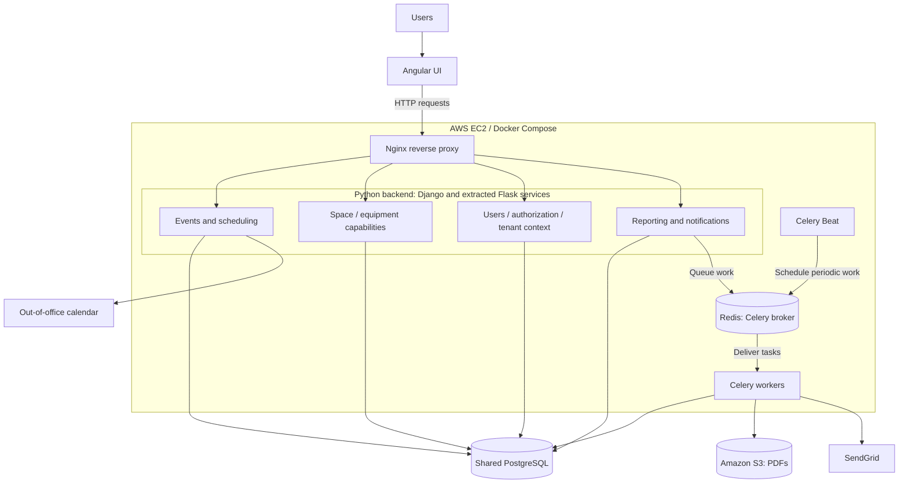
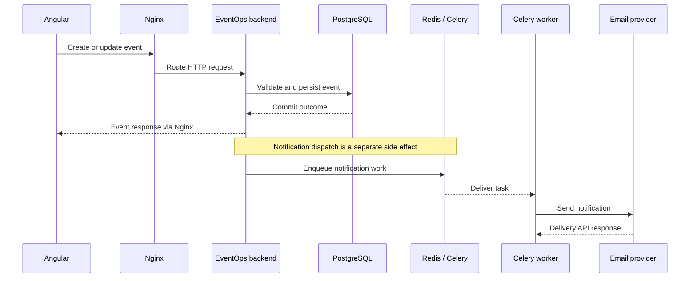
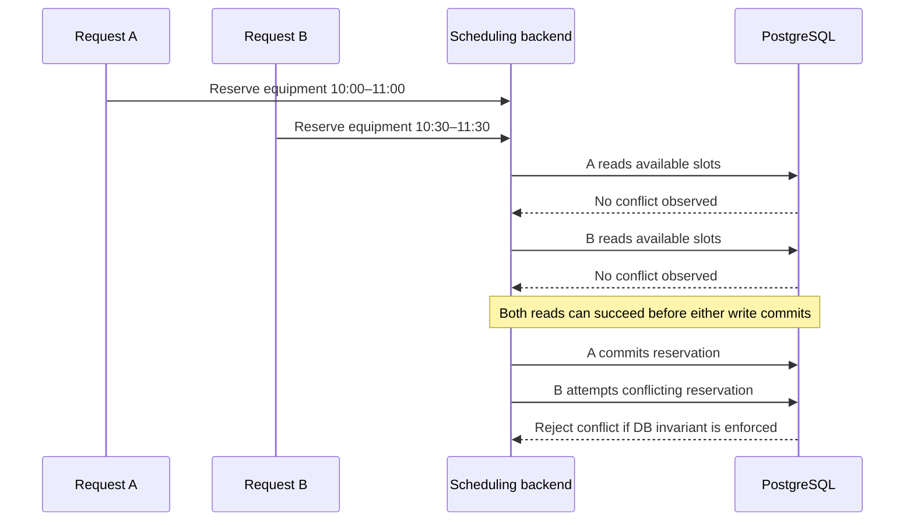
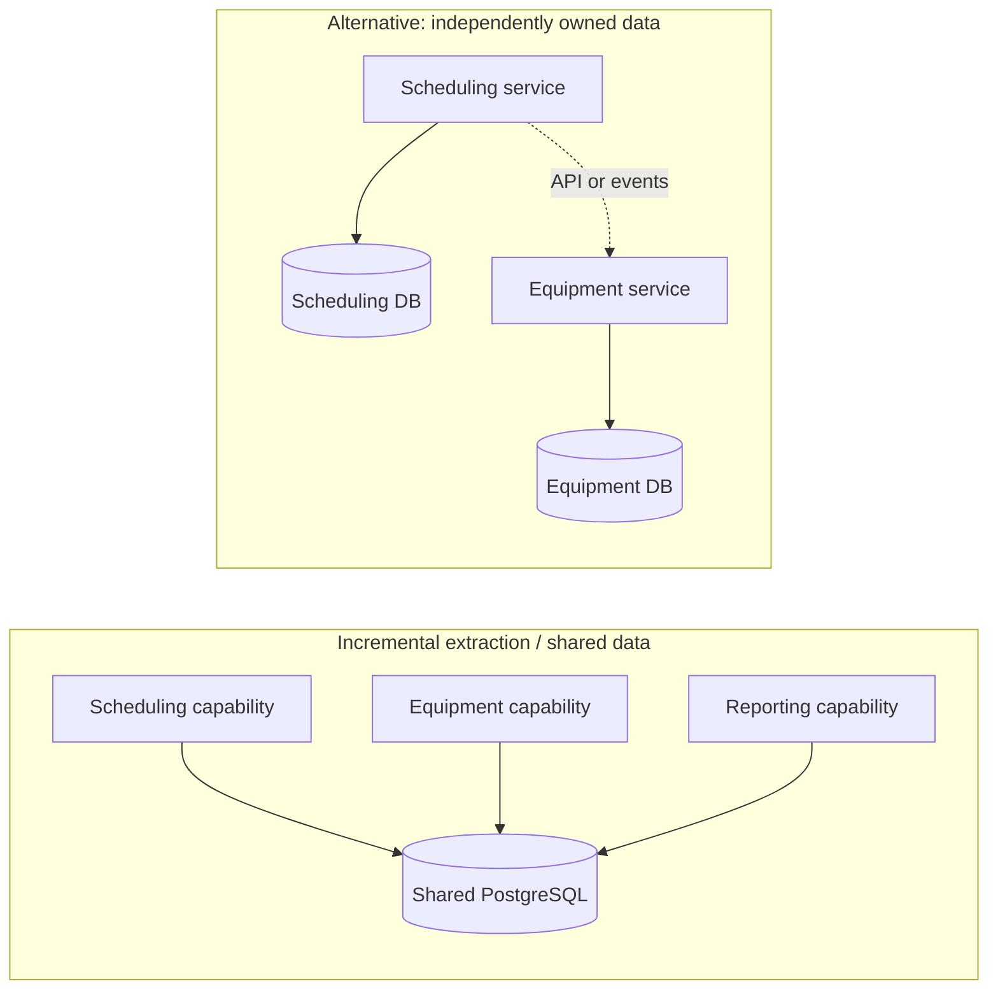

# EventOps — microservices, scale, and distributed-systems diagrams

[Project guide](Interview_Guide.md) · [Challenge scenarios](Project_Challenge_Scenarios.md) · [Interview Q&A](05_Interview_QA.md)

These diagrams separate the **project architecture** from **interview scenarios**. The system used Angular, Nginx, Django/Flask, Docker Compose on EC2, shared PostgreSQL, Celery/Redis, and external calendar/email integrations. The individual service boxes are **logical capabilities**, not a claim that every box was deployed as an independent service.

## 1. High-level architecture: what runs where?

**Explain in an interview:** Nginx routes requests to backend capabilities; it is not the application runtime. Redis carries asynchronous work, while PostgreSQL stores transactional application data. The shared database is a significant coupling point even when Python components are deployed separately. Docker Compose manages container configuration and startup; it does not guarantee application readiness or distributed high availability.

**Scale discussion:** Multiple stateless backend replicas can increase request capacity, but the database, worker throughput, external APIs, and proxy become separate bottlenecks. Scaling Celery consumers increases background concurrency, not HTTP throughput. Adding replicas requires consistent authorization and tenant handling.

## 2. Request flow versus asynchronous side effects

**Distributed-systems question:** What if the database commits but enqueue fails? The event exists but notification may be missing. Discuss an outbox as a hardening option. What if the email succeeds but the worker crashes before acknowledging? A retry may send twice; use a stable notification identity and delivery-state checks.

## 3. Concurrent resource reservation: read-check-write race

**Interview design:** Enforce the no-overlap invariant at the authoritative database boundary, e.g. PostgreSQL exclusion constraints for suitable interval schemas or a serialized resource-row lock plus check. Ordinary application-level availability checks alone do not prevent races.

**Follow-ups:** Multi-resource bookings, deadlocks and lock order, retry after timeout, transaction isolation, calendar staleness, tenant scoping.

## 4. Shared database versus service-owned databases

**Trade-off:** Shared data simplifies cross-feature queries and incremental migration but couples schema changes and can undermine service ownership. Database-per-service improves autonomy but requires explicit consistency, contract, and reporting designs. A modular monolith can also be a valid intermediate choice.

## 5. Failure and scaling drills

| Interviewer asks | What to explain |
|---|---|
| Nginx returns 502 | Route, upstream container address, process health, timeout, and logs |
| One service is slow | Trace downstream calls and database query time; bound timeouts |
| Database connection pool is exhausted | Replica count × per-instance connections; pooling and backpressure |
| Celery queue grows | Arrival rate versus worker service rate, task duration, retries, and worker concurrency |
| Two Beat schedulers run | Duplicate scheduling risk and idempotent task processing |
| Tenant data leaks across services | Consistent tenant context, authorization at each boundary, and cross-tenant tests |
| One service deploys before a schema migration | Expand/contract schema compatibility |
| Calendar API is down | Separate unknown availability from confirmed free slots; define fallback |
