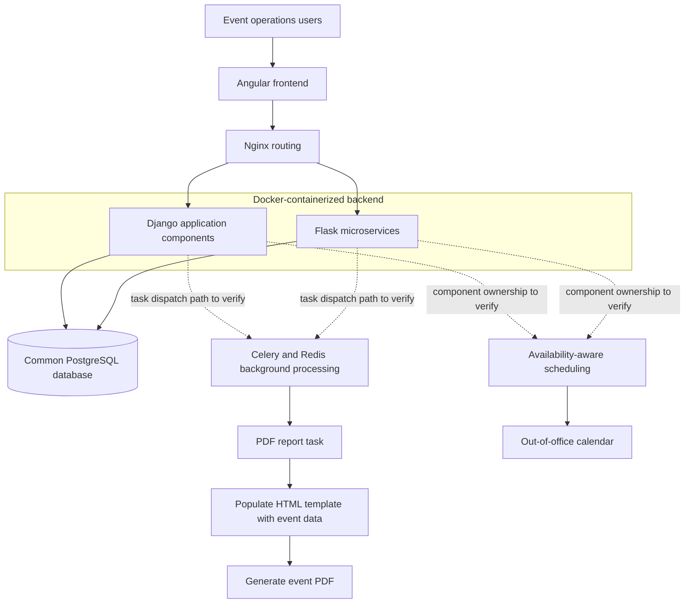
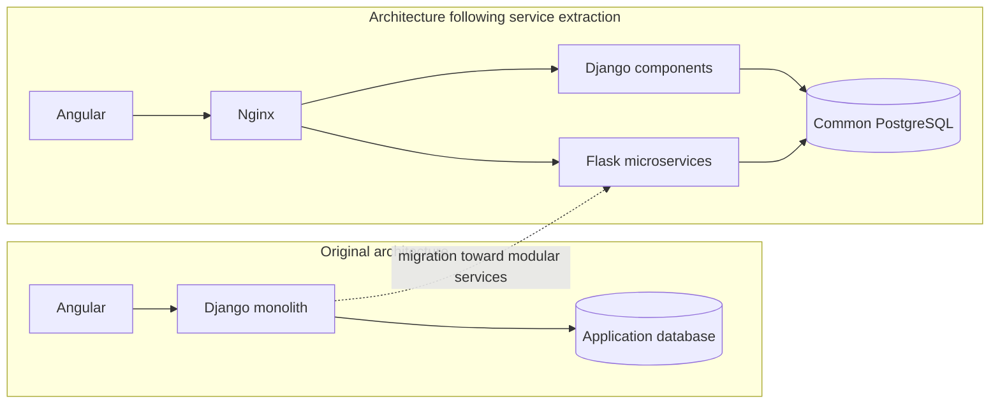
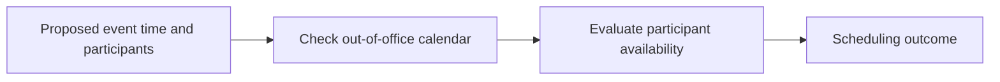

# EventOps: architecture, implementation, and contributions

**InApp | September 2019-November 2021 | Merin Rose Tom**

## 1. Project architecture

EventOps evolved from a Django monolith toward Flask-based microservices. Angular provided the frontend, Nginx routed backend traffic, Docker packaged backend services, and a common PostgreSQL database stored application data. Celery and Redis supported background processing; detailed PDF generation ran as a Celery task.



**Diagram scope:** the technologies, shared database, calendar-based availability checks, and PDF pipeline are confirmed from Merin's recollection. Dotted connections identify unresolved component ownership or dispatch paths. Exact service names and retained Django functionality are not recovered. Redis's broker/result-backend role remains unspecified.

### Architecture evolution



The migration changed application boundaries while retaining a common database. This enabled a more modular backend but preserved database coupling: schema changes and competing writes could still affect multiple services. Separate services did not imply a separate database per service.

Tenant isolation was probably implemented through separate PostgreSQL schemas within the common database. This remains a tentative recollection. Customer isolation and service ownership are separate concerns: tenant schemas would separate customers, while services could still share the same customer's data.

## 2. Technology stack

| Layer | Technology | Role |
|---|---|---|
| Frontend | Angular, JavaScript | Event-management screens, visualizations, authentication-related UI, user interactions |
| Original backend | Python, Django | Original monolithic application and backend functionality |
| Extracted backend services | Python, Flask | Microservices introduced during the migration |
| Persistence | PostgreSQL | Common database used by backend services |
| Background execution | Celery | Asynchronous work, including PDF report generation |
| Background infrastructure | Redis | Used with Celery; exact broker/result-backend configuration not recalled |
| Containers | Docker | Consistent packaging and runtime for backend services |
| Traffic routing | Nginx | Routing requests to backend components |
| Unit testing | pytest, mocking | Isolated tests and improved important-area coverage |
| Reporting template | HTML populated with event contents | Reusable report structure separated from event-specific data |
| PDF walkthrough | WeasyPrint | Concrete implementation example based on Merin's personal use; historical EventOps renderer unverified |

The hosting provider, scheduler implementation, email provider, authentication mechanism, framework versions, and CI/CD configuration remain unspecified. Celery use alone does not identify Celery Beat, and Docker use alone does not identify a container orchestrator.

## 3. Product purpose and scope

EventOps managed organizational event operations involving spaces, equipment, people, budgeting, and reporting. It combined event planning with workflow automation, reducing repeated coordination and manual follow-up.

| Capability | Purpose |
|---|---|
| Event and resource management | Organize event information and associated space/equipment requirements |
| Participant scheduling | Check availability using an out-of-office calendar |
| Conditional task generation | Create work when relevant business conditions are met |
| Automated email | Communicate workflow updates and required actions |
| Role-based access control | Regulate operations for different user types |
| PDF reporting | Produce detailed event documents from populated HTML templates |
| Frontend dashboards/components | Present information and support user interactions |

Merin worked on the project across trainee and software-engineer roles at InApp. The latest confirmed project dates are **September 2019-November 2021**. The older portfolio excerpt displays July 2019-June 2020; this guide uses the direct correction.

The [official EventOPS website](https://eventops.com/) supplies current product context. Historical implementation details in this guide come from Merin and the supplied career materials.

## 4. Backend migration: Django monolith to Flask services

Merin was a main contributor to converting the original Django application toward Flask-based microservices. Docker supported service packaging and Nginx provided routing. The documented goals were modular development and scalability; the precise original bottleneck and individual extracted service names remain to be recalled.

### Application boundaries and contracts

A monolith can call internal modules directly and coordinate work inside one application. Extracted services introduce explicit interfaces and network boundaries. Request data, response formats, validation, authorization, and error behavior become part of the contract between the frontend and backend components.

Django and Flask are frameworks rather than architecture categories. Flask supports lightweight service construction, but is not inherently more scalable than Django. The architectural change was the separation of capabilities and routing, not simply a framework substitution.

### Common database and coordination

The backend services used a common PostgreSQL database. Exact shared tables and write ownership remain unknown. A common database simplifies access to existing data during extraction but couples services through schema and transaction behavior. Two separate requests using the same database are not automatically one atomic transaction.

### Packaging and routing

Docker packaged service code with its runtime dependencies. Nginx routed incoming requests to backend components. Authentication and permission checks still belonged in the application or an explicitly configured identity layer; routing alone did not establish user authorization.

### Migration mechanics: reference explanation

A gradual extraction can preserve existing behavior while moving a bounded capability to a separate service: characterize the existing workflow, define its contract, implement the service, verify behavior and permissions, and change the relevant route. This is a reference migration method; the exact EventOps extraction order and rollout strategy have not been established. Routing rollback also requires database compatibility to be effective.

## 5. Event scheduling and participant availability

Event scheduling used an **out-of-office calendar** to check participant availability. This establishes absence-based availability checking, rather than necessarily a complete meeting-calendar free/busy integration. The calendar provider, internal/external integration, and representation of availability remain unverified.



The confirmed workflow checked availability. Whether it searched for alternative slots or validated a selected slot is not yet known.

### Interval overlap: reference algorithm

For half-open intervals `[start, end)`, a calendar interval overlaps a proposed event when:

```text
calendar_start < event_end AND calendar_end > event_start
```

For example, an absence from 10:00 to 12:00 conflicts with an event from 11:00 to 11:30, while an event beginning at 12:00 is adjacent under this convention. All-day absences and time zones require explicit interpretation. This algorithm is a reference explanation, not recovered EventOps code.

### Concurrent scheduling

An availability query followed by an unprotected save can race with another request. A reference booking design serializes conflicting decisions and rechecks relevant constraints inside the protected operation. A unique start-time constraint alone cannot prevent arbitrary interval overlap. The actual EventOps concurrency mechanism remains unknown.

## 6. Conditional workflows and email notifications

EventOps included rule-based triggers, conditional task generation, and automated email notifications. Merin contributed to these automation capabilities and access controls.

| Workflow element | Responsibility | Illustrative example |
|---|---|---|
| Trigger | Identify a business occurrence | Event enters an approved state |
| Condition | Determine whether action is applicable | A planner has been assigned |
| Action | Perform business work | Create an assigned follow-up task |
| Notification | Communicate the result | Email the responsible person |

The example illustrates the model; it is not a recalled EventOps rule. The real rule format, configuration mechanism, recipients, and provider remain unspecified.

Business state changes, task generation, and email delivery have different failure boundaries. An email failure need not undo an already-created business task. Retrying notification delivery should not recreate business work unintentionally.

### Transaction and delivery reliability: reference design

For Django code, dispatching through `transaction.on_commit()` can prevent a worker from observing a change that subsequently rolls back. It does not eliminate the crash window between commit and publication. A transactional outbox is one stronger approach to durable dispatch, but is not a confirmed EventOps feature. See [Django transactions](https://docs.djangoproject.com/en/5.2/topics/db/transactions/).

Repeated execution requires an identity for each logical action occurrence and safe state transitions. Exactly-once external email delivery cannot be inferred from a local completion flag: a provider may accept an email before the worker records success. The historical retry/deduplication mechanisms remain unknown.

## 7. Background processing with Celery and Redis

Celery and Redis supported background processing. PDF generation is a confirmed Celery workload. The assignment of email work to Celery, Redis's exact role, retry settings, and acknowledgment settings have not been recalled.

Background execution separates request handling from slower work. It introduces queue waiting time, worker execution time, and a later success/failure outcome. Celery relocates work; it does not make the PDF renderer intrinsically faster.

Scheduling and execution are different responsibilities. A scheduler decides when work becomes due; Celery workers execute tasks. A broker carries tasks, while a result backend can store task outcomes. The actual EventOps configuration of these responsibilities remains unspecified. See the [Celery task guide](https://docs.celeryq.dev/en/stable/userguide/tasks.html).

## 8. Detailed event PDF reporting

Merin worked on PDF reports containing extensive event details. Generation ran as a **Celery task**. Event contents were added by formatting/populating an **HTML template**, and the populated HTML was converted to PDF.


The template separated stable report structure from variable event content. Stable structure can include headings, tables, branding, and print styles. Variable content contains the selected event's fields and detail rows. Exact historical report fields, template formatting API, file storage, and delivery path remain unverified.

### WeasyPrint implementation walkthrough

WeasyPrint is the chosen implementation example because Merin uses it personally. The historical EventOps renderer remains unverified; the earlier pdfkit recollection was tentative.

In this reference implementation, scoped event data becomes a presentation context, a template engine produces HTML, and WeasyPrint converts that HTML into PDF bytes. A controlled base URL resolves relative stylesheets, fonts, and images.

```python
from weasyprint import HTML


def render_event_pdf(rendered_html, asset_base_url):
    return HTML(
        string=rendered_html,
        base_url=asset_base_url,
    ).write_pdf()
```

This is the rendering step, not a complete Celery task. With no output target, `write_pdf()` returns PDF bytes. Django templates or Jinja are possible template engines; the historical choice is unknown. The [WeasyPrint documentation](https://doc.courtbouillon.org/weasyprint/latest/first_steps.html) describes the API and setup.

### Template formatting and layout

Formatting an HTML template does not establish use of Python `str.format()` or f-strings. A template engine can provide repetition, conditionals, and escaping. For a reference implementation, ordinary event text should be escaped appropriately rather than inserted as trusted HTML.

Print styles govern page size, margins, table layout, and pagination. Long tables, missing fonts, image paths, and page breaks are material report-quality concerns. Worker images must include the renderer's version-appropriate dependencies and fonts. Resource fetching and rendering limits matter when inputs or URLs are untrusted. See [WeasyPrint web application considerations](https://doc.courtbouillon.org/weasyprint/stable/common_use_cases.html).

### Report consistency and performance

A report assembled through several queries can combine data from different moments unless the application defines a snapshot strategy. Generation access and later download access are also separate authorization boundaries. These are design considerations; the historical implementation is not yet established.

There is no EventOps benchmark proving a renderer fastest or most memory efficient. WeasyPrint suits HTML/CSS template workflows; ReportLab is an alternative for directly programmed document layout. Representative report size, images, fonts, latency, peak memory, and worker concurrency determine efficiency.

## 9. Persistence, tenant isolation, and access control

### Shared PostgreSQL database

The common database served the backend services. This describes the database boundary, not the exact table ownership or migration process. A service extraction can retain shared data while introducing application-level interfaces, with the tradeoff that schema compatibility still affects several components.

### Tentative schema-per-tenant model

Merin recalls schema-level tenant separation but is uncertain. If confirmed, the conceptual structure would be:

```text
Common PostgreSQL database
  |-- Tenant A schema: customer-owned tables
  |-- Tenant B schema: customer-owned tables
  |-- Other tenant schemas
```

This is a tentative model, not a recovered schema listing. Schema-per-tenant implementations need controlled tenant selection, context restoration on reused connections, and equivalent context handling in background jobs. Celery does not automatically preserve Django request context. Separate schemas also do not prove database-enforced isolation if one role can access every schema.

### Role-based access control

Merin worked on RBAC to regulate permissions for different user types. The exact role names, permission storage, authentication mechanism, and enforcement locations remain unspecified.

The general authorization sequence is identity, verified tenant membership, permission for the operation, and access to the particular object. UI controls reflect permissions; backend checks enforce them. Reports, exports, related-object access, and background work need the same scope discipline as primary APIs.

## 10. Conceptual data model

The following entities explain the domain. They are reference names, not recovered production tables.

| Entity | Purpose | Relationship |
|---|---|---|
| Tenant / organization | Customer boundary | Contains customer-scoped event data |
| User membership | User's organization and permissions | Connects users to an authorized scope |
| Event | Main event details and lifecycle | Associated with participants and operational requirements |
| Availability entry | Out-of-office interval or availability information | Used for participant scheduling checks |
| Task | Assigned work | Associated with an event and responsible user |
| Automation rule | Trigger, condition, action | Determines conditional workflow behavior |
| Report request / execution | PDF-generation work and outcome | Reference entity for background reporting; persistence unverified |

Query patterns determine useful indexes. Examples include event lists by status/date, participant availability over a time range, and due work by state/time. Actual indexes and query plans have not been supplied.

## 11. My contributions

### Backend modernization

I was a main contributor to moving the original Django monolith toward Flask-based microservices, using Docker for services and Nginx for routing. The confirmed contribution concerns migration and modularization; exact extracted capabilities and rollout responsibilities remain to be documented.

### Scheduling and workflow automation

I worked on scheduling that checked participant availability from an out-of-office calendar, automated email notifications, and rule-based workflows. These capabilities reduced repeated coordination and supported more consistent event operations.

### Detailed event reports

I worked on PDF generation executed through Celery. Reports used an HTML template populated with event contents before conversion to PDF. WeasyPrint provides the concrete technical walkthrough in this guide based on my personal use.

### Testing framework improvements

Initial unit test coverage was approximately 40%. I developed and improved the pytest-based unit testing framework, expanded coverage over important areas, and used mocking to isolate dependencies. Coverage reached 70%, a **30 percentage-point increase**.

### Frontend and access control

The portfolio records Angular components supporting visualizations, authentication-related interactions, and user workflows, alongside role-based access improvements. Specific screens and role definitions remain unspecified.

## 12. Testing approach and results

The confirmed testing work used pytest and mocking; the portfolio also identifies Django multi-tenancy testing. Coverage improved from 40% to 70%. The exact measured code scope and whether the metric was line or branch coverage remain unknown.

Mocking isolates dependencies so business behavior can be exercised without every external component. For example, a reference notification unit test can replace an email adapter, execute a qualifying condition, and assert the intended action. A nonqualifying condition should make no delivery call. These are illustrative cases, not a claim that particular tests were written.

| Test area | Representative coverage |
|---|---|
| Workflow conditions | Matching/nonmatching condition, disabled rule, unrelated update |
| Scheduling | Absence overlap, boundary times, rescheduling, invalid duration |
| Permissions | Authorized operation, denied operation, object-level restriction |
| Tenancy | Customer isolation and context cleanup |
| PDF reporting | Template population, missing optional fields, rendering failure |
| Background work | Failure handling, duplicate execution, cancelled/stale work |

The table is a proposed coverage map; individual cases require confirmation. Unit tests, database/request integration tests, worker integration, and browser tests provide different evidence. Mocked unit tests alone do not establish real queue delivery or browser behavior. See [Django testing tools](https://docs.djangoproject.com/en/5.2/topics/testing/tools/).

## 13. Outcomes and engineering tradeoffs

| Outcome | Evidence and interpretation |
|---|---|
| Test coverage: 40% to 70% | Directly confirmed; +30 percentage points, equivalent to 75% relative growth |
| Approximately 20% operational/manual-effort improvement | Career materials; baseline and measurement method remain unspecified |
| Approximately 15% efficiency improvement | Portfolio performance/debugging claim; metric definition remains unspecified |
| CEO appreciation | Documented recognition for EventOps contribution |

The most concrete numerical result is the coverage baseline and final value. The approximate efficiency figures should not be interpreted as API latency, throughput, or cloud-cost improvements without supporting measurement.

| Design choice | Benefit | Cost or constraint |
|---|---|---|
| Flask service extraction | More modular application boundaries | Network contracts and distributed debugging |
| Common database | Continued access to existing application data | Shared schema/write coupling |
| Celery background work | Moves suitable slow work outside request execution | Queue delay, retries, delayed outcomes |
| HTML report templates | Separates content from reusable presentation | Rendering dependencies and pagination complexity |
| Mocked unit tests | Fast isolated behavior checks | Requires integration tests for real wiring |
| Schema-per-tenant, if confirmed | Customer namespace separation | Migration and connection-context complexity |

Operational diagnosis separates request latency, queue waiting time, task duration, and downstream errors. Useful reference signals include task failure rate, oldest waiting-task age, overdue scheduled work, rendering duration, and report memory consumption. Historical EventOps monitoring details are not yet known.

## 14. Implementation notes and sources

Confirmed details and clearly labeled reference explanations are kept separate. Remaining unknowns are the service list, table/write ownership, tenancy package/context selection, calendar integration, scheduler, historical renderer/template engine, email provider, hosting, authentication, rollout, and exact coverage scope. No private EventOps source code has been inspected.

The 16 GB CSV pipeline, shared LRU cache, piracy analytics, and Oracle/OCI work are not attributed to EventOps without evidence.

Sources:

- Merin's direct clarifications: corrected dates, stack, common database, tentative schema tenancy, migration contribution, out-of-office scheduling, Celery PDF tasks, populated HTML templates, personal WeasyPrint use, pytest/mocking, and 40%-70% coverage.
- [Resume](/Users/merin/workspace/printMyCV/MerinRoseTomSSE7_N.pdf) and [LinkedIn export](/Users/merin/Downloads/LinkedinProfile.pdf): role history, EventOps capabilities, recognition, and career statements.
- Supplied [portfolio](https://merinrose123.github.io/merin-rose-tom/) excerpt: product scope, architecture, frontend, testing, workflows, RBAC, and approximate outcomes. Direct website retrieval was unavailable; the supplied text was used.
- [Official EventOPS website](https://eventops.com/): public product context, accessed 28 October 2026.
- Framework documentation linked within the relevant technical sections supports reference explanations; it does not establish historical versions or implementation.

## 15. Interview preparation

The project description above is followed here by short introductions and interview-specific questions. Design answers describe possible approaches where historical details remain unknown.


### 30-second introduction

> I worked on EventOps at InApp from September 2019 to November 2021. It managed organizational event operations such as people, spaces, equipment, budgets, and reporting. I was a main contributor to migrating its Django monolith toward Flask-based microservices using Docker and Nginx. I also worked on availability-aware scheduling, email notifications, detailed PDF reports, and pytest-based testing, increasing coverage from 40% to 70%.

### Two-minute introduction

> EventOps was an event-management system I worked on across my trainee and software-engineer roles at InApp. It supported event operations including spaces, equipment, people, budgets, and reporting, with conditional workflows and role-based access.
>
> It originally used a Django monolith. I was a main contributor to moving toward Flask-based microservices. Our stack included Angular on the frontend, Python with Django and Flask on the backend, PostgreSQL for persistence, Celery and Redis for background processing, and Docker with Nginx for containerized services and routing.
>
> My feature work included email notifications, scheduling that considered participant availability, and PDF reports containing extensive event details. Another concrete contribution was improving the pytest-based unit testing framework. Coverage had been limited at about 40%; I expanded important-area coverage, using techniques such as mocking, and brought it to 70%, an increase of 30 percentage points. The project also earned me CEO appreciation.
>
> For a deeper technical discussion, I can explain the migration, how an event workflow connected to background processing, or how I made the application more testable.

### Interview questions and answers


#### 1. What was EventOps, and what did you do?

**Answer:** I worked on EventOps at InApp from September 2019 to November 2021. It managed organizational event operations including people, spaces, equipment, budgets, and reporting. I was a main contributor to migrating the Django monolith toward Flask microservices, and worked on email notifications, availability-aware scheduling, detailed PDF reports, and testing. My pytest improvements increased coverage from 40% to 70%.

#### 2. Explain the architecture end to end.

**Answer:** The frontend was Angular. The backend began as a Django monolith and evolved toward Flask microservices, packaged with Docker and routed through Nginx. PostgreSQL stored application data, and Celery with Redis supported background processing. I would then map one actual route and task. The services used a common PostgreSQL database, and PDF generation ran as a Celery task. Tenant isolation was probably schema based according to my recollection; exact service/table ownership and context handling need confirmation.

#### 3. What was your technology stack?

**Answer:** Python, Django and Flask for the backend; Angular and JavaScript for the frontend; PostgreSQL for persistence; Celery and Redis for background processing; Docker for containerization; Nginx for routing; and pytest for testing. I should explain each tool through the feature or migration work I personally handled.

#### 4. Why perform work asynchronously?

**Answer:** We used Celery and Redis for background processing. PDF report generation ran as a Celery task, moving that work out of the synchronous execution path. Email task assignments still need confirmation. Asynchronous work keeps suitable long-running operations out of the request path, but requires explicit failure handling and visibility.

#### 5. How does a rule-based trigger work?

**Answer:** A trigger identifies a business occurrence, conditions decide whether it qualifies, and an action specifies the resulting work. A useful walkthrough names the original event, relevant old/new values, rule scope, and action. Whether EventOps represented these as configurable data or explicit code needs confirmation.

#### 6. How would you avoid duplicate actions?

**Design answer:** Define the identity of one logical occurrence, enforce uniqueness when recording execution, and make internal state changes safe to repeat. Include the occurrence or schedule version so later legitimate reminders are not suppressed. External email delivery still has an ambiguity window unless the provider supports suitable deduplication. I should separately describe what EventOps actually implemented.

#### 7. What if the database update succeeds but job publication fails?

**Design answer:** Dispatch after commit avoids jobs observing rolled-back state, but does not eliminate the commit-to-publication gap. A durable outbox written in the same transaction and retried by a dispatcher is one approach. I would not claim EventOps had an outbox without evidence. [Django transaction reference](https://docs.djangoproject.com/en/5.2/topics/db/transactions/).

#### 8. How did you implement RBAC?

**Answer:** RBAC is an explicit EventOps contribution. A complete personal answer needs the real roles, permission storage, enforcement point, and one allowed/denied example. The essential design principle is backend enforcement for the operation and object, in the correct tenant context; UI visibility is only a presentation concern.

#### 9. How did you prevent cross-tenant access?

**Answer:** We used a common PostgreSQL database, and my recollection is that tenants were separated by schema, although I need to confirm that detail. Under that model, the correct schema must be selected for both requests and background tasks, with context reset on reused connections. I should explain the actual library and a real isolation test before claiming those implementation mechanisms.

#### 10. What happens when an event is rescheduled or cancelled?

**Design answer:** Execution should check the current event state and schedule identity before acting. A reschedule can invalidate an older occurrence and create a new one; cancellation should suppress obsolete work. The scheduler and worker need compatible behavior even if old jobs remain queued. EventOps' actual mechanism is pending confirmation.

#### 11. How would you handle email failures?

**Design answer:** Classify transient and permanent failures, use timeouts and bounded retry delays, record attempts, and make exhausted failures visible. An accepted API request does not prove inbox delivery. Handle uncertain acceptance separately because retries may duplicate mail. Identify the real provider and behavior before making this a project claim.

#### 12. Did EventOps use Celery and Redis?

**Answer:** Yes. We used Celery and Redis for background processing. Celery is the task-processing framework; Redis can serve roles such as broker or result backend, and I need to identify its actual configuration in our system. Retry and acknowledgment choices determine failure behavior; naming the tools alone does not establish those guarantees. [Celery task reference](https://docs.celeryq.dev/en/stable/userguide/tasks.html).

#### 13. What did you improve in testing?

**Answer:** Initial coverage was around 40%. I developed and improved the pytest-based unit testing framework, expanded tests over important areas, and used mocking to isolate dependencies. Coverage reached 70%, a 30 percentage-point increase. I would substantiate this with one real tested module, the dependency mocked, and the edge case asserted. The portfolio also records Django multi-tenancy testing.

#### 14. What tests would you prioritize for automation?

**Design answer:** Conditions that should and should not fire; permission and tenant denial; cancelled or rescheduled work; duplicate execution; provider failures; and transaction rollback. Test the business logic in isolation, then verify request/worker behavior through appropriate integration tests. Browser tests cover UI behavior that a backend client cannot. [Django testing reference](https://docs.djangoproject.com/en/5.2/topics/testing/tools/).

#### 15. How was the 20% improvement measured?

**Answer:** The resume reports a 20% reduction in manual event-management effort. I need to identify the baseline, comparison workflow, and whether this was measured or estimated. Until then, I can explain which manual steps automation removed, but should not invent a measurement study.

#### 16. Was this a microservices architecture?

**Answer:** Yes. It started as a Django monolith, and I was a main contributor to migrating toward Flask-based microservices using Docker and Nginx routing. I should identify actual extracted services and their data/API contracts to explain the architecture. Separate containers by themselves do not establish independent service ownership.

#### 17. What was your hardest technical challenge?

**Answer framework:** The monolith-to-microservices migration is a confirmed engineering challenge I contributed to. I can structure the answer around an extracted capability, existing dependencies, API/data compatibility, my implementation changes, and verification. I still need a specific remembered obstacle or defect; I should not invent a production incident.

#### 18. How would you scale the application?

**Design answer:** First measure whether requests, database queries, queue delay, execution time, or provider limits are the bottleneck. Improve query shape and indexes where needed, separate suitable background workloads, and increase concurrency within downstream limits. Tenant fairness matters if one customer's work can consume the entire queue. This is a design discussion, not a claim about changes I delivered.

#### 19. What would you improve today?

**Design answer:** I would assess existing gaps before proposing changes. Candidate improvements include clearer execution history, stronger duplicate suppression, safer dispatch, tenant-isolation regression tests, and visibility into overdue work. I would prioritize the observed failure or support burden and avoid claiming those capabilities were absent without evidence.

#### 20. How do you separate your contribution from the team's?

**Answer:** My confirmed work includes a major contribution to the Django-to-Flask microservices migration, email notifications, participant-availability-aware scheduling, detailed PDF reports, and pytest framework improvements using mocking. I can quantify testing as 40% to 70% coverage. I would name the exact module and change I owned, and distinguish shared architecture decisions from my implementation.

#### 21. Why migrate from Django to Flask?

**Answer:** I contributed to moving a Django monolith toward Flask microservices for a more modular backend; scalability and modular development are documented goals. Flask suited the chosen service approach, but it is not inherently more scalable than Django. A strong answer needs the actual business capability extracted and the original maintenance or delivery problem. Django can also power microservices, and Flask can also be used in a monolith.

#### 22. What did Docker and Nginx contribute?

**Answer:** Docker packaged backend services into consistent runtime units, while Nginx routed incoming requests to the appropriate backend. I should support this with a real service and route from the migration. Neither Docker nor Nginx automatically provides service ownership, correct authorization, database isolation, or high availability.

#### 23. How did participant availability affect scheduling?

**Answer:** Our scheduling feature checked participant availability from an out-of-office calendar. I need to recall the calendar integration and whether we searched for slots or validated a selected slot. An out-of-office check alone does not establish absence of other meetings. For a conceptual overlap check, two half-open intervals overlap if each starts before the other ends. Concurrent scheduling requires protection beyond a pre-save availability query; the mechanism we used remains to be recalled.

#### 24. How did PDF generation work?

**Answer:** I worked on PDF reports containing extensive event details. A complete walkthrough should identify the requested event, authorization, data assembly, PDF library, and how users received the file. PDF generation ran as a Celery task. We populated an HTML template with event contents and converted it to PDF. I use WeasyPrint personally and can explain its implementation, but the historical EventOps renderer is not verified. I should not attach the separate 16 GB CSV pipeline to this story without evidence.

#### 25. What does 40% to 70% coverage mean?

**Answer:** It is an increase of 30 percentage points, or 75% relative to the original coverage. In interviews I would say “from 40% to 70%” to avoid ambiguity. I improved the pytest framework, used mocking, and expanded important-area tests. I should also explain the measured scope and one meaningful regression case, because coverage alone does not establish correctness.

#### 26. How did you manage transactions after splitting services?

**Answer:** The backend services used a common PostgreSQL database, so I should discuss the actual table/write ownership and migration coupling. A common database does not automatically make writes from separate service requests one atomic transaction. I need to recall the real transaction boundaries. Outbox patterns or compensation are possible designs, not confirmed EventOps features.
