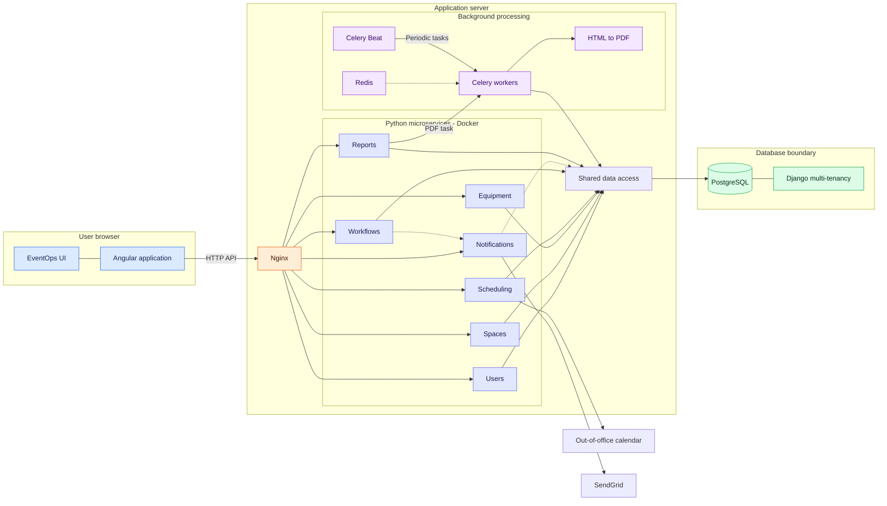
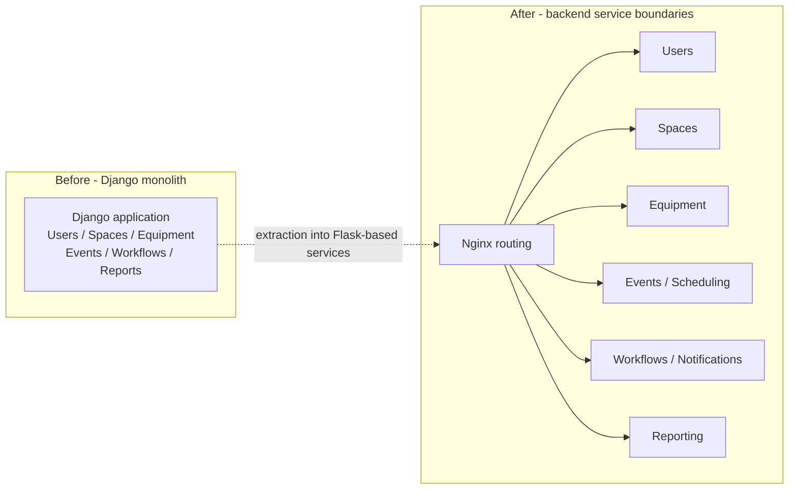
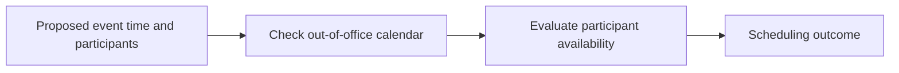

# EventOps: project architecture, implementation, and contributions

**InApp | September 2019-November 2021 | Merin Rose Tom**

[Interview questions and answers](Interview_Questions_and_Answers.md)

## 1. Project architecture

EventOps managed events together with the users, spaces, and equipment needed to run them. Users could modify availability, schedule events, receive email notifications, and generate detailed PDF reports. The application evolved from a Django monolith toward Flask-based microservices, with Angular in the browser, Nginx routing on the backend, Docker-packaged services, and a common PostgreSQL database.

### System architecture



**Reading the diagram:** the browser contains Angular; the server contains Nginx, backend services, and background processing; PostgreSQL is shown as a separate database boundary. The server box groups backend responsibilities and does not assert that every component ran on one physical machine. The data-access box summarizes service-to-database connections; it is not an additional deployed service.

**Reconstruction scope:** user, space, equipment, availability, scheduling, email, and reporting capabilities are confirmed. They are shown as functional microservice boundaries to explain the architecture requested here. Their exact original deployment names, one-container-per-service mapping, and split between Django and Flask remain unverified. Workflow and notification connections shown with dotted lines are illustrative. SendGrid email delivery, Django multi-tenancy, and Celery Beat periodic scheduling are confirmed. Redis's exact role and schema-level isolation remain uncertain. The calendar provider is unspecified.

### Service responsibilities and routing

The route prefixes below illustrate Nginx routing; they are not recovered production URLs.

| Service | Responsibility | Availability / data handled | Illustrative route |
|---|---|---|---|
| User management | Maintain users and role-related operations | User details and user availability modifications | `/api/users/` |
| Space management | Maintain event spaces and their availability | Space details and availability modifications | `/api/spaces/` |
| Equipment management | Maintain event equipment and its availability | Equipment details and availability modifications | `/api/equipment/` |
| Event and scheduling | Manage event scheduling and relevant resource allocation | Event timing, participants, space/equipment requirements; out-of-office checks | `/api/events/`, `/api/scheduling/` |
| Workflow | Apply conditions and generate follow-up tasks | Triggers, conditions, task assignments | `/api/workflows/` |
| Notifications | Prepare and send event-related email | Recipient and notification content; persistence unspecified | `/api/notifications/` |
| Reporting | Accept event report requests and dispatch PDF work | Event report inputs and HTML-template content | `/api/reports/` |

Availability modifications belong with the entity being managed: user availability with users, space availability with spaces, and equipment availability with equipment. Scheduling consumes the relevant availability information. The historical mechanism for obtaining resource availability across service boundaries is not yet recalled; the shared database does not establish whether scheduling queried tables directly or called service APIs.

### Request and background execution paths

A space-availability update starts in Angular, reaches Nginx, and is routed to the space capability. The backend validates the request and permissions, updates the relevant PostgreSQL data, and returns the result to the browser. This is a reconstructed request path using the confirmed technology stack; actual endpoints and permission middleware remain unspecified. Equipment and user availability follow the same responsibility model.

Scheduling combines the proposed event timing and relevant availability data. Participant availability came from an out-of-office calendar. Space and equipment availability were also managed, but the exact rules for combining all three availability sources in one scheduling decision remain to be recalled.

Reporting uses a different execution path: the reporting capability dispatches PDF generation as a Celery task; the task populates an HTML template with event contents and renders the PDF. The generation mechanism is confirmed, while job-status tracking, file storage, and download delivery remain unspecified.

### Evolution from the original monolith



The migration changed application boundaries while retaining a common database. This supported modular development but preserved database coupling: schema changes and competing writes could still affect multiple services. The capability grouping above is a reconstruction, not a verified extraction sequence.

Tenant isolation was probably implemented through separate PostgreSQL schemas within the common database. Customer isolation and service ownership are separate concerns: tenant schemas would separate customers, while services could still share the same customer's data.

## 2. Technology stack

| Layer | Technology | Role |
|---|---|---|
| Frontend | Angular, JavaScript | Event-management screens, visualizations, authentication-related UI, user interactions |
| Original backend | Python, Django | Original monolithic application and backend functionality |
| Extracted backend services | Python, Flask | Microservices introduced during the migration |
| Persistence | PostgreSQL | Common database used by backend services |
| Background execution | Celery | Asynchronous work, including PDF report generation |
| Periodic scheduling | Celery Beat | Dispatch periodic tasks for execution by Celery workers |
| Email delivery | SendGrid | Send automated email notifications |
| Tenant architecture | Django multi-tenancy | Multi-tenant application; exact package and schema mechanism unverified |
| Background infrastructure | Redis | Used with Celery; exact broker/result-backend configuration not recalled |
| Containers | Docker | Consistent packaging and runtime for backend services |
| Traffic routing | Nginx | Routing requests to backend components |
| Unit testing | pytest, mocking | Isolated tests and improved important-area coverage |
| Reporting template | HTML populated with event contents | Reusable report structure separated from event-specific data |
| PDF walkthrough | WeasyPrint | Concrete implementation example based on Merin's personal use; historical EventOps renderer unverified |

Celery Beat handled periodic scheduling and SendGrid handled email sending. The hosting provider, authentication mechanism, framework versions, and CI/CD configuration remain unspecified. Docker use alone does not identify a container orchestrator.

## 3. Product purpose and scope

EventOps managed organizational event operations involving spaces, equipment, people, budgeting, and reporting. It combined event planning with workflow automation, reducing repeated coordination and manual follow-up.

| Capability | Purpose |
|---|---|
| User management | Maintain users and support role-based access |
| Space management | Maintain spaces and modify their availability |
| Equipment management | Maintain equipment and modify its availability |
| User availability | Modify user availability and support calendar-based scheduling checks |
| Event management | Organize event information and associated space/equipment requirements |
| Participant scheduling | Check availability using an out-of-office calendar |
| Conditional task generation | Create work when relevant business conditions are met |
| Automated email | Communicate workflow updates and required actions |
| Role-based access control | Regulate operations for different user types |
| PDF reporting | Produce detailed event documents from populated HTML templates |
| Frontend dashboards/components | Present information and support user interactions |

Merin worked on the project across trainee and software-engineer roles at InApp. The latest confirmed project dates are **September 2019-November 2021**. The older portfolio excerpt displays July 2019-June 2020; this guide uses the direct correction.

The [official EventOPS website](https://eventops.com/) supplies current product context. Historical implementation details in this guide come from Merin and the supplied career materials.

## 4. Backend migration: Django monolith to Flask services

Merin was a main contributor to converting the original Django application toward Flask-based microservices. Docker supported service packaging and Nginx mainly provided routing. The documented goals were modular development and scalability; the precise original bottleneck and individual extracted service names remain to be recalled.

### Application boundaries and contracts

A monolith can call internal modules directly and coordinate work inside one application. Extracted services introduce explicit interfaces and network boundaries. Request data, response formats, validation, authorization, and error behavior become part of the contract between the frontend and backend components.

Django and Flask are frameworks rather than architecture categories. Flask supports lightweight service construction, but is not inherently more scalable than Django. The architectural change was the separation of capabilities and routing, not simply a framework substitution.

### Common database and coordination

The backend services used a common PostgreSQL database. Exact shared tables and write ownership remain unknown. A common database simplifies access to existing data during extraction but couples services through schema and transaction behavior. Two separate requests using the same database are not automatically one atomic transaction.

### Packaging and routing

Docker packaged service code with its runtime dependencies. Nginx mainly routed incoming requests to different backend components; replica load balancing is not a confirmed EventOps use. Authentication and permission checks still belonged in the application or an explicitly configured identity layer; routing alone did not establish user authorization.

### Inter-service communication

Nginx primarily routed frontend requests to the appropriate service. Merin tentatively recalls REST calls for inter-service communication. These are different paths: a browser request reaching a service through Nginx does not establish that every internal call also passed through Nginx.

Synchronous REST lets a service obtain an immediate answer from another capability, at the cost of network latency and dependency failures. Celery supported work that could execute later, including PDF generation. The exact internal HTTP endpoints, clients, authentication propagation, tenant propagation, and timeout/retry settings remain unverified. The shared database is confirmed, but direct access by one service to another capability's tables is not established.

### Migration mechanics: reference explanation

A gradual extraction can preserve existing behavior while moving a bounded capability to a separate service: characterize the existing workflow, define its contract, implement the service, verify behavior and permissions, and change the relevant route. This is a reference migration method; the exact EventOps extraction order and rollout strategy have not been established. Routing rollback also requires database compatibility to be effective.

## 5. Event scheduling and participant availability

Event scheduling used an **out-of-office calendar** to check participant availability. This establishes absence-based availability checking, rather than necessarily a complete meeting-calendar free/busy integration. The calendar provider, internal/external integration, and representation of availability remain unverified.



The confirmed workflow checked availability. Whether it searched for alternative slots or validated a selected slot is not yet known.

### Interval overlap: reference algorithm

For half-open intervals `[start, end)`, a calendar interval overlaps a proposed event when:

```text
calendar_start < event_end AND calendar_end > event_start
```

For example, an absence from 10:00 to 12:00 conflicts with an event from 11:00 to 11:30, while an event beginning at 12:00 is adjacent under this convention. All-day absences and time zones require explicit interpretation. This algorithm is a reference explanation, not recovered EventOps code.

### Concurrent scheduling

An availability query followed by an unprotected save can race with another request. A reference booking design serializes conflicting decisions and rechecks relevant constraints inside the protected operation. A unique start-time constraint alone cannot prevent arbitrary interval overlap. The actual EventOps concurrency mechanism remains unknown.

## 6. Conditional workflows and email notifications

EventOps included rule-based triggers, conditional task generation, and automated email notifications. Merin contributed to these automation capabilities and access controls.

| Workflow element | Responsibility | Illustrative example |
|---|---|---|
| Trigger | Identify a business occurrence | Event enters an approved state |
| Condition | Determine whether action is applicable | A planner has been assigned |
| Action | Perform business work | Create an assigned follow-up task |
| Notification | Communicate the result | Email the responsible person |

The example illustrates the model; it is not a recalled EventOps rule. SendGrid sent the emails. The real rule format, configuration mechanism, recipients, and SendGrid API/SMTP integration details remain unspecified.

SendGrid provided email delivery. The notification capability prepared the message and handed it to SendGrid; whether the integration used its HTTP API or SMTP, and whether delivery webhooks were tracked, remain unspecified.

Business state changes, task generation, and email delivery have different failure boundaries. An email failure need not undo an already-created business task. Retrying notification delivery should not recreate business work unintentionally.

### Transaction and delivery reliability: reference design

For Django code, dispatching through `transaction.on_commit()` can prevent a worker from observing a change that subsequently rolls back. It does not eliminate the crash window between commit and publication. A transactional outbox is one stronger approach to durable dispatch, but is not a confirmed EventOps feature. See [Django transactions](https://docs.djangoproject.com/en/5.2/topics/db/transactions/).

Repeated execution requires an identity for each logical action occurrence and safe state transitions. Exactly-once external email delivery cannot be inferred from a local completion flag: a provider may accept an email before the worker records success. The historical retry/deduplication mechanisms remain unknown.

## 7. Background processing with Celery and Redis

Celery and Redis supported background processing, and Celery Beat scheduled periodic tasks. PDF generation is a confirmed Celery workload. The assignment of email work to Celery, Redis's exact role, retry settings, and acknowledgment settings have not been recalled.

Background execution separates request handling from slower work. It introduces queue waiting time, worker execution time, and a later success/failure outcome. Celery relocates work; it does not make the PDF renderer intrinsically faster.

Celery Beat determined when periodic work became due and dispatched it for Celery workers to execute. Beat was the scheduler; workers performed the work. A broker carries tasks, while a result backend can store task outcomes. The exact Redis role, schedule storage, and periodic task list remain unspecified. See the [Celery task guide](https://docs.celeryq.dev/en/stable/userguide/tasks.html).

## 8. Detailed event PDF reporting

Merin worked on PDF reports containing extensive event details. Generation ran as a **Celery task**. Event contents were added by formatting/populating an **HTML template**, and the populated HTML was converted to PDF.


The template separated stable report structure from variable event content. Stable structure can include headings, tables, branding, and print styles. Variable content contains the selected event's fields and detail rows. Exact historical report fields, template formatting API, file storage, and delivery path remain unverified.

### WeasyPrint implementation walkthrough

WeasyPrint is the chosen implementation example because Merin uses it personally. The historical EventOps renderer remains unverified; the earlier pdfkit recollection was tentative.

In this reference implementation, scoped event data becomes a presentation context, a template engine produces HTML, and WeasyPrint converts that HTML into PDF bytes. A controlled base URL resolves relative stylesheets, fonts, and images.

```python
from weasyprint import HTML


def render_event_pdf(rendered_html, asset_base_url):
    return HTML(
        string=rendered_html,
        base_url=asset_base_url,
    ).write_pdf()
```

This is the rendering step, not a complete Celery task. With no output target, `write_pdf()` returns PDF bytes. Django templates or Jinja are possible template engines; the historical choice is unknown. The [WeasyPrint documentation](https://doc.courtbouillon.org/weasyprint/latest/first_steps.html) describes the API and setup.

### Template formatting and layout

Formatting an HTML template does not establish use of Python `str.format()` or f-strings. A template engine can provide repetition, conditionals, and escaping. For a reference implementation, ordinary event text should be escaped appropriately rather than inserted as trusted HTML.

Print styles govern page size, margins, table layout, and pagination. Long tables, missing fonts, image paths, and page breaks are material report-quality concerns. Worker images must include the renderer's version-appropriate dependencies and fonts. Resource fetching and rendering limits matter when inputs or URLs are untrusted. See [WeasyPrint web application considerations](https://doc.courtbouillon.org/weasyprint/stable/common_use_cases.html).

### Report consistency and performance

A report assembled through several queries can combine data from different moments unless the application defines a snapshot strategy. Generation access and later download access are also separate authorization boundaries. These are design considerations; the historical implementation is not yet established.

There is no EventOps benchmark proving a renderer fastest or most memory efficient. WeasyPrint suits HTML/CSS template workflows; ReportLab is an alternative for directly programmed document layout. Representative report size, images, fonts, latency, peak memory, and worker concurrency determine efficiency.

## 9. Persistence, tenant isolation, and access control

### Shared PostgreSQL database

The common database served the backend services. This describes the database boundary, not the exact table ownership or migration process. A service extraction can retain shared data while introducing application-level interfaces, with the tradeoff that schema compatibility still affects several components.

### Tentative schema-per-tenant model

EventOps used a Django-based multi-tenant architecture, now confirmed by Merin. The exact package name is not identified. Schema-level tenant separation remains a tentative recollection; if confirmed, the conceptual structure would be:

```text
Common PostgreSQL database
  |-- Tenant A schema: customer-owned tables
  |-- Tenant B schema: customer-owned tables
  |-- Other tenant schemas
```

This is a tentative model, not a recovered schema listing. Schema-per-tenant implementations need controlled tenant selection, context restoration on reused connections, and equivalent context handling in background jobs. Celery does not automatically preserve Django request context. Separate schemas also do not prove database-enforced isolation if one role can access every schema.

### Role-based access control

Merin worked on RBAC to regulate permissions for different user types. User management is a confirmed feature. The exact role names, permission storage, authentication mechanism, and enforcement locations remain unspecified.

The general authorization sequence is identity, verified tenant membership, permission for the operation, and access to the particular object. UI controls reflect permissions; backend checks enforce them. Reports, exports, related-object access, and background work need the same scope discipline as primary APIs.

## 10. Conceptual data model

The following entities explain the domain. They are reference names, not recovered production tables.

| Entity | Purpose | Relationship |
|---|---|---|
| Tenant / organization | Customer boundary | Contains customer-scoped event data |
| User membership | User's organization and permissions | Connects users to an authorized scope |
| Event | Main event details and lifecycle | Associated with participants and operational requirements |
| Space | Event space and its availability | Resource available to event planning |
| Equipment | Event equipment and its availability | Resource available to event planning |
| Availability entry | User, space, or equipment availability information | Updated through the corresponding management capability; user scheduling also checks the out-of-office calendar |
| Task | Assigned work | Associated with an event and responsible user |
| Automation rule | Trigger, condition, action | Determines conditional workflow behavior |
| Report request / execution | PDF-generation work and outcome | Reference entity for background reporting; persistence unverified |

Query patterns determine useful indexes. Examples include event lists by status/date, participant availability over a time range, and due work by state/time. Actual indexes and query plans have not been supplied.

## 11. My contributions

### Backend modernization

I was a main contributor to moving the original Django monolith toward Flask-based microservices, using Docker for services and Nginx for routing. The confirmed contribution concerns migration and modularization; exact extracted capabilities and rollout responsibilities remain to be documented.

### Scheduling and workflow automation

I worked on scheduling that checked participant availability from an out-of-office calendar, automated email notifications, and rule-based workflows. These capabilities reduced repeated coordination and supported more consistent event operations.

### Detailed event reports

I worked on PDF generation executed through Celery. Reports used an HTML template populated with event contents before conversion to PDF. WeasyPrint provides the concrete technical walkthrough in this guide based on my personal use.

### Testing framework improvements

Initial unit test coverage was approximately 40%. I developed and improved the pytest-based unit testing framework, expanded coverage over important areas, and used mocking to isolate dependencies. Coverage reached 70%, a **30 percentage-point increase**.

### Frontend and access control

The portfolio records Angular components supporting visualizations, authentication-related interactions, and user workflows, alongside role-based access improvements. Specific screens and role definitions remain unspecified.

## 12. Testing approach and results

The confirmed testing work used pytest and mocking; the portfolio also identifies Django multi-tenancy testing. Coverage improved from 40% to 70%. The exact measured code scope and whether the metric was line or branch coverage remain unknown.

Mocking isolates dependencies so business behavior can be exercised without every external component. For example, a reference notification unit test can replace an email adapter, execute a qualifying condition, and assert the intended action. A nonqualifying condition should make no delivery call. These are illustrative cases, not a claim that particular tests were written.

| Test area | Representative coverage |
|---|---|
| Workflow conditions | Matching/nonmatching condition, disabled rule, unrelated update |
| Scheduling | Absence overlap, boundary times, rescheduling, invalid duration |
| Permissions | Authorized operation, denied operation, object-level restriction |
| Tenancy | Customer isolation and context cleanup |
| PDF reporting | Template population, missing optional fields, rendering failure |
| Background work | Failure handling, duplicate execution, cancelled/stale work |

The table is a proposed coverage map; individual cases require confirmation. Unit tests, database/request integration tests, worker integration, and browser tests provide different evidence. Mocked unit tests alone do not establish real queue delivery or browser behavior. See [Django testing tools](https://docs.djangoproject.com/en/5.2/topics/testing/tools/).

## 13. Outcomes and engineering tradeoffs

| Outcome | Evidence and interpretation |
|---|---|
| Test coverage: 40% to 70% | Directly confirmed; +30 percentage points, equivalent to 75% relative growth |
| Approximately 20% operational/manual-effort improvement | Career materials; baseline and measurement method remain unspecified |
| Approximately 15% efficiency improvement | Portfolio performance/debugging claim; metric definition remains unspecified |
| CEO appreciation | Documented recognition for EventOps contribution |

The most concrete numerical result is the coverage baseline and final value. The approximate efficiency figures should not be interpreted as API latency, throughput, or cloud-cost improvements without supporting measurement.

| Design choice | Benefit | Cost or constraint |
|---|---|---|
| Flask service extraction | More modular application boundaries | Network contracts and distributed debugging |
| Common database | Continued access to existing application data | Shared schema/write coupling |
| Celery background work | Moves suitable slow work outside request execution | Queue delay, retries, delayed outcomes |
| HTML report templates | Separates content from reusable presentation | Rendering dependencies and pagination complexity |
| Mocked unit tests | Fast isolated behavior checks | Requires integration tests for real wiring |
| Schema-per-tenant, if confirmed | Customer namespace separation | Migration and connection-context complexity |

Operational diagnosis separates request latency, queue waiting time, task duration, and downstream errors. Useful reference signals include task failure rate, oldest waiting-task age, overdue scheduled work, rendering duration, and report memory consumption. Historical EventOps monitoring details are not yet known.

## 14. Implementation notes and sources

Confirmed details and clearly labeled reference explanations are kept separate. Remaining unknowns are the exact deployed service boundaries/names, table/write ownership, inter-service REST details (tentative recollection), tenancy package/context selection, calendar integration, Beat schedule configuration, historical renderer/template engine, SendGrid integration method, hosting, authentication, rollout, and exact coverage scope. No private EventOps source code has been inspected.

The 16 GB CSV pipeline, shared LRU cache, piracy analytics, and Oracle/OCI work are not attributed to EventOps without evidence.

Sources:

- Merin's direct clarifications: corrected dates, stack, common database, confirmed Django multi-tenancy with tentative schema isolation, SendGrid, Celery Beat, Nginx mainly for routing, tentative inter-service REST recollection, migration contribution, out-of-office scheduling, Celery PDF tasks, populated HTML templates, personal WeasyPrint use, pytest/mocking, and 40%-70% coverage.
- [Resume](/Users/merin/workspace/printMyCV/MerinRoseTomSSE7_N.pdf) and [LinkedIn export](/Users/merin/Downloads/LinkedinProfile.pdf): role history, EventOps capabilities, recognition, and career statements.
- Supplied [portfolio](https://merinrose123.github.io/merin-rose-tom/) excerpt: product scope, architecture, frontend, testing, workflows, RBAC, and approximate outcomes. Direct website retrieval was unavailable; the supplied text was used.
- [Official EventOPS website](https://eventops.com/): public product context, accessed 28 October 2026.
- Framework documentation linked within the relevant technical sections supports reference explanations; it does not establish historical versions or implementation.
