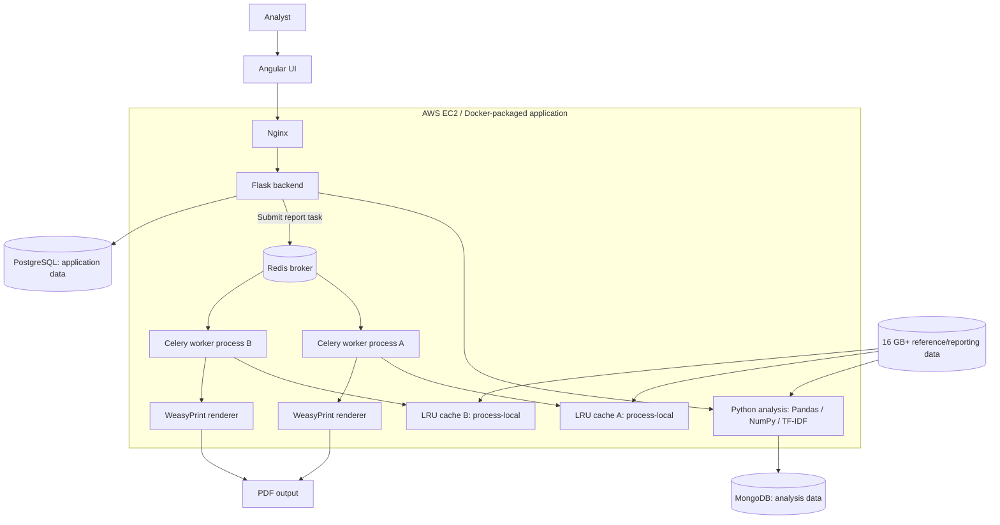
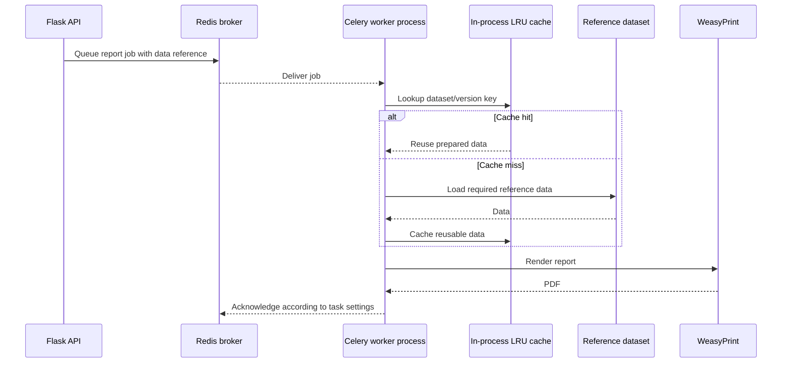
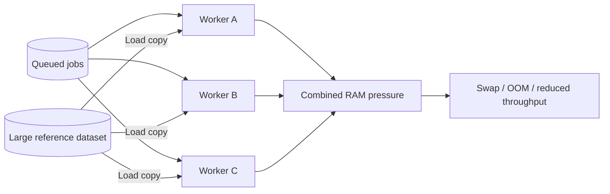
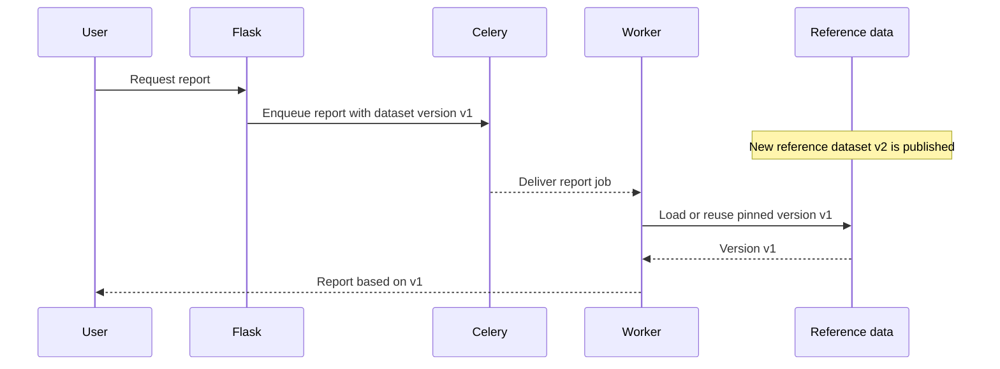

# Gordian — Architecture and data flow

[Project guide](Interview_Guide.md) · [Challenge scenarios](Project_Challenge_Scenarios.md) · [Interview Q&A](Interview_Questions_and_Answers.md)

Gordian was a **single-tenant Flask application**, not a collection of independent microservices. Its distributed-systems discussion centers on **web requests, Celery tasks, a Redis broker, process-local cached data, persistent analysis results, and PDF generation**.

## 1. End-to-end architecture with explicit execution boundaries

**Most important detail:** The custom Celery base-task LRU cache is reused **within a worker process**. Two separate worker processes do not share the same Python memory. Redis transports task messages; it is not the large-dataset cache.

**Scale trade-off:** Increasing worker count can improve parallelism but also multiply memory use and cold-cache loading. For large data, throughput may fall when worker count exceeds the RAM or I/O budget.

## 2. Cache hit, cache miss, and retry behavior

**Failure discussion:** A worker can crash after rendering but before acknowledging; depending on acknowledgement and broker configuration, the task may be redelivered. Design report publication to tolerate duplicate execution. Cache contents disappear on worker restart.

## 3. Why more Celery workers can make things worse

**Capacity reasoning:** Approximate memory as `N × (worker baseline + per-process cached dataset + active task peak)`, plus database, OS, and other services. This is a planning model; shared memory and copy-on-write can change actual usage. Profile peak RSS/PSS and task duration before changing concurrency.

**Alternatives:** Fewer long-lived workers with high cache reuse; chunked/streaming transforms; precomputed sparse or partitioned reference artifacts; versioned datasets; separate resource-intensive queues.

## 4. Data-version consistency during report generation

**Trade-off:** Version pinning makes results reproducible but may require retaining older data while jobs run. Using “latest” at each step risks mixing versions. Versioned cache keys make invalidation and traceability clearer.

## 5. Failure and scale drills

| Interviewer asks | Strong answer direction |
|---|---|
| Why not scale Celery workers indefinitely? | Per-process cache duplication, memory pressure, I/O contention |
| Why not put 16 GB in a Redis task? | Queue identifiers/references, not bulk datasets |
| What happens on worker restart? | Local cache lost; cold load on next task |
| What if task runs longer than broker visibility timeout? | Redelivery and duplicate execution risk; configure and design idempotently |
| What if two workers miss the same cache key? | Independent loads across processes; per-key coordination must match scope |
| What if reference data changes? | Versioned inputs, cache keys, reproducible reports |
| What if PDF rendering crashes? | Separate report state and artifact publication; bounded retries |
| Why MongoDB rather than SQS? | Queryable analytical documents versus task delivery |
| How do you measure scaling? | Throughput, queue age, task duration, cache hit rate, peak RAM, retries |
