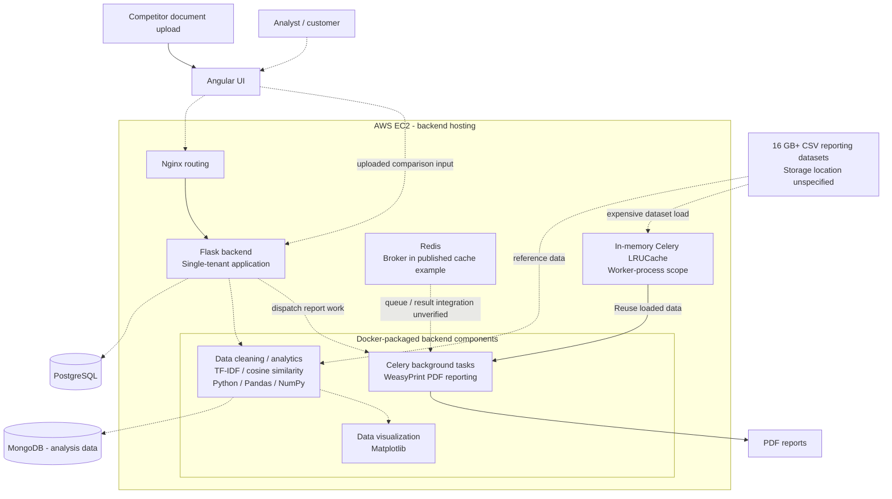

# Gordian: piracy detection, architecture, and contributions

**InApp | Merin Rose Tom**

[Interview questions and answers](Interview_Questions_and_Answers.md) · [MongoDB schema, queries, and performance](MongoDB_Interview_Deep_Dive.md) · [All projects](../README.md)

## 1. Project overview

Gordian was a single-tenant document/data copying-detection application built for the client. The client maintained a large reference CSV containing industrial-equipment details and related information. Users uploaded competitor documents, and the application compared their contents against the reference data to assess the amount of copying and produce analysis/reports for the client's review and possible legal follow-up. This workflow and single-tenant scope are directly confirmed by Merin.

### Client domain: public context versus internal application

Gordian's official [November 2021 RSMeans announcement](https://www.gordian.com/press/gordian-releases-2022-rsmeans-data-construction-costs/) describes construction-cost datasets covering materials, equipment, and labor, used for construction estimating. That is consistent with the equipment-related reference data recalled here. It does not prove that the internal CSV was specifically RSMeans data or establish its columns. No public source located in this research independently documents the internal piracy-detection application.

The client company and this internal application have different scopes: Gordian supplies construction data/software; this project helped compare competitor documents with the client's proprietary reference data. The comparison output supported client review; the exact copying-score formula remains to be recalled.

**Backend and reporting correction:** Merin confirms Flask was the backend framework, Django was not involved, and WeasyPrint generated PDFs. These direct corrections supersede older project-stack attributions.

**Source correction:** Older career materials attribute a multi-tenant backend to Gordian. Merin's October 28, 2026 clarification takes precedence: this application was **single-tenant**. The original resume, LinkedIn PDF, and portfolio have not been edited.

The resume and LinkedIn profile place the relevant work under the InApp Software Engineer role, July 2020-November 2021. This is the documented employment window, not a confirmed project start/end date.

### Interview introduction

“At InApp, I worked on Gordian, a single-tenant document/data copying-detection and reporting system. The client supplied a large reference CSV with equipment-related data, and we compared uploaded competitor documents against it to assess copying for client review and possible legal follow-up. I implemented data cleaning, data analysis, and document similarity scoring using Python, Pandas, and NumPy to identify possible plagiarism, and analyzed and visualized more than 50,000 data points using Matplotlib and MongoDB. I also engineered an asynchronous Celery pipeline for PDF reports over 16 GB+ datasets under memory constraints. A shared LRU cache helped eliminate repeated data loads that took around 30 minutes. The backend used Flask, PostgreSQL, Redis, Docker, and Nginx on AWS EC2.”

Do not describe document fingerprinting, watermark extraction, web crawling, OCR, or a particular classification algorithm as implemented features: the supplied sources do not establish those mechanisms.

## 2. Architecture diagram

The diagram reconstructs logical responsibilities from the documented stack. It is a study diagram, not a recovered production topology. Dashed arrows indicate inferred integration paths; boxes do not imply separately deployed microservices or physical hosts.



**Confirmed components:** Angular is listed in Gordian's portfolio skills; Flask, PostgreSQL, Redis, Celery, AWS EC2, Docker, Nginx, Python, Pandas, NumPy, Matplotlib, and MongoDB appear in its project bullets or supporting career materials, with the tenancy correction above. Nginx routed traffic, and Docker packaged services. Celery generated reports, with shared LRU caching of expensive data loads.

**Reconstruction limits:** PostgreSQL's exact entities, the API-to-analysis contract, MongoDB read/write paths, production Redis configuration, frontend report delivery, and worker placement are not documented. The EC2 box groups the backend hosting environment; it does not assert one machine. Docker grouping does not establish one container per box. The application was single-tenant. Redis is explicitly the broker in the published example; the production configuration is not independently recovered.

### Reporting execution path

```mermaid
sequenceDiagram
    participant Caller as Report requester
    participant Backend as Backend
    participant Worker as Celery task
    participant Cache as Shared LRU cache
    participant Source as Dataset source
    participant Render as WeasyPrint PDF generation
    Caller-->>Backend: Request report (interface unverified)
    Backend-->>Worker: Dispatch asynchronous task (transport unverified)
    Worker->>Cache: Look up reusable dataset
    alt Cache hit
        Cache->>Worker: Reuse loaded data
    else Cache miss
        Worker-->>Source: Load required data
        Source-->>Worker: Dataset
        Worker->>Cache: Retain reusable data
    end
    Worker->>Render: Generate report
    Render->>Worker: PDF output
    Note over Caller,Render: Cache reuse is within a worker process; WeasyPrint renderer confirmed; delivery path unknown
```

The documented optimization removes repeated loading work; it does not prove a 30-minute reduction in every report's end-to-end latency. The sources do not say the 50,000+ analysis points and 16 GB+ reporting datasets represent the same dataset.

## 3. Technology stack and responsibilities

| Layer | Technology | Documented role / boundary |
|---|---|---|
| UI | Angular | Listed for Gordian; specific screens and personal UI ownership unspecified |
| Backend | Python, Flask | Single-tenant Flask backend confirmed directly by Merin |
| Routing | Nginx | Route traffic and integrate backend services |
| Runtime packaging | Docker | Package services and standardize development environments |
| Hosting | AWS EC2 | Backend hosting; instance count and topology unknown |
| Application persistence | PostgreSQL | Backend persistence; exact schema unverified |
| Analysis storage | MongoDB | Data store associated with piracy analytics and visualization |
| Data processing | Pandas, NumPy | Analyze data and implement piracy-detection processing |
| Detection | TF-IDF with cosine similarity | Fitted text representation and document similarity scoring to identify possible plagiarism |
| Visualization | Matplotlib | Visualize piracy-related data for product decisions |
| Background execution | Celery | Asynchronous PDF report tasks |
| Background infrastructure | Redis | Broker in published cache example; production settings unverified |
| Data reuse | Celery LRUCache / in-memory task cache | Avoid redundant expensive dataset loads; published pattern explained below |
| Reports | WeasyPrint | PDF report generation; exact template and delivery flow unverified |

Redis and the shared LRU cache are separate documented concepts. Do not assume Redis held the large dataset or implemented the LRU cache. Likewise, general resume skills such as Kafka, Kubernetes, S3, and scikit-learn are not established Gordian dependencies.

## 4. Piracy analysis workflow

The confirmed business workflow is reference-to-upload comparison:

1. Maintain the client's large base CSV containing equipment-related records.
2. Accept another document supplied by the client, originating from a competitor.
3. Clean and analyze the data, then compute similarity scores between the reference content and uploaded documents to identify possible plagiarism.
4. Present similarity-based findings and analysis, with PDF reports generated using WeasyPrint.
5. Let the client review the findings and decide whether further action is required.

Merin confirms data cleaning, other data-analysis methods, and similarity scoring between documents. Python, Pandas, and NumPy are documented processing tools. The exact extraction/parsing method, record alignment, specific cleaning operations, document representation, threshold and aggregation formula are still unverified. A copying percentage needs a defined denominator: matched reference records, matched upload records, or matched fields can produce different numbers. These are possible interpretations, not recovered implementation details.

The resume's “machine learning” description does not establish that the system used supervised learning. Document similarity scoring and a trained/fitted model are now directly confirmed; supervised classification is not established. Training-label and classification-metric questions apply only if that was the implementation.

### Algorithm: TF-IDF with cosine similarity

Gordian used **TF-IDF with cosine similarity** to identify possible plagiarism between reference content and competitor documents. Data cleaning and analysis prepared the inputs. The fitted TF-IDF model learned vocabulary and inverse-document-frequency weights from a corpus; documents were represented in a shared feature space and compared using cosine similarity.

TF-IDF fitting does not require labeled copying examples. Cosine similarity measures vector similarity; it is not itself a trained classifier or a calibrated copying probability. A score should not automatically be interpreted as the literal percentage of content copied.

Use the same fitted vectorizer for both sides of a comparison. The specific fitting corpus, cleaning operations, n-gram configuration, saved model format, threshold, and document/section aggregation remain implementation details to recover.

References: [TF-IDF](https://scikit-learn.org/stable/modules/feature_extraction.html), [cosine similarity](https://scikit-learn.org/stable/modules/metrics.html#cosine-similarity).

### Development environment

Development and analysis used **Jupyter Notebook and Anaconda**, with **Pandas, NumPy, and Matplotlib** for data preparation, numerical processing, exploration, and visualization.

### Questions needed to complete the comparison algorithm story

| Topic | Detail to recover |
|---|---|
| Detection target | Meaning of piracy level and whether it was a category, score, or continuous value |
| Inputs | Actual record fields, granularity, and data origin |
| Validation examples | Known copied/independent documents, review process, and ambiguous examples |
| Features | One real predictive feature and why it helped |
| Algorithm | Matching/similarity method, library, and any actual training/inference ownership |
| Evaluation | Split strategy, baseline, metrics, and false-positive/false-negative tradeoff |
| Integration | Batch versus request-time processing; output consumers |
| Production behavior | Refresh cadence, failure handling, and observed quality issues |

## 5. Large-data reporting and caching

### Documented problem and contribution

Report generation involved CSV datasets larger than 16 GB under memory constraints. Repeated loading could take around 30 minutes. Merin engineered Celery-based asynchronous report generation and a shared LRU cache to reuse data across concurrent tasks and eliminate redundant loads.

Celery moved long-running reporting out of synchronous request execution. Caching addressed repeated data preparation. These solve different problems: asynchronous execution alone does not reduce dataset memory or loading cost.

### Explain the cache precisely

Merin identified the [published caching article](https://merin-rose-tom.medium.com/caching-in-celery-using-lrucache-357053251e96) as the implementation reference. It uses `celery.utils.functional.LRUCache`, a configured `RESOURCE_CACHE`, and a custom `ResourceTask` base exposing `shared_resource_data` to child tasks. The example sets an entry limit of 10 and uses Redis as broker. These example values are not independently verified production settings.

**Process boundary:** The described cache is in-memory. Reuse through a common base task does not create distributed shared memory. Independent prefork worker processes can retain separate caches, so warm-cache reuse applies within the process holding the cached resource. Production worker pool/concurrency settings remain to be recovered. Do not claim one dataset allocation shared across every Celery process or host.

For large datasets, cache entry count alone is not a sufficient memory budget. DataFrame memory, intermediate arrays, copied slices, worker concurrency, and PDF rendering all contribute to peak memory. The 16 GB input size does not establish that the entire file was retained in RAM.

### Design discussion: improvements to evaluate

The following are possible designs, not historical claims:

- Read selected columns with suitable types and process chunks when the computation can be aggregated incrementally.
- Include reference-dataset identity/version and transformation version in cache identity; include comparison-input identity when caching input-specific results.
- Coalesce concurrent misses so many tasks do not load the same dataset simultaneously.
- Bound memory by estimated bytes and worker concurrency; reserve headroom for transformations and rendering.
- Make tasks safe to retry, and publish a completed report only after generation succeeds.
- Track queue delay, load duration, cache hits/misses, peak memory, task failures, and report completion time.

Chunking is not sufficient by itself for global operations such as a full sort or joins requiring large retained state. Such operations may need partitioning, external storage, or a different processing plan.

### Recommended design: memory, worker concurrency, and invalidation

This is a recommended approach for the workload, not a reconstruction of production settings. The best chunk size and concurrency depend on measured RAM, text lengths, vocabulary size, and task peaks.

**Selected approach:** Follow the published `ResourceTask` / Celery `LRUCache` pattern with one long-lived process initially assigned to the heavy comparison queue. Reuse the fitted TF-IDF vectorizer and bounded prepared reference-vector partitions within that process. Prepare the reference CSV in chunks, persist reusable artifacts, and load them on cache misses. Redis remains the broker in the published pattern. Use versioned keys and measure peak memory before increasing concurrency. This is the agreed recommendation; exact historical production settings remain unverified.

**Cache lifecycle:** A task looks up `(reference_version, cleaning_version, vectorizer_version, partition_id)`. On a hit it reuses the local resource; on a miss it loads the prepared artifact and retains it if capacity permits. Different uploads reuse the same reference key. Publish new immutable versions for data/model changes, pin running jobs to their original versions, and retire old versions after their jobs finish. Bound cache memory as well as entry count: the blog's ten-entry example is not a ten-entry production recommendation for large partitions.


**Prepare once per reference version.** Read selected CSV columns in bounded chunks with explicit types, clean each chunk, and persist versioned processed partitions. Do not accumulate chunks into a list and concatenate them back into a full DataFrame. Preserve equipment codes as strings where leading zeros matter. Example column names below are illustrative:

```python
import pandas as pd

def prepare_reference(csv_path, write_partition):
    for part, frame in enumerate(pd.read_csv(
        csv_path,
        usecols=["record_code", "description"],
        dtype={"record_code": "string", "description": "string"},
        chunksize=50_000,  # Starting point; tune against measured peak memory.
    )):
        frame["description"] = (
            frame["description"].fillna("").str.strip().str.replace(
                r"\s+", " ", regex=True
            )
        )
        write_partition(part, frame)  # Persist now; do not retain all frames.
```

Chunked reading limits input working memory; it does not make every later operation out-of-core. TF-IDF fitting also needs a memory plan. Use a bounded vocabulary and a repeatable corpus iterator where feasible; profile fitting separately. If vocabulary/statistics still exceed the budget, use an explicit multi-pass/out-of-core preparation strategy rather than fitting an unrelated vectorizer per chunk. Transform reference partitions with the **same fitted vectorizer**, save sparse features, and version their row mappings. Score upload batches against reference blocks, retaining only needed top matches or incremental summaries. Avoid materializing a dense all-upload-by-all-reference similarity matrix. Exact global statistics may require more than a top-k summary.

**Keep task messages small.** Queue upload IDs, reference/model versions, and processing parameters. Store source data and artifacts durably; Redis carries task messages and, if desired, small coordination/status data. Cache the fitted vectorizer and bounded reference-feature blocks in worker-local memory rather than assuming a 16 GB DataFrame fits or is shared across processes.

**Bound concurrency by measured memory.** Start the heavy comparison queue with one process. Increase only after observing peak task memory and downstream capacity. For a process-local cache, a conservative sizing condition is:

`processes × (worker baseline + cached artifacts + peak task working memory) + other host memory + safety reserve <= host RAM`

A separate reporting queue prevents WeasyPrint rendering from competing with similarity computation; include both queues in the host budget. Set prefetch conservatively, for example `worker_prefetch_multiplier = 1`, while recognizing that early acknowledgments can still allow an extra reserved task per process. Worker recycling can control retained memory growth but discards warm caches; a memory-per-child setting is not a hard mid-task RAM cap. [Celery optimization](https://docs.celeryq.dev/en/stable/userguide/optimizing.html).

**Use versioned cache identities.** A base-artifact key can be `(reference_version, cleaning_version, vectorizer_version, partition_id)`. A comparison-result key additionally includes upload content hash, scoring configuration/threshold, and aggregation version. A PDF cache additionally depends on report-template version. Keep base-data cache keys independent of upload ID so different comparisons can reuse the base artifacts.

**Invalidate through immutable versions.** Write a new reference/model version to a separate location, finish and validate its artifacts, then atomically publish a ready manifest. Pin each job to that manifest. New jobs use the new version; running jobs keep their original version. Retire old artifacts after active jobs no longer depend on them. TTL/LRU eviction controls retention; it does not replace version correctness. Bound cache bytes, not just entry count, and coalesce concurrent loads where necessary. Independent processes may still have independent copies.

**Validate the design.** Measure cold/warm load time, peak process and host RAM, cache hits/evictions, queue wait, comparison time, PDF time, and failure rate on representative inputs. CSV file size alone does not predict DataFrame or sparse-feature memory.

References: [Pandas CSV reading](https://pandas.pydata.org/docs/reference/api/pandas.read_csv.html), [large-data processing](https://pandas.pydata.org/docs/user_guide/scale.html), and the TF-IDF references above. The chunk count and cache-key names here are proposed examples.

### Broker choice: Redis versus RabbitMQ

Redis dispatched Celery work in the published implementation pattern. The in-process LRUCache handled reusable resources separately. The [broker comparison and interview answers](Interview_Questions_and_Answers.md#redis-versus-rabbitmq) explain why Redis fits small task messages, when RabbitMQ is worth evaluating, and how long-task visibility/acknowledgement settings affect retries. The original selection rationale is not documented.

## 6. Single-tenant backend, persistence, and deployment

Merin confirms this application served one client as a single-tenant system. Multiple users, uploads, and reports do not imply multiple tenants. Flask, PostgreSQL, Redis, Celery, Docker, Nginx, and EC2 are listed in the project materials; the exact service boundaries and deployment automation remain unspecified.

Authorization still needs to protect reference files, competitor uploads, and report access. A useful design discussion covers permitted users, file validation, dataset versions, and comparison-job ownership without inventing a tenant-routing layer.

PostgreSQL and MongoDB were both present. A possible division is application metadata versus analysis records, but actual ownership and consistency requirements need confirmation.

## 7. Contributions and evidence

| Contribution / scale | Evidence | Safe interpretation |
|---|---|---|
| Python piracy detection with Pandas / NumPy | Resume, LinkedIn, portfolio | Personal implementation contribution; algorithm unspecified |
| 50,000+ data points with Matplotlib / MongoDB | All three | Analysis scale, not prediction accuracy or request throughput |
| Celery PDF pipeline for 16 GB+ datasets | All three; portfolio names Gordian | Large-data reporting; no verified final runtime or RAM figure |
| Shared LRU cache avoiding repeated 30-minute loads | LinkedIn and portfolio; resume says in-memory task cache | Data reuse optimization; published local-memory cache pattern; production pool settings unknown |
| Single-tenant Flask backend on EC2 | Stack in career materials; tenancy corrected directly by Merin | Single-client application; older multi-tenant attribution superseded |
| Docker and Nginx | All three; portfolio names Gordian | Packaging and routing contribution |
| 15% operational-efficiency improvement | Resume and LinkedIn InApp role | Role-level metric; Gordian attribution and measurement need confirmation |

### STAR answer: reporting optimization

**Situation:** Gordian needed PDF reporting over 16 GB+ CSV datasets under memory constraints, with repeated data loads taking around 30 minutes.

**Task:** Support asynchronous report generation and reduce redundant data loading across concurrent tasks.

**Action:** “I engineered the Celery reporting pipeline and implemented reusable dataset caching described in my materials as a shared LRU cache.” The article supplies the base-task/local-memory pattern; recover production keys, memory limits, and worker-pool configuration for deeper follow-up.

**Result:** Repeated expensive loads were eliminated through reuse. Do not invent final report latency, memory savings, cache hit rate, or a benchmark configuration.

## 8. Sources and remaining confirmations

- Merin’s direct clarifications, October 28, 2026: Flask only, WeasyPrint PDFs, document similarity scores, data cleaning/analytics, reference CSV, competitor uploads, copying assessment, potential legal follow-up, and single-tenant scope.
- [Caching article](https://merin-rose-tom.medium.com/caching-in-celery-using-lrucache-357053251e96): published cache pattern.
- [Gordian official 2021 announcement](https://www.gordian.com/press/gordian-releases-2022-rsmeans-data-construction-costs/): client business context only.

- [Resume](../../MerinRoseTomSSE7_N.pdf), InApp Software Engineer section.
- [LinkedIn profile PDF](../../LinkedinProfile.pdf), InApp experience on page 3.
- [Portfolio](https://merinrose123.github.io/merin-rose-tom/), Gordian project card and InApp experience, reviewed October 28, 2026. The Gordian card explicitly links the reporting pipeline and backend stack to this project.

Before interviews, recover the exact project dates, one real request/report walkthrough, service ownership, TF-IDF configuration/features/score aggregation formula, cache production configuration, report templates/output storage, and one concrete defect or failure you personally resolved. These gaps do not prevent using the documented project story; they define where to avoid guessing.
