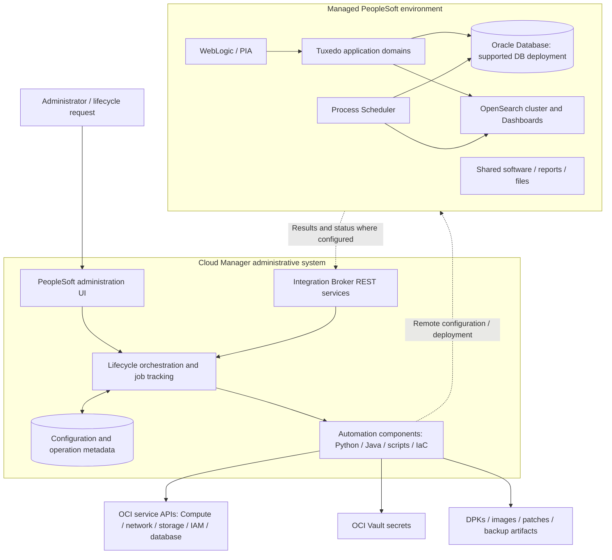
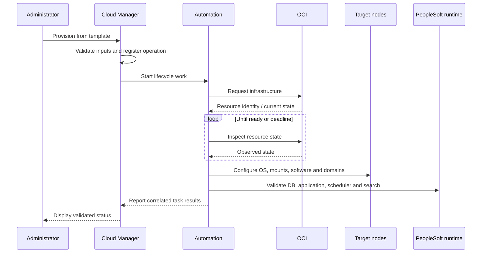
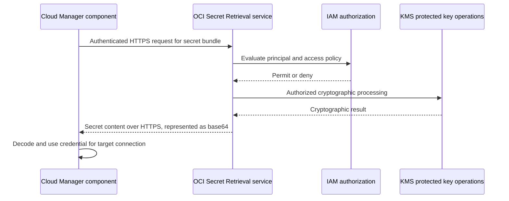

# PeopleSoft Cloud Manager: project, orchestration, and interview guide

**Merin Rose Tom | Oracle, November 2021–October 2026 | Research reviewed 28 October 2026**

Companion: [PeopleSoft architecture and distributed mechanisms](Runtime_Architecture.md).

[Dedicated interview questions and answers](05_Interview_QA.md) — 50 questions across both guides.

[Technology comparisons for general backend interviews](../../Cheatsheets/Technology_Comparisons.md) · [Real debugging and release stories](Debugging_Stories.md)

## Contents

1. [Study plan and evidence](#1-study-plan-and-evidence)
2. [Product and vocabulary](#2-product-and-vocabulary)
3. [Architecture and deployment boundaries](#3-architecture-and-deployment-boundaries)
4. [Communication and asynchronous work](#4-communication-and-asynchronous-work)
5. [Provisioning and recovery](#5-provisioning-and-recovery)
6. [Lifecycle operations](#6-lifecycle-operations)
7. [Search integration and reindexing](#7-search-integration-and-reindexing)
8. [Oracle Database and Exadata integration](#8-oracle-database-and-exadata-integration)
9. [Vault and credential lifecycle](#9-vault-and-credential-lifecycle)
10. [Infrastructure automation and delivery](#10-infrastructure-automation-and-delivery)
11. [Reliability, scaling, security, and observability](#11-reliability-scaling-security-and-observability)
12. [Personal project narratives](#12-personal-project-narratives)
13. [Interview questions and model answers](#13-interview-questions-and-model-answers)
14. [Practice exercises and sources](#14-practice-exercises-and-sources)

## 1. Study plan and evidence

### What to learn first

| Session | Focus | Speak or draw without notes |
|---|---|---|
| 1 | Product boundaries and PeopleSoft runtime | Explain Cloud Manager versus a managed HCM/FSCM environment; draw both |
| 2 | Communication and orchestration | Trace one provisioning operation, including delayed completion and lost responses |
| 3 | Search clustering | Explain shards, replicas, node failure, indexing freshness, and reindex validation |
| 4 | Database and Exadata | Distinguish VM, database instance, database, PDB, RAC, and Exadata |
| 5 | Credentials | Explain rotation when only some consumers update successfully |
| 6 | Lifecycle reliability | Handle failed provisioning, cloning, scaling, upgrades, and concurrent operations |
| 7 | Personal stories | Rehearse a two-minute overview and three five-minute technical deep dives |

**Evidence labels used here:**

- **Documented product behavior:** supported by linked Oracle documentation. Public Cloud Manager Image 22 documentation is the principal product reference; selected older pages explain historical features. A current feature does not establish which release you implemented.
- **Personal experience:** stated in your resume, LinkedIn PDF, or portfolio. These sources establish your stated scope, not independent verification of metrics or internal implementation.
- **Design reasoning:** proposed patterns for explaining reliability and tradeoffs. State these as design choices or recommendations unless you can confirm they existed in your code.

### Personal evidence anchors

| Stated contribution | Interview deep dive | Evidence to have ready |
|---|---|---|
| Python/Java backend and OCI lifecycle automation | Durable operations across APIs, VMs, and application configuration | One actual operation and the modules you changed |
| Clustered OpenSearch and reindexing | Membership, bootstrap, readiness, data movement, failure recovery | Real node roles/counts, versions, indexing path, cutover behavior |
| Exadata integration across releases | Database service discovery, RAC connectivity, credentials, lifecycle differences | Actual create/import/clone/refresh operation you owned |
| OCI Vault credential framework; stated 15 engineering hours/month saved | Secret references, consumer updates, rotation, recovery | Previous manual steps, measurement period, failure example |
| Terraform/OpenTofu migration | Provider compatibility, state, locks, reproducible plans | Your migration scope and state-handling approach |
| CI/CD redesign; stated 25% cloud-cost reduction | Automated cleanup, ephemeral environments, readiness checks | Baseline, denominator, time window, and your contribution |
| Python 2.7 → 3.11 migration | Dependency and runtime compatibility | Concrete bytes/text, subprocess, or library issue you fixed |

Personal sources: resume, LinkedIn profile export, and [portfolio](https://merinrose123.github.io/merin-rose-tom/). The portfolio’s public application bundle was inspected because the initial HTML is a JavaScript shell.

**Scale wording:** say “a product serving 2,000+ customers,” as stated in your materials. That figure does not establish 2,000 concurrent users, one shared tenancy, one cluster, one database, or a fleet you personally operated. Customer adoption, installed environments, and request throughput are different measures.

## 2. Product and vocabulary

PeopleSoft Cloud Manager automates provisioning and lifecycle management of PeopleSoft environments on OCI. Think of an environment as a coordinated set of infrastructure, software installations, domains, configuration, database services, and operational metadata. An administrator describes the desired environment; Cloud Manager coordinates the steps needed to produce and maintain it. Oracle delivers the application through OCI Marketplace. [Oracle product overview](https://docs.oracle.com/en/applications/peoplesoft/cloud-manager/22/peoplesoft-cloud-manager-for-oracle-cloud-infrastructure/understanding-peoplesoft-cloud-manager-oracle-cloud-infrastructure.html)

Cloud Manager and the managed application have different responsibilities:

- **Cloud Manager:** provisioning, configuration, lifecycle jobs, administrative policies, resource inventory, and operational status.
- **Managed PeopleSoft environment:** business transactions, PeopleCode, application data, integrations, batch jobs, search, and reports.
- **OCI:** compute, networks, storage, IAM, database services, and other infrastructure capabilities used by these systems.

Cloud hosting does not turn PeopleSoft into Oracle Fusion Cloud Applications. Nor does Cloud Manager imply that all customers use one centrally operated SaaS instance. Describe the installation and tenancy model of the deployment you actually worked on.

| Term | Meaning | Interview distinction |
|---|---|---|
| PeopleSoft application | HCM, FSCM, Campus Solutions, etc. | Business product and data model |
| PeopleTools | Runtime and tooling underlying PeopleSoft | Its release affects middleware and search compatibility |
| Cloud Manager image | Release of Cloud Manager | Different version axis from PeopleTools and application update images |
| Topology | Nodes, VM properties, and component placement | Defines the infrastructure layout |
| Environment template | Reusable environment provisioning configuration | Selects content/topology and relevant settings |
| Environment | Provisioned or imported deployment | Running resources plus configuration and metadata |
| DPK | Deployment package | Software/configuration packaging, not a live VM |
| PUM | PeopleSoft Update Manager | Selective application maintenance; different from Cloud Manager |
| PRP | PeopleSoft Release Patchset | Maintenance artifact; not interchangeable with a VM image |
| FSS | OCI File Storage Service | Shared files; not a message broker or relational database |
| DB System | OCI database service resource | Different from an ordinary middle-tier compute VM |

Oracle defines topology nodes as VM abstractions with attributes such as OS, shape, disks, and installed components. Template and environment creation then select a topology and database source. [Topology overview](https://docs.oracle.com/en/applications/peoplesoft/cloud-manager/22/peoplesoft-cloud-manager-for-oracle-cloud-infrastructure/topology-overview.html), [environment creation](https://docs.oracle.com/en/applications/peoplesoft/cloud-manager/22/peoplesoft-cloud-manager-for-oracle-cloud-infrastructure/specifying-basic-environment-information.html)

## 3. Architecture and deployment boundaries

### Conceptual architecture



**Diagram scope:** a logical synthesis of public product behavior and your stated stack. Boxes group responsibilities; they do not assert separate microservices, exact executable names, queue technology, or one VM per box. The exact path from a particular automation component to a callback must be verified from your implementation.

The administrative system is the **control plane** in this explanation. The managed PeopleSoft business workload is the **runtime plane**. This is an architectural description, not a claim about Oracle’s internal service names.

### Why it is distributed

One lifecycle operation crosses independently failing systems: Cloud Manager, an OCI API, a VM boot process, a remote software deployment, a database listener, a search cluster, and a callback endpoint. Each has different state, permissions, response times, and recovery behavior. No single local transaction can atomically commit all those changes.

The hard problems are therefore coordination and recovery: knowing which step completed, distinguishing a timeout from an actual failure, preventing two operations from conflicting, and reconciling stored status with observed infrastructure. Python and Java alone do not make it distributed; independent execution and failure boundaries do.

### Placement is different from logical responsibility

A compact nonproduction topology may colocate web, application, and scheduler domains. A larger deployment can separate them across VMs and failure domains. Multiple domains can exist on one machine. Conversely, one logical environment can span many machines. This separation affects capacity, blast radius, credentials, remote execution, and readiness checks.

Cloud Manager’s repository can use FSS, and supported configurations can share PeopleSoft software homes across middle tiers. Shared storage reduces duplicate software but creates dependencies on mount availability, permissions, compatible binaries, and coordinated patching. Treat local configuration separately from shared executables. [Cloud Manager overview](https://docs.oracle.com/en/applications/peoplesoft/cloud-manager/22/peoplesoft-cloud-manager-for-oracle-cloud-infrastructure/understanding-peoplesoft-cloud-manager-oracle-cloud-infrastructure.html)

## 4. Communication and asynchronous work

### Communication map

| Boundary | Mechanism | What completion means | Typical failure |
|---|---|---|---|
| Administrator → Cloud Manager | Browser HTTP(S), PeopleSoft UI | Request handled or job displayed | Session expiry, request timeout |
| Automation ↔ Cloud Manager | Internal IB REST services | Endpoint accepted/result recorded | Bad credentials, route/TLS failure, lost callback |
| Automation → OCI | Signed API/SDK calls or infrastructure tooling | API response; resource may still be provisioning | Throttle, quota, authorization, unknown outcome |
| Cloud Manager → Linux target | SSH where required by operation | Remote command/result | VM unreachable, key missing, privilege mismatch |
| Cloud Manager → Windows target | WinRM over HTTPS in documented import requirements | Remote operation/result | Certificate, WinRM, firewall, credentials |
| Deployment → database | Database tools and Oracle connectivity | Database-side operation status | Listener/service mismatch, locks, restore failure |
| Deployment → search | Supported deployment tools and search HTTP(S) APIs | Node or cluster operation status | Bootstrap/discovery, TLS, allocation, disk pressure |
| Artifact movement | Repository/FSS/Object Storage as applicable | Artifact transferred and verified | Partial transfer, permissions, capacity |

Oracle explicitly documents IB REST services in the Cloud Manager instance for returning results of long-running asynchronous activities. It also documents SSH prerequisites for imported nodes and HTTPS WinRM for Windows imports. These are concrete product mechanisms; do not substitute an invented Kafka/Celery architecture. [Cloud Manager settings](https://docs.oracle.com/en/applications/peoplesoft/cloud-manager/22/peoplesoft-cloud-manager-for-oracle-cloud-infrastructure/cloud-manager-settings-page.html), [import prerequisites](https://docs.oracle.com/en/applications/peoplesoft/cloud-manager/22/peoplesoft-cloud-manager-for-oracle-cloud-infrastructure/prerequisites-1.html)

### Asynchronous business operation versus synchronous transport

A provisioning job can run for an hour even though its component REST calls are ordinary synchronous request/response calls. A command can acknowledge launch immediately, while a later callback records completion. Polling a job endpoint is another way to observe progress. Identify these separately:

1. **Submission:** authorize, validate, assign an operation identity, and record intent.
2. **Execution:** perform infrastructure and software steps outside the browser request lifetime.
3. **Progress:** update task state through whichever polling/callback mechanisms the implementation uses.
4. **Completion:** validate the actual environment before reporting readiness.

Do not invent the exact response code, operation table, callback schema, or worker scheduler. The public REST callback fact does not prove that every operation uses one common callback protocol.

### Proposed robust operation record

For system-design discussion, propose: operation ID, environment ID, operation type, requested version, initiating principal, phase, attempt number, resource OCIDs, timestamps, last error, and a concurrency/version token. Save secret references rather than secret values. This is an illustrative schema, not a statement about Cloud Manager’s internal tables.

Callbacks should be authenticated and correlated to the right operation and attempt. Duplicate or late callbacks must not change a newer successful state back to an older phase. A lost callback should trigger inspection of actual resources, not automatic duplicate creation.

## 5. Provisioning and recovery

### End-to-end explanation

Oracle’s environment creation UI selects a template, topology, and database source. It can pause after infrastructure creation before PeopleSoft deployment. That is useful evidence that infrastructure readiness and application deployment are separate phases. [Specifying environment information](https://docs.oracle.com/en/applications/peoplesoft/cloud-manager/22/peoplesoft-cloud-manager-for-oracle-cloud-infrastructure/specifying-basic-environment-information.html)

The following sequence is a **conceptual implementation walkthrough**, not an exact list of delivered task names:



### Recommended phase gates

1. **Preflight:** compatible releases, quotas/capacity, IAM, subnet routes, DNS, artifact availability, key access, secret references, and target database prerequisites.
2. **Infrastructure:** record resource IDs; wait for the needed state rather than a fixed sleep; verify remote access and storage.
3. **Deployment:** install/configure database and middle tiers in dependency order; render environment-specific hostnames and paths.
4. **Domain startup:** database/service reachable, application domain booted, web domain connected, scheduler registered, search configured where needed.
5. **Functional readiness:** login, safe read operation, representative service call, batch smoke test, and search/security smoke test.

Cloud Manager’s own installation tutorial notes that a successful Resource Manager Apply job is followed by bootstrap work; the application is not immediately ready. This is a concrete example of why “VM created” and “application usable” require different checks. [Resource Manager installation](https://docs.oracle.com/en/applications/peoplesoft/cloud-manager/tutorial-install-with-resource-manager/)

### Unknown outcome: VM creation times out

**Scenario:** OCI accepted a create request, but the caller timed out before saving the result.

**Design reasoning:** record operation context before issuing the request; use a provider-supported retry token when available; correlate resources through persisted IDs and operation tags. Inspect the provider before retrying creation. If the VM exists, resume from its observed state. If no resource exists and the retry is safe, issue the request again. Do not describe display-name matching alone as a uniqueness guarantee.

### Partial success: infrastructure exists, software deployment failed

Retain useful infrastructure if the failure is recoverable and the product supports resumption. Record the failed phase, preserve logs, repair the prerequisite, and resume an appropriate boundary. If cleanup is needed, delete only resources owned by that operation. Never delete an imported database, shared Exadata resource, or shared FSS mount merely because a child deployment failed.

Oracle lists resumption after recoverable provisioning failures as a Cloud Manager capability. The idempotency, tagging, and ownership model above is recommended design reasoning; confirm the exact implemented mechanisms before claiming them. [Product capabilities](https://docs.oracle.com/en/applications/peoplesoft/cloud-manager/22/peoplesoft-cloud-manager-for-oracle-cloud-infrastructure/understanding-peoplesoft-cloud-manager-oracle-cloud-infrastructure.html)

### Concurrency: clone and patch start together

Define an operation-compatibility policy. Serialize incompatible mutations per environment; a read-only status query can still proceed. A database lock held for an entire cloud operation is often undesirable. A persisted operation lease or equivalent coordination can protect the workflow, but lease expiry also requires fencing against stale workers. If using IaC state locks, remember they protect state operations, not every application-level action.

## 6. Lifecycle operations

The mechanisms below combine documented capabilities with engineering questions to rehearse. They are not claims that you personally implemented every operation.

| Operation | Main coordination problem | Ready/success criterion | Failure question |
|---|---|---|---|
| Provision | Infrastructure → software → runtime dependencies | Representative workload succeeds | Can a failed step resume safely? |
| Import | Discover and validate an existing environment | Inventory/configuration agrees with reality | What resources are owned versus referenced? |
| Clone | Copy data and regenerate environment identity | Independent target with safe endpoints | Can clone email or batch accidentally affect production? |
| Refresh | Replace target data/configuration with a new source | Data validation plus preserved target-specific settings | How are secrets, URLs, integrations, and schedules handled? |
| Scale | Add/remove capacity and update dependent configuration | New node serves work or removed node is drained | What if DB connections or search quorum become the limit? |
| Patch/upgrade | Ordered changes across versions and tiers | Application, integration, search, batch regression checks | Is rollback compatible with database changes? |
| Backup/restore | Data and configuration consistency | A tested recoverable environment | Are keys, artifacts, metadata, and files recoverable together? |
| Start/stop | Dependency order and clean shutdown | Required services start/stop coherently | What happens to in-flight requests and scheduled work? |
| Delete | Ownership and dependency-aware cleanup | Owned resources removed and state reconciled | Are shared resources protected? |

### Lift and shift

Oracle describes lift as packaging application homes into DPK artifacts and backing up the Oracle database with RMAN for transfer to Object Storage. Shift consumes the lifted artifacts and database backup to create the cloud environment. Application and database packaging are distinct. [Oracle lift-and-shift description, Image 14](https://docs.oracle.com/cd/F57916_01/pcd91pbr14/eng/pcd/cmif/UnderstandingTheLiftAndShiftProcess.html?pli=ul_d18e113_cmif)

Treat this as migration, not a promise of zero downtime. Ask about backup consistency, data volume, bandwidth, change capture, compatibility, cutover, and rollback. Current Cloud Manager documentation also discusses ZDM; do not collapse RMAN lift-and-shift and every ZDM migration into one identical workflow.

### Patching versus upgrading

A PeopleTools patch, a PeopleTools major/minor upgrade, an application change package, middleware critical patches, and a Cloud Manager self-update have different compatibility and recovery implications. Check the supported combination of application, PeopleTools patch, search DPK, database, OS, WebLogic, Java, Tuxedo, and COBOL where relevant.

The current patch page distinguishes search-provider choices by PeopleTools release; 8.61 and later use OpenSearch/OpenSearch Dashboards. Cloud Manager self-update also has its own prerequisites and an availability interruption. [Applying PeopleTools patches](https://docs.oracle.com/en/applications/peoplesoft/cloud-manager/22/peoplesoft-cloud-manager-for-oracle-cloud-infrastructure/applying-peopletools-patch.html), [self-update preparation](https://docs.oracle.com/en/applications/peoplesoft/cloud-manager/22/peoplesoft-cloud-manager-for-oracle-cloud-infrastructure/preparing-automatic-self-update.html)

### Policy automation

Policies can associate actions with events and optional schedules. A concrete public example provisions a new PUM environment after an image download and migrates PUM metadata. This requires connectivity for IB REST calls between participating environments. An event-triggered policy is not evidence that a particular Kafka topic or global event bus exists. [Policy editor](https://docs.oracle.com/cd/F82676_01/pcd91pbr16/eng/pcd/cmif/UsingPolicyEditor.html), [self-managed update images](https://docs.oracle.com/en/applications/peoplesoft/cloud-manager/22/peoplesoft-cloud-manager-for-oracle-cloud-infrastructure/configuring-self-managed-update-images.html)

## 7. Search integration and reindexing

**Confirmed personal scope:** you worked on the **add-node functionality**, adding an additional OpenSearch node. You recall reindexing as part of the surrounding workflow but do not remember the exact mechanism. The recommended design below is not a reconstruction of your historical code. Your earlier materials broadly identify clustered OpenSearch and reindexing; use this more specific ownership description in interviews.

### Adding a node: recommended approach and the reindexing distinction

**Recommendation:** when adding a compatible data node to the same existing cluster with healthy indexes, join the node, update the relevant configuration, and allow normal shard allocation/rebalancing. A full application-data rebuild is not inherently required by node addition. This recommendation follows from Oracle's documented node-join procedure and OpenSearch's allocation model. [Oracle add-node procedure](https://docs.oracle.com/cd/F86650_01/pt859pbr5/eng/pt/tpst/AddingANewNodeToAnExistingCluster.html?pli=ul_d2076e53_tpst), [OpenSearch allocation/rebalancing](https://docs.opensearch.org/latest/install-and-configure/configuring-opensearch/cluster-settings/)

| Mechanism | What happens | Appropriate reason |
|---|---|---|
| Shard allocation/rebalancing | Existing shard copies are assigned/moved across eligible nodes | Additional capacity within the same cluster |
| Replica recovery | Another copy of an existing shard is populated/recovered | New placement or lost redundancy |
| OpenSearch `_reindex` | Documents are read from one index and indexed into another | A justified index transformation/migration |
| PeopleSoft full index build | Application data is extracted and searchable documents rebuilt | Missing/invalid application indexes or required definition rebuild |
| PeopleSoft incremental/RTI processing | Eligible changes are propagated | Routine freshness/catch-up under supported configuration |

**Why avoid a full rebuild for ordinary scale-out?** Rebalancing reuses existing indexed data. A rebuild adds extraction/database load and search indexing load without being needed simply to place existing shards on the new machine. It may also affect search availability. This is engineering reasoning, not a claim that your old workflow never rebuilt indexes.

#### Recommended end-to-end add-node workflow

1. **Preflight:** identify the environment and existing cluster; check the supported PeopleTools/search DPK combination, baseline health, disk headroom, access, DNS, node-to-node reachability, and security configuration. Serialize incompatible cluster operations.
2. **Provision:** create the additional VM/storage and install the compatible search software through the supported deployment mechanism. Give it its own node identity and appropriate roles; it must be data-capable to store shards.
3. **Join the existing cluster:** use the same cluster name and the supported discovery configuration pointing to existing cluster-manager-eligible nodes. Match transport security/trust requirements. A joining node must not bootstrap a separate new cluster. [OpenSearch discovery settings](https://docs.opensearch.org/latest/tuning-your-cluster/discovery-cluster-formation/settings/)
4. **Update persisted configuration:** Oracle's PeopleTools procedure describes updating existing nodes' discovery configuration and registering the added node in Search Instance Properties. Keep future restart discovery and PeopleSoft client endpoint configuration distinct; they serve different purposes. Follow the delivered release automation rather than manually overriding generated settings. [Oracle add-node procedure](https://docs.oracle.com/cd/F86650_01/pt859pbr5/eng/pt/tpst/AddingANewNodeToAnExistingCluster.html?pli=ul_d2076e53_tpst)
5. **Verify membership:** check the expected node count and that the node belongs to the intended cluster UUID. A process answering on its HTTP port alone is insufficient.
6. **Observe allocation/recovery:** let the cluster place eligible shard copies. Monitor relocations, unassigned shards, disk, resource pressure, and user-facing latency. Allocation filters, node roles, replica settings, and disk constraints can prevent movement. Do not assume every index will appear on every node or every node will receive equal data.
7. **Validate through PeopleSoft:** check representative search results, authorized/unauthorized visibility, indexing freshness, and the updated endpoint path. Declare completion only after the defined gates pass.

These are recommended engineering phases; the exact modules, tools, and checks you personally implemented remain to be supplied.

#### Cloud Manager-specific details and a historical clue

Oracle's current Cloud Manager guide requires existing search nodes to be running for the add operation. It also says automatic search-instance updates apply to the cluster-owning environment; environments sharing that cluster need their configuration updated separately. The same page documents an Image-before-19 compatibility case in which adding a node does not form a cluster and an alternative replacement procedure is needed. This is a possible historical clue, not evidence that it explains your reindexing memory. [Managing search clusters](https://docs.oracle.com/en/applications/peoplesoft/cloud-manager/22/peoplesoft-cloud-manager-for-oracle-cloud-infrastructure/managing-search-clusters.html)

If your workflow created a fresh cluster or replaced an existing search deployment, indexes might need population/recovery. That is a different operation from ordinary same-cluster expansion. Check the release and original task logs before deciding which scenario applied.

#### When reindexing really is required

Identify **why** before selecting the mechanism. For a PeopleSoft search-definition rebuild, use the supported Search Framework build path. For an index-to-index transformation, assess whether `_reindex` is appropriate and supported by the PeopleSoft integration. Generic `_reindex` does not automatically copy mappings/settings and does not continually stream subsequent source changes. Plan target configuration, concurrent updates/deletes, security, validation, and cutover explicitly. Do not introduce custom aliases into a managed PeopleSoft search path without confirming support. [OpenSearch Reindex API](https://docs.opensearch.org/latest/api-reference/document-apis/reindex/)

Adding nodes does not automatically increase an existing index's primary-shard count. If the actual bottleneck is insufficient partitioning, investigate supported split/rebuild/migration options separately. More nodes alone cannot spread one shard across several nodes. [OpenSearch index operations](https://docs.opensearch.org/latest/im-plugin/index-operations/)

#### Evidence that can recover your memory

- `PTSF_GENFEED`, a scheduler process instance, or Search Framework full/incremental build logs: a PeopleSoft index-build path.
- `/_reindex`, source/destination index names, and task IDs: a search-engine reindex API path.
- `RELOCATING`, `INITIALIZING`, recovery logs, and unchanged index identity with shard placement changes: allocation/recovery rather than application reindexing.
- A changed cluster UUID or new search deployment: investigate cluster replacement/migration.

These signatures guide investigation; none alone establishes every implementation detail.

### Four separate responsibilities

1. **Infrastructure:** VMs, disks, private networking, DNS, IAM/remote access as required.
2. **Search runtime:** supported software package, node identities, discovery, roles, certificates, credentials, and cluster formation.
3. **PeopleSoft integration:** search instance configuration, reachable endpoints, security callbacks, definitions, and index builds.
4. **Data readiness:** expected documents, access controls, deletions, freshness, and representative queries.

A cluster can be green with empty or stale indexes. A node process can be alive while the application cannot authenticate to it. Readiness must cross these boundaries.

### Clustered storage and failure

An index is divided into primary shards; replica shards provide additional copies on other nodes and can serve searches. Adding nodes does not by itself choose good shard counts, ensure all copies survive a failure domain loss, or create additional primary partitions. [OpenSearch introduction](https://docs.opensearch.org/latest/getting-started/intro/)

Oracle recommends a three-node cluster on separate physical servers in its search-instance guidance. In OCI, express the intent through available placement controls and an appropriate failure-domain design; VM separation alone does not prove physical separation. Node roles and supported deployment patterns depend on the delivered DPK and release. [Creating search instances](https://docs.oracle.com/en/applications/peoplesoft/peopletools/8.63/search-technology/creating-search-instances.html)

### Reindexing story structure

**Trigger → source → extraction → delivery → index readiness → validation → recovery.**

- Explain whether the operation was a full build, incremental build, real-time indexing catch-up, or search-provider migration.
- Name the actual extraction and delivery path. PeopleSoft search does not require Logstash for every application index.
- Explain how updates and deletes during the build were handled; a full historical scan alone can miss concurrent changes.
- Validate known records, deletions, permissions, representative searches, and data freshness. Count equality alone is insufficient when definitions filter or combine rows.
- Explain failure recovery and runtime impact: database reads, scheduler capacity, network, search CPU/heap, disk, and write load.

PeopleSoft’s documented full index build may clear existing data. Do not claim an atomic alias-based zero-downtime cutover unless that mechanism was actually implemented and supported in your workflow. Full Direct Transfer can bypass the Integration Gateway. [Index build process](https://docs.oracle.com/en/applications/peoplesoft/peopletools/8.63/search-technology/understanding-index-build-process.html), [Direct Transfer](https://docs.oracle.com/en/applications/peoplesoft/peopletools/8.63/search-technology/understanding-direct-transfer.html)

**Version context:** Elasticsearch/Kibana are relevant to historical deployments. OpenSearch became supported in selected 8.59/8.60 patches, and PeopleTools 8.61 supports OpenSearch only. Keep the date of your work separate from the current documentation baseline. [Oracle search information portal](https://docs.oracle.com/cd/E52319_01/infoportal/search.html)

See the companion guide for indexing flows, shard placement, cluster health, and Logstash/Dashboards responsibilities.

## 8. Oracle Database and Exadata integration

The database integration changes where transactional data resides and how its lifecycle is managed. It does not move PeopleCode execution into Exadata or make OpenSearch the transaction store.

Oracle’s Cloud Manager DB System node page states that selecting Exadata uses an **existing Exadata DB System** for the environment’s database placement. Do not say Cloud Manager always provisions an entire new Exadata infrastructure. The documented configuration requires access across the relevant RAC nodes. [Adding DB System nodes](https://docs.oracle.com/en/applications/peoplesoft/cloud-manager/22/peoplesoft-cloud-manager-for-oracle-cloud-infrastructure/adding-db-systems-nodes.html)

### Layers to explain

```text
PeopleSoft app / batch processes
    → Oracle client connectivity and database service
    → Oracle Database instance(s), potentially RAC
    → logical database / CDB and relevant PDB
    → ASM and Exadata storage infrastructure

Exadata database-server VMs are distinct from ordinary PeopleSoft middle-tier VMs.
```

### Integration concerns to rehearse

- **Discovery:** which Exadata, VM cluster, database home, CDB, PDB, and service are in scope?
- **Connectivity:** client subnet, DNS/SCAN/service resolution, listeners, firewall rules, and database client compatibility.
- **Credentials:** database, OS, wallet, and management API credentials have different purposes and privileges.
- **Operations:** import, clone, refresh, backup, restore, start/stop, and patch may have different capabilities from a database installed directly on a compute VM.
- **Ownership:** a managed PeopleSoft environment may use a database hosted on shared infrastructure; deleting the environment must respect that distinction.
- **Readiness:** validate the intended database service/PDB rather than assuming that one reachable host proves full RAC correctness.

This list is an integration design checklist. Use your implementation to supply exact APIs and commands. Oracle’s MAA reference deployment separately provisions Exadata infrastructure and its VM cluster and describes a database service topology with SCAN/listeners. It is a reference architecture, not proof of your production layout. [Oracle MAA infrastructure example](https://docs.oracle.com/en/solutions/deploy-maa-for-peoplesoft-on-oci/5-provision-primary-infrastructure.html)

**Interview answer:** “My contribution was integrating PeopleSoft lifecycle automation with the database platform. The application still connected through Oracle’s database services. The engineering work involved the platform-specific prerequisites and lifecycle behavior, with particular attention to connectivity, credentials, multi-node handling, and safe failure recovery.” Add only the operations and details you personally owned.

## 9. Vault and credential lifecycle

Your resume and portfolio describe an OCI Vault credential framework with rotation, recovery, and scaling-related updates. Oracle’s public installation tutorials also document Vault secrets and password groups. This supports the product context, while the exact framework design remains your project story. [Vault setup](https://docs.oracle.com/en/applications/peoplesoft/cloud-manager/tutorial-create-vault-resources/index.html), [settings and password groups](https://docs.oracle.com/en/applications/peoplesoft/cloud-manager/tutorial-specify-cloud-manager-settings/index.html)

### How OCI Vault protects credentials

**Project fact:** you used OCI Vault for credential rotation. The explanation below describes OCI mechanisms; whether your deployment used HSM or software key protection, instance principals, private routing, or automatic rotation must match its actual configuration. Oracle's current documentation separates Key Management and Secret Management services, although the resources and older product material commonly use the Vault name.

#### Secret, master key, key version, and identity

| Object | Purpose | Example |
|---|---|---|
| Secret | Stores sensitive content and its versions | Database or search password |
| Master encryption key (MEK) | Cryptographic key protecting data or subordinate encryption keys | An AES key managed through OCI KMS |
| Key version | Particular generation of the master key's cryptographic material | New version after key rotation |
| Secret version | Particular generation of the stored credential | Old password versus new password |
| OCID | Resource identifier, not secret cryptographic material | Secret OCID referenced by an application |
| IAM principal | Identity authorized to make a request | User, instance principal, or resource principal |

A master key is not the database's administrator password or a universal login password. AES is symmetric encryption: the same cryptographic key is used for encryption and decryption. OCI also supports asymmetric key types for other purposes; do not infer that RSA or ECDSA was used for your password secret. [Oracle key creation and algorithms](https://docs.oracle.com/en-us/iaas/Content/KeyManagement/Tasks/managingkeys_topic-To_create_a_new_key.htm)

#### Encryption at rest and HSM protection

Oracle documents secret versions as encrypted under a master encryption key and stored outside the HSM. The HSM protects cryptographic key material; it does not contain the entire password store. Oracle documents FIPS 140-2 Level 3-certified HSM protection. Certification applies to the cryptographic module and does not automatically certify the whole application. [Oracle security services](https://docs.oracle.com/en-us/iaas/Content/Security/Concepts/security_features.htm)

For HSM-protected AES master keys, key material remains inside the HSM and key operations occur there. Software-protected keys have different storage and processing behavior and are protected at rest by an HSM-rooted key. Confirm the protection mode before saying “our master key never left the HSM.” [OCI KMS overview](https://docs.oracle.com/en-us/iaas/Content/KeyManagement/Concepts/keyoverview.htm)

#### Envelope encryption: the two-key concept

OCI KMS also supports a hierarchy in which a data encryption key (DEK) encrypts data and a master key encrypts the DEK:

```text
Data + DEK → encrypted data
DEK + master key → encrypted DEK

Decryption requires authorized recovery of the DEK,
then use of that DEK to decrypt the data.
```

This is envelope encryption. Oracle documents it for integrated storage services. It is a useful explanation of OCI's key hierarchy, but do not claim your application generated DEKs or implemented this two-step operation unless it did. With managed secret retrieval, the service handles the cryptographic workflow. [OCI envelope encryption](https://docs.oracle.com/en-us/iaas/Content/KeyManagement/Concepts/keyoverview.htm), [DEK generation API](https://docs.oracle.com/en-us/iaas/Content/KeyManagement/Tasks/usingkeys_topic-To_generate_a_data_encryption_key_from_your_Vault_master_encryption_key.htm)

#### Retrieval: encrypted storage to an authorized consumer



This is a logical security flow, not a documented internal service-call trace. The consumer does not need to download the master key or call KMS Decrypt manually to use the managed secret-retrieval API. Base64 is only a representation: after retrieval and decoding, the password is available to the authorized application. [Secret management and application retrieval](https://docs.oracle.com/en-us/iaas/Content/secret-management/Concepts/manage-secrets.htm)

IAM policy can grant one dynamic group read access to one secret bundle rather than all secrets in the tenancy. Example policy shape:

```text
Allow dynamic-group CMInstances to read secret-bundles
in compartment EnvironmentSecrets
where target.secret.id = '<secret_OCID>'
```

This is illustrative, not your confirmed deployed policy. The identity must actually belong to the intended dynamic group. Secret metadata access and permission to retrieve its content are different concerns. Separate consumer read permissions from permissions to update secrets or administer keys. [Oracle scoped secret-bundle policy example](https://docs.oracle.com/en-us/iaas/Content/APIGateway/Tasks/apigatewaytroubleshooting_topic-gateway_create_or_update_fails.htm)

#### Security mechanisms and their boundaries

| Mechanism | Protection | Your implementation responsibility |
|---|---|---|
| Encrypted secret storage | Protects stored credential contents | Select/manage the intended key and control access |
| HSM protection where configured | Protects key material and cryptographic operations | Confirm mode and least-privilege administration |
| IAM policies | Restrict who can read, change, rotate, or delete resources | Scope principals, compartments, resources, and actions |
| HTTPS/TLS | Protects service communication in transit | Validate certificates; avoid logging request/response secrets |
| Secret versions and rotation states | Support controlled credential changes | Coordinate with the actual target and consumers |
| OCI Audit | Records supported API activity for investigation | Review applicable operations and alert/export requirements |
| Private service access where configured | Avoids public-internet routing from a VCN | Configure service gateway, routes, and network controls |

OCI documents private access to Vault through a service gateway. Private routing and TLS solve different problems; a private path still needs authorization and transport protection. [OCI Vault access](https://docs.oracle.com/en-us/iaas/Content/KeyManagement/Concepts/keyoverview.htm), [OCI TLS security guidance](https://docs.oracle.com/en-us/iaas/Content/Resources/Assets/whitepapers/advisory-oci-trm-guidelines-mas.pdf), [Audit API records](https://docs.oracle.com/en-us/iaas/Content/Audit/Tasks/viewinglogevents.htm)

Vault cannot protect a plaintext password after an authorized application leaks it through a log, exception, crash dump, insecure file, or compromised runtime. Minimize plaintext lifetime and access; redact logs and protect any necessary materialized configuration. Oracle explicitly identifies application memory as a remaining exposure boundary. [Secret rules and runtime exposure](https://docs.oracle.com/en-us/iaas/Content/secret-management/Concepts/secret-rules.htm)

#### Master-key rotation versus credential rotation

| Operation | What changes | What does not automatically change |
|---|---|---|
| Master-key rotation | New version of cryptographic key material | Database/search password; all existing ciphertext |
| Secret/credential rotation | New credential content and secret version | Every consumer connection/configuration |

Key rotation creates a new key version. Previously encrypted objects can continue to use an older version for decryption; do not assume rotation automatically re-encrypts all existing data. [Rotating an OCI key](https://docs.oracle.com/en-us/iaas/Content/KeyManagement/Tasks/managingkeys_topic-To_rotate_a_master_encryption_key.htm)

For credential rotation, secret versions can be pending before promotion to current. OCI offers automatic rotation integrations and function-based mechanisms, but these must be configured; simply storing a password in Vault does not rotate the target database password. A generic target-dependent sequence is: prepare a new version, change the target credential, verify it, promote/distribute it, update consumers, and verify fresh connections. Handle the interval where only one password is accepted. [Secret rotation states and mechanisms](https://docs.oracle.com/en-us/iaas/Content/secret-management/Concepts/manage-secrets.htm)

**Interview answer:** “We used OCI Vault to centralize credentials and control retrieval through IAM. The stored credentials were encrypted using a managed master encryption key. Key protection and credential rotation were separate concerns: changing the encryption key did not change a database password. Our framework coordinated credential changes with consumers and recovery. I would describe our actual protection mode, retrieval identity, and update sequence rather than assume every available OCI feature was enabled.”

### Coordinating credential changes

Model credential updates as a distributed workflow. Changing a stored secret does not automatically change the password in the database, the application configuration, every running connection pool, and every newly scaled node.

| Phase | Question to answer |
|---|---|
| Identify | Which consumers use the credential, and which version do they currently use? |
| Prepare | Can consumers support an overlap window or staged replacement? |
| Change authority | Where is the actual password changed: DB, search user, OS, middleware, or another system? |
| Distribute | How do authorized consumers obtain the new value/reference? |
| Activate | Must connections be recycled, a domain restarted, or a client configuration reloaded? |
| Verify | Can each consumer open a new authenticated connection? |
| Retire | When is the old credential safely disabled, and what audit evidence remains? |
| Recover | If half the consumers fail, which credential state is authoritative? |

The feasible ordering depends on the target authentication system; not every password supports dual credentials. Avoid universal “rotate with zero downtime” promises.

### Failure example: stale credentials on a newly added node

The scale operation reads an old configuration snapshot while rotation is in progress. The new node boots but cannot authenticate. A robust design serializes incompatible operations or checks a credential generation before activation, retrieves the current secret through authorized access, and verifies a fresh connection. Existing healthy connections can hide the problem, so connection establishment must be part of validation.

**Security points:** least-privilege secret access; encryption keys versus secrets; no plaintext values in logs or artifacts; scrubbed exceptions; bounded caching; auditable retrieval and changes. Base64 encoding is not encryption. OCI API signing credentials, SSH keys, PeopleSoft user passwords, database passwords, and Tuxedo domain passwords are distinct identities.

**Your metric:** explain how 15 engineering hours/month was estimated: number of events × previous handling time, minus the residual manual effort after automation. Do not invent the input values.

## 10. Infrastructure automation and delivery

Detailed companion: [Terraform execution, state, and OCI lifecycle guide](../../Cheatsheets/Terraform.md).

### Different tools own different layers

| Tool/layer | Typical responsibility | Boundary |
|---|---|---|
| Terraform / OpenTofu | Infrastructure declarations, provider resources, dependency graph, state | Successful apply does not prove business readiness |
| Packer | Image construction | Image existence does not prove compatibility with every target topology |
| Puppet / DPK automation | Software/configuration deployment where used | Configuration convergence does not prove a functional integration |
| Python / Java / shell | Product logic, integrations, validation, orchestration glue | Exact process/service split is implementation-specific |
| Jenkins / Gradle / JUnit | Build and delivery automation | Development pipeline is separate from customer runtime communication |

These tools are stated in your materials. Do not infer that every one runs in every customer installation. Oracle publicly documents installing Cloud Manager through an OCI Resource Manager stack. [Installation tutorial](https://docs.oracle.com/en/applications/peoplesoft/cloud-manager/tutorial-install-with-resource-manager/index.html)

### Terraform → OpenTofu migration questions

Prepare a real example of provider/version pinning, compatible syntax, module sources, state formats, sensitive data in state, lock handling, plan review, drift, and resource import. Prevent two engines from concurrently modifying the same state. Compare a controlled no-change plan before and after migration. Confirm the product release and component you migrated; public documentation found for this guide does not establish a universal Cloud Manager OpenTofu implementation.

### Python migration questions

Have one concrete example each for bytes versus text, dependency changes, exception handling, subprocess output/exit codes, TLS/HTTP behavior, and packaging. Explain how validation exercised real provisioning/configuration paths, rather than only importing modules successfully.

### CI/CD story

Describe the pipeline as source → build → artifact/image → deployment → readiness validation → cleanup, using your actual sequence. Separate reproducible unit checks from slower OCI integration checks. Test failure paths such as a partially created resource, a bad image, expired credentials, and bootstrap failure. Cloud cleanup must use ownership and retention rules; a failed build should not leave an untracked fleet.

For the stated 25% cost reduction, distinguish lower cloud spending from faster builds or lower engineering effort. Explain the baseline period and cost categories; give a reproducible calculation if available.

**Confirmed measurement source:** monthly OCI cloud-cost reports showed a 25% reduction after the implementation, compared with the pre-implementation baseline. Calculate it as `(baseline monthly OCI cost - post-implementation monthly OCI cost) / baseline monthly OCI cost × 100`. Explain the actual resource/automation changes that produced savings; the report comparison establishes measured spending reduction, while workload or other simultaneous changes are relevant to causal attribution.

## 11. Reliability, scaling, security, and observability

### Failure matrix: proposed operational reasoning

| Symptom | Likely boundary | Next evidence | Safe response |
|---|---|---|---|
| Job stuck; VM appears ready | Remote deployment or missing status update | Task log, bootstrap state, callback/auth logs | Inspect actual state, then resume/reconcile |
| OCI resource create denied | IAM/quota/capacity | Provider error/request ID, compartment and shape | Correct prerequisite; preserve operation context |
| New middle tier cannot start | DB, mounts, secrets, domain config | New connection test, mount status, domain logs | Repair dependency before enabling traffic |
| Search cluster formed but queries fail | Integration/security/index data | PeopleSoft search instance and query error | Validate application credentials and definitions |
| Search yellow after scale-down | Missing replicas/allocation | Shard allocation, disk, node count | Restore safe capacity or supported allocation |
| Exadata import only partly succeeds | Per-node access or service discovery | Reachability and identity on each required node | Correct access and revalidate inventory |
| Rotation appears successful; new sessions fail | Stale credentials | Secret generation and fresh connection test | Finish consumer convergence or controlled recovery |
| Stop action does not remove all costs | Different resource billing models | Compute, database, storage, backup charges | Evaluate resource-specific cost behavior |

Stopping a VM does not imply all associated storage, database, networking, and retained-resource charges disappear. Make resource-specific claims rather than repeating an environment-wide “no charges” slogan.

### Scale at the bottleneck

Horizontal middle-tier capacity can reduce CPU/queue pressure but increase DB sessions and shared database load. Search data-node capacity affects shard placement and recovery; it is different from adding application-server processes. Larger shapes can help one saturated resource but do not repair lock contention or serial workflows. Scaling Cloud Manager’s administrative throughput is also different from scaling managed business workloads.

For system-design discussion, use queue depth and age, arrival rate, active workers, service time, errors, and downstream saturation. Little’s Law, `L = λW`, can estimate in-flight work for a stable system when measurements use the same boundary and units. It is not a formula proving linear scalability.

### Observability

Correlate operation ID → phase/attempt → environment → resource OCID → provider request/work request ID where available → remote log → callback. Track operation success rate, phase latency, oldest incomplete job, retry counts, orphaned resources, and readiness failures. For managed applications, add login latency, app queues, DB waits, scheduler age, search freshness, and cluster health.

Logstash/Dashboards can support selected PeopleSoft monitoring flows, but their presence does not prove that every Cloud Manager operation uses them as the sole logging backend. Cloud Manager exposes environment logs through its environment management facilities. [Environment operations/logs](https://docs.oracle.com/cd/F57916_01/pcd91pbr14/eng/pcd/cmif/EnvironmentsOverview.html)

### Availability and recovery

Cloud Manager being unavailable does not inherently mean every managed business transaction stops; runtime dependencies must be examined separately. Administrative operations, callbacks, policies, or monitoring may be affected. Recovering Cloud Manager must preserve both metadata and the ability to reconcile real resources. Likewise, managed-environment recovery needs database data, files, configuration, secrets/key access, and connectivity.

RAC addresses database-instance/node availability; Data Guard addresses a separate standby database; backups address recovery from additional failure classes. Neither an extra VM nor an OpenSearch replica replaces a tested disaster-recovery plan. [Oracle PeopleSoft MAA reference](https://docs.oracle.com/en/solutions/deploy-maa-for-peoplesoft-on-oci/index.html)

## 12. Personal project narratives

For a confirmed release incident, see [Cloud Manager 16: OCI CLI dependency installation failure](Debugging_Stories.md#1-cloud-manager-16-oci-cli-dependency-installation-failure). The exact CLI version was pinned, but a newer related dependency release caused an installation issue. The remedy was prepackaging the CLI with its dependencies. Exact package names and versions remain unverified.

### Two-minute overview

“At Oracle, I worked on PeopleSoft Cloud Manager, which automates provisioning and lifecycle operations for PeopleSoft environments on OCI. The product serves 2,000+ customers, according to my project materials. My backend work used Python and Java alongside SQL, REST integrations, and infrastructure automation.

“The distributed aspect was coordination across OCI resources, VMs, database platforms, middleware, and search services. Those systems could complete or fail independently, so infrastructure creation alone was not enough to declare an environment ready.

“My contributions included clustered OpenSearch and reindexing, Exadata integration, a Vault-based credential framework, infrastructure automation, and CI/CD improvements. I would use one specific feature to explain the technical depth: its dependencies, communication path, failure handling, validation, and my individual ownership.”

Use this as an opening, then choose one contribution. Do not recite every technology without explaining a mechanism.

### OpenSearch deep dive

“I worked on the add-node functionality for OpenSearch integration in PeopleSoft Cloud Manager, enabling an additional node to be added to the search deployment. The feature sits across infrastructure provisioning, search-node configuration, and PeopleSoft integration. For an existing cluster, shard allocation and recovery are distinct from an application-data reindex. I recall an indexing step in our workflow; I would verify its implementation before naming the exact mechanism.”

Complete the story with your actual cluster roles, node count, DPK/release, node-join logic, failure handling, index-build method, and validation. An alias switch, custom change-data-capture pipeline, or zero-downtime migration is not established by your resume.

### Vault deep dive

“I designed a credential framework using OCI Vault to centralize secrets and automate rotation, recovery, and updates needed during scaling. The central challenge was keeping the authoritative credential and its distributed consumers consistent. I would explain the actual change order, validation, and recovery path, including how a new node obtained the current credential.”

Supply a real incident or edge case and the measurement behind the stated time savings.

### Exadata deep dive

“I helped deliver Exadata integration across releases. The important boundary was connecting PeopleSoft lifecycle management to a database platform with its own resources, credentials, and multi-node behavior. My role was [actual feature/module], and the key issue I solved was [actual failure or design constraint].”

Fill the brackets before practicing. Do not claim to have designed Oracle RAC, Exadata storage, or the entire database service when your contribution was integration.

## 13. Interview questions and model answers

### 1. Why call Cloud Manager distributed?

One operation coordinates independently executing components across network and process boundaries. OCI state, VM state, deployment state, database readiness, and stored job status can disagree temporarily. Timeouts, partial completion, retries, and reconciliation are central problems.

### 2. Is it a microservices platform?

It is an infrastructure orchestration product with distributed interactions. My Python/Java and REST experience does not alone establish independent microservice deployment or database ownership. I would describe the actual service/process boundaries of the component I worked on.

### 3. How do services communicate?

Separate the boundary: Cloud Manager documents internal IB REST services for asynchronous activity results; OCI operations use the appropriate cloud APIs/tooling; Linux and Windows management can involve SSH and HTTPS WinRM; managed PeopleSoft runtime uses Jolt/Tuxedo, database connections, and Integration Broker. There is no single transport for all interactions.

### 4. What makes an operation asynchronous?

Its execution outlives the submitting request. A later status observation or callback communicates progress. Individual transport calls can still be synchronous. Acceptance is different from successful infrastructure creation and from validated application readiness.

### 5. How do you guarantee exactly-once provisioning?

I would avoid promising global exactly-once execution. Use stable operation identity, safe provider retry behavior, durable phase tracking, idempotent steps where possible, and reconciliation. A timeout can hide successful creation; blindly replaying the create call can leak resources.

### 6. Where is the message queue?

First clarify which workload. Tuxedo IPC queues dispatch local services; Integration Broker has durable asynchronous runtime state; Process Scheduler polls database-backed requests. Cloud Manager’s public callback documentation does not establish Kafka, RabbitMQ, Celery, or one specific internal orchestration queue.

### 7. What happens when a callback is lost?

The controller should inspect operation progress and actual resource state, using a timeout and reconciliation policy. Re-executing a non-idempotent action solely because its callback is absent is unsafe. In a real project answer, name the implemented recovery mechanism rather than only describing the ideal.

### 8. How do you recover a failed workflow?

Identify the last verified phase and distinguish recoverable prerequisites from invalid configuration or irreversible changes. Resume safely completed work when supported; compensate only owned resources where appropriate. Preserve diagnostic context and validate the final state.

### 9. Is rollback just the reverse of provisioning?

No. Some resources are shared or imported; some steps create external side effects; database upgrades can be incompatible with old software. Recovery may require restore, forward repair, or controlled compensation rather than reversing every command.

### 10. Why is search eventually consistent?

The transactional database and the search index are separate stores. Extraction, transfer, indexing, refresh, and retries add delay. A successful business commit does not establish that a subsequent search sees the change immediately.

### 11. Why do you need Logstash if you already have PeopleSoft indexing?

They serve different paths. Search Framework can build application indexes through Application Engine and Direct Transfer/IB mechanisms. Logstash supports configured ingestion such as external data and PeopleSoft Health Center. It is not mandatory in every application transaction or index build.

### 12. What is the difference between node clustering and reindexing?

Clustering coordinates search nodes and shard placement. Reindexing creates or rebuilds searchable data. A healthy cluster can contain stale or empty indexes; a completed extraction can still leave failed shard writes or incorrect access controls.

### 13. Why Exadata rather than an ordinary DB VM?

Exadata is an Oracle database platform with specialized infrastructure and service capabilities. The choice depends on workload, availability, consolidation, operational requirements, and cost. It does not automatically fix bad SQL, application locks, or inefficient batch processing.

### 14. Is RAC equivalent to sharding?

No. RAC instances access a shared database. OpenSearch shards partition index data. These have different storage, coordination, and failure models. Do not draw RAC nodes as independent databases unless describing separate databases intentionally.

### 15. How do you rotate credentials without breaking scaling?

Coordinate the two operations or validate credential generation before activating the new node. Update the credential authority and consumers using a target-specific sequence, then test fresh connections. Explain overlap or downtime only when supported by the authentication system.

### 16. Why can a job say successful while the application fails?

The job may have checked only a lower layer: API acceptance, VM state, or process startup. A useful readiness gate exercises dependent services and a representative workload. Describe what the actual product checked and what improvement you made.

### 17. How do you prevent concurrent conflicting operations?

Define permitted combinations and serialize incompatible environment mutations. Combine durable ownership with stale-worker protection where needed. Infrastructure state locking alone does not protect a simultaneous secret rotation or application upgrade.

### 18. How did you validate your change?

Use an actual feature example: supported topology/release combinations, success path, partial failure, retry/resume, compatibility, security, and cleanup. Distinguish checks you performed personally from the broader QA/release process.

### 19. Does serving 2,000 customers prove scalability?

It establishes adoption context if accurate. Scalability requires workload measurements: operation concurrency, environment size, duration, failure rates, resource limits, and bottlenecks. I would give actual measured data when available rather than converting customer count into throughput.

### 20. What would you improve?

Choose a defensible proposal: clearer phase readiness, operation correlation, fewer manual recovery steps, stronger reconciliation, safer credential convergence, or better failure injection. Explicitly label it as a proposed improvement if you did not implement it.

## 14. Practice exercises and sources

### Whiteboard drills

1. Draw Cloud Manager and a managed PeopleSoft environment separately. Label every network boundary and state store.
2. Provision three nodes; lose the response to the second create call. Explain how you avoid duplication.
3. Rotate a DB credential while adding an application node. Explain the activation gate and recovery.
4. Rebuild a large search index while transactions continue. Explain updates, deletes, security, and failure recovery.
5. Import an Exadata-backed environment. Identify referenced resources versus resources the workflow owns.
6. Upgrade PeopleTools, then discover a search compatibility issue. Explain why rollback requires more than replacing binaries.

### Facts to retrieve from your own experience

Actual component names and languages; Cloud Manager and PeopleTools releases; node roles/counts; topology variants; workflow trigger and persistence; callbacks/polling; remote-execution mechanism; APIs you changed; lock/retry behavior; concrete incident; validation evidence; metric definitions. Keep confidential customer names, secrets, and proprietary code out of practice material.

### Research source map

Primary links are placed beside relevant sections. Start with the [Cloud Manager documentation hub](https://docs.oracle.com/en/applications/peoplesoft/cloud-manager/index.html), then the linked Image 22 product, settings, topology, database, update, and installation pages. Use the [PeopleSoft documentation home](https://docs.oracle.com/en/applications/peoplesoft/) to select the appropriate release. Use the companion guide’s references for runtime mechanisms.

Public pages explain architecture but are not a replacement for patch-specific certification and prerequisites in My Oracle Support. No MOS-only certification matrix or private Cloud Manager source code was used for this guide.

## Terraform installation context

```text
Administrator selects Cloud Manager Marketplace stack
    → Resource Manager configuration and variables
    → Terraform plan/apply through OCI provider
    → OCI infrastructure resources exist
    → Cloud Manager bootstrap/install continues
    → Cloud Manager UI and operations become available
```

Oracle documents this installation path. It does not establish that every subsequent managed-environment operation in every Cloud Manager release runs as a separate Resource Manager stack job. Explain your component's actual invocation path. [Oracle Cloud Manager installation spotlight](https://docs.oracle.com/cd/E52319_01/infoportal/pdfs/Cloud_Manager_Spotlight_Installing_and_Configuring_Cloud_Manager.pdf)

### Integration story to prepare

“Our lifecycle workflow supplied [actual configuration/inputs] and invoked [actual execution mechanism]. State lived in [actual location/backend]. We correlated the run with [actual job/environment ID]. Infrastructure completion triggered [actual next stage]. We handled partial failure through [actual recovery path].”

Replace every bracket before using this in an interview. Do not invent backend names, API retry tokens, or Resource Manager use based solely on this generic explanation.


General execution, state, locking, and recovery concepts are in the [Terraform guide](../../Cheatsheets/Terraform.md).
