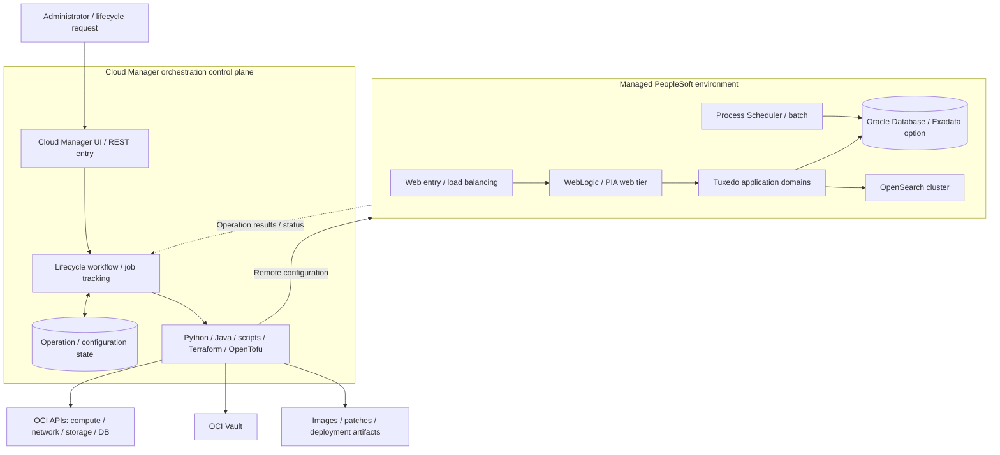
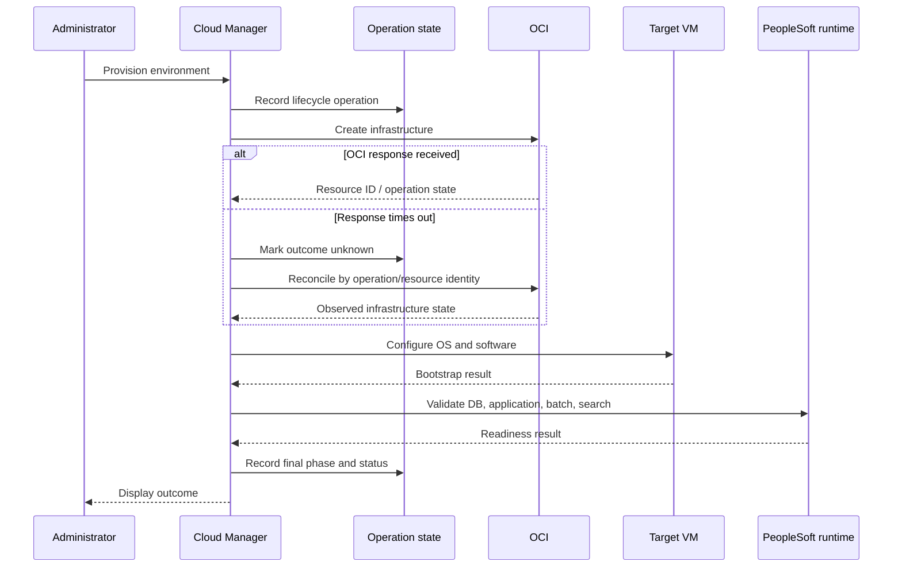
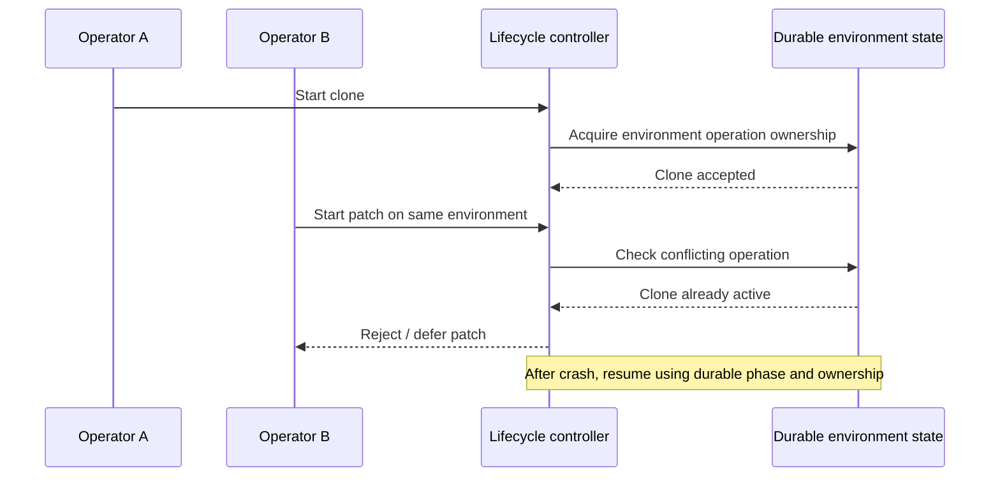
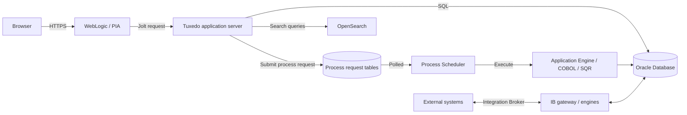
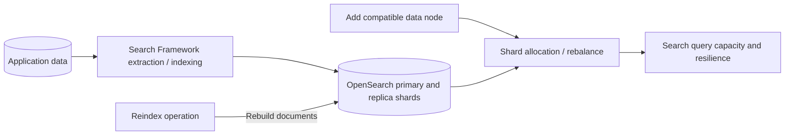
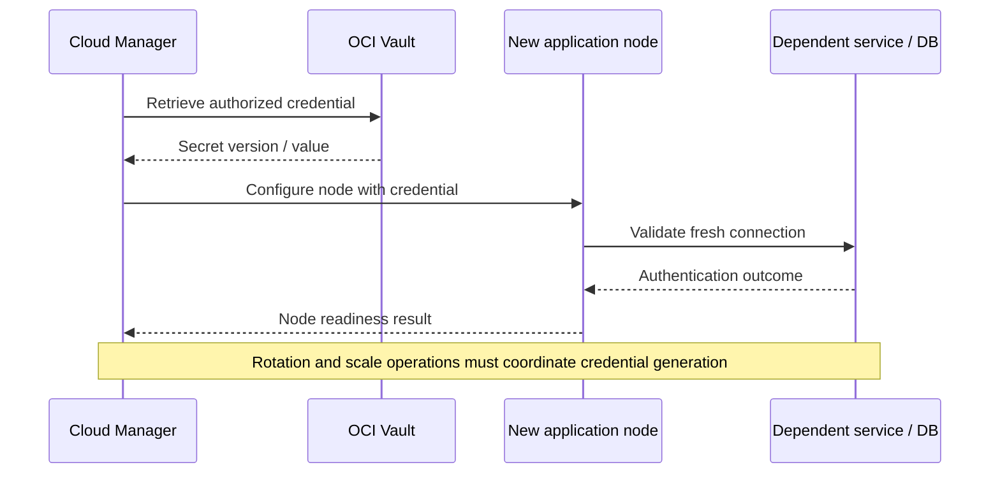

# peoplesoft — Architecture and data flow

[Cloud Manager guide](Cloud_Manager_Interview_Guide.md) · [PeopleSoft runtime architecture](PeopleSoft_Architecture_and_Distributed_Systems.md) · [Challenge scenarios](03_Engineering_Challenges.md)

**Key distinction:** Cloud Manager is an infrastructure-orchestration product. The managed PeopleSoft runtime contains web, application, batch, database, and search components. Do not present Cloud Manager itself as a conventional independently deployed microservices platform.

## 1. Control plane versus managed environment

**Interview narrative:** Cloud Manager coordinates resources and lifecycle actions; PeopleSoft handles business traffic after deployment. Control-plane success does not prove application readiness. The OCI API, target VM, domain processes, database, and job state can temporarily disagree.

**Scale discussion:** Scaling Cloud Manager's orchestration throughput is different from scaling PeopleSoft web/app nodes, Process Scheduler capacity, Oracle Database, or OpenSearch shards. Identify the bottleneck and the independently scalable component before choosing a remedy.

## 2. Provisioning workflow with partial-failure recovery

**Design discussion:** This is a recovery-oriented model of a lifecycle workflow. A timeout is not proof of failure. Retrying a create operation without checking the provider may duplicate resources. Job checkpoints and resource ownership support recovery and safe cleanup.

## 3. Concurrent environment operations and stale workers

**Trade-offs:** Serializing incompatible operations protects environment consistency but limits concurrency for that environment. Operations on independent environments can still run concurrently. Terraform state locking protects IaC state; it does not automatically serialize every credential rotation, application patch, and cloud lifecycle job.

## 4. Managed PeopleSoft runtime: synchronous versus asynchronous

**Explain:** Browser business requests, asynchronous Process Scheduler work, and Integration Broker message flows have different execution and delivery semantics. Tuxedo queues are not interchangeable with Kafka, Celery, or a cloud message broker. Search indexing is a separate consistency path from transactional SQL.

## 5. Search cluster expansion versus reindexing

**Trade-off:** Adding nodes can redistribute shards and capacity; reindexing rebuilds documents. A healthy cluster does not imply fresh search results. Query throughput, indexing rate, shard counts, disk watermarks, and network costs may limit gains from more nodes.

## 6. Credential rotation during scaling

**Failure discussion:** A node configured with a stale password may bootstrap successfully yet fail application readiness. Vault access control, secret rotation, consumer update, and validation are distinct responsibilities.

## 7. Distributed-systems interview drills

| Question | Answer direction |
|---|---|
| OCI create call times out | Unknown outcome, provider reconciliation, stable operation identity |
| VM exists but bootstrap fails | Phase checkpoints, safe retry, ownership-aware cleanup |
| Two operations target one environment | Durable operation coordination and conflict policy |
| A stale worker resumes | Fencing / ownership generation and state validation |
| App reports healthy but DB is unreachable | Layered readiness checks, not just process status |
| New search node does not help | Shard distribution, query/indexing bottleneck, disk/network limits |
| Search result is stale after SQL commit | Separate indexing pipeline and eventual consistency |
| Credential rotates during node creation | Coordinate versions and validate fresh connections |
| Terraform state is locked | IaC serialization, not universal lifecycle serialization |
| Customer count is high | Measure actual concurrency, latency, duration, and failure rate |
