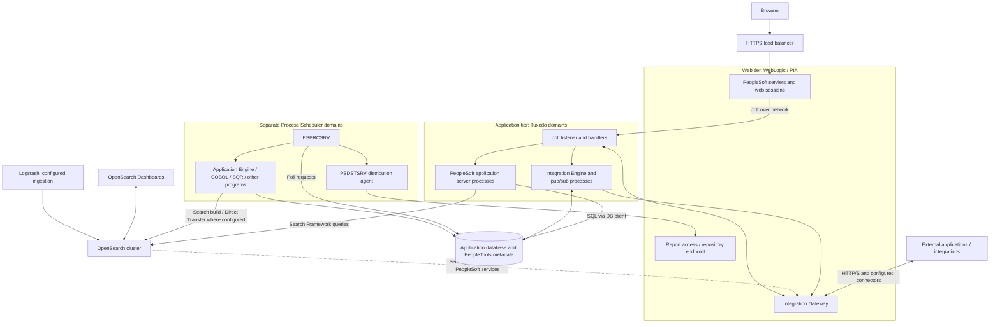
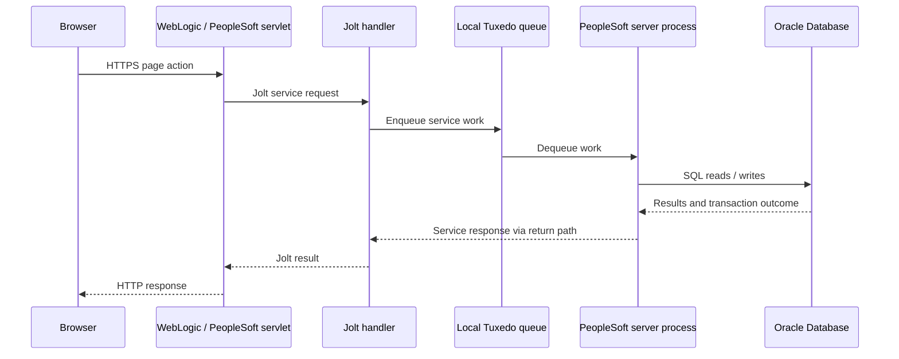
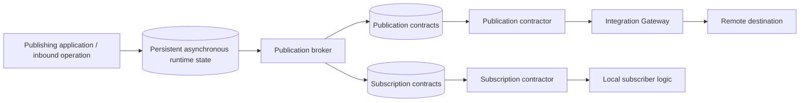
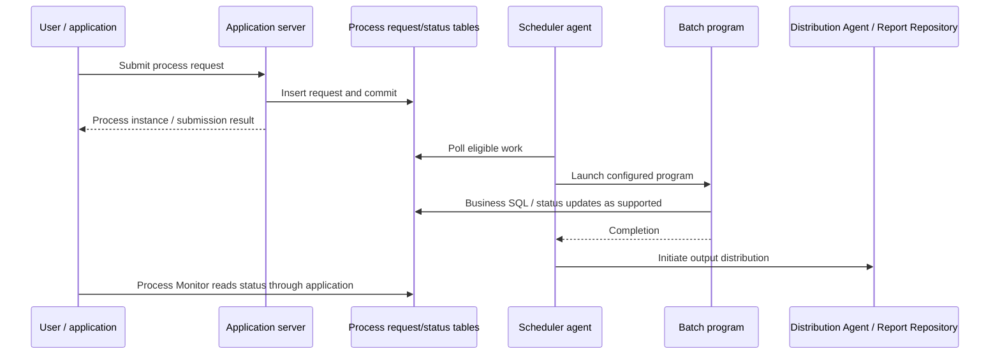

# PeopleSoft architecture and its distributed mechanisms

**Interview deep dive | Merin Rose Tom | Research reviewed 28 October 2026**

Companion: [Cloud Manager project and orchestration guide](Cloud_Manager_Interview_Guide.md).

[Dedicated interview questions and answers](05_Interview_QA.md) — 50 questions across both guides.

## Contents

1. [The architecture answer](#1-the-architecture-answer)
2. [Components and deployment model](#2-components-and-deployment-model)
3. [Online request: browser to database](#3-online-request-browser-to-database)
4. [Tuxedo internals and local communication](#4-tuxedo-internals-and-local-communication)
5. [Integration Broker and intersystem communication](#5-integration-broker-and-intersystem-communication)
6. [Process Scheduler and background work](#6-process-scheduler-and-background-work)
7. [Search Framework, OpenSearch, Elasticsearch, and indexing](#7-search-framework-opensearch-elasticsearch-and-indexing)
8. [Dashboards, Kibana, Logstash, and monitoring](#8-dashboards-kibana-logstash-and-monitoring)
9. [DBMS, Oracle Database, RAC, and Exadata](#9-dbms-oracle-database-rac-and-exadata)
10. [Consistency, transactions, and failure boundaries](#10-consistency-transactions-and-failure-boundaries)
11. [Availability, capacity, and security](#11-availability-capacity-and-security)
12. [Troubleshooting distributed paths](#12-troubleshooting-distributed-paths)
13. [Interview questions and model answers](#13-interview-questions-and-model-answers)
14. [Study exercises, glossary, and research references](#14-study-exercises-glossary-and-research-references)

## 1. The architecture answer

### A 90-second explanation

“PeopleSoft is a multi-tier enterprise application architecture built on PeopleTools. A browser communicates with the PeopleSoft web application on WebLogic. The web tier uses Oracle Jolt to call services in a Tuxedo-managed application-server domain. PeopleSoft server processes execute application logic and issue SQL through persistent database connections.

“Background jobs use a separate Process Scheduler facility, which polls database-backed process requests and launches batch programs. Integration Broker handles synchronous and asynchronous integrations. Search Framework maintains a separate search index in a supported search engine, currently OpenSearch in newer PeopleTools releases; dashboards and selected ingestion flows use OpenSearch Dashboards and Logstash.

“It is distributed because these tiers and subsystems run in separate processes, often on separate VMs, with independent failure and scaling behavior. They do not all share one transaction. Business data may be committed in Oracle Database while search is still catching up or an integration is retrying. Cloud Manager automates the provisioning and lifecycle of these environments.”

This is a synthesis of Oracle’s [application-server description](https://docs.oracle.com/cd/F86650_01/pt859pbr5/eng/pt/tsvt/ApplicationServers-d27b3e.html?pli=ul_d4294e41_tsvt), [scheduler relationship](https://docs.oracle.com/en/applications/peoplesoft/peopletools/8.63/portal-technology/peoplesoft-process-scheduler-application-server.html), and [search overview](https://docs.oracle.com/en/applications/peoplesoft/peopletools/8.63/search-technology/peoplesoft-search-technology-overview.html).

### Distributed architecture versus microservices

Distribution means computation or state crosses process/machine boundaries. Microservices additionally imply service boundaries, independent deployment, clear interfaces, and ownership choices. A PeopleSoft environment can be highly distributed while sharing a central application database and coordinated PeopleTools release lifecycle. Multiple application domains are not automatically business-domain microservices.

Use “intercomponent communication” when discussing browser, web tier, Jolt, application processes, and database. Use “service operation” for Integration Broker’s logical integration contract. A Tuxedo service name is a different concept from an IB service operation.

## 2. Components and deployment model

### Logical architecture



The diagram groups responsibilities, not physical hosts. Not every transaction traverses every arrow. Integration Gateway and report access can have dedicated placement. The search callback path is logical; URLs, routing, and security plugins vary by release/configuration. Legacy environments substitute certified Elasticsearch/Kibana components where applicable.

### Tier, domain, process, VM, and cluster

| Concept | Meaning | Example |
|---|---|---|
| Tier | Logical architectural responsibility | Web, application, database |
| Domain | Configured collection of runtime processes | A Tuxedo application-server domain |
| Process | Executing OS program | PSAPPSRV, PSPRCSRV, PSDSTSRV |
| VM | Virtual machine with OS/resources | Linux middle-tier host |
| Cluster | Coordinated set of nodes or instances | OpenSearch cluster, RAC cluster |
| Environment | Complete application installation and its dependencies | HCM test environment |
| Node in Cloud Manager topology | VM abstraction with assigned properties/components | Search VM or middle-tier VM |
| Node in Integration Broker | Logical integration participant | External payroll system node |
| Node in OpenSearch | A running search-engine instance | Data/cluster-manager-eligible node |

Do not use “node” without naming its subsystem. One VM may run multiple domains. One domain contains multiple processes. A database PDB is not a VM, and an IB node need not correspond one-to-one with a machine.

Oracle configures an application-server domain to connect to one database; a host can run multiple domains. Application-server and scheduler domains are administered separately even when colocated. [Application-server domains](https://docs.oracle.com/cd/F86650_01/pt859pbr5/eng/pt/tsvt/ApplicationServers-d27b3e.html?pli=ul_d4294e41_tsvt), [scheduler versus application server](https://docs.oracle.com/en/applications/peoplesoft/peopletools/8.63/portal-technology/peoplesoft-process-scheduler-application-server.html)

### Version context

This guide uses newer PeopleTools 8.63 help for mechanisms and explicitly labels older references. It does not establish which version your customer environments used. Oracle’s portal identifies OpenSearch availability in 8.59.21/8.60.07 and OpenSearch-only support in 8.61. Exact engine, Dashboards, Logstash, middleware, and database certifications must match the deployed PeopleTools patch and delivered packages. Generic upstream support is not PeopleSoft certification. [Oracle search portal](https://docs.oracle.com/cd/E52319_01/infoportal/search.html)

## 3. Online request: browser to database

### Follow a normal page request

1. The browser sends an HTTP(S) request, commonly through a load balancer, to PeopleSoft’s web application.
2. The web tier handles the servlet/session interaction and makes the needed application-service request using Jolt.
3. Jolt connection establishment uses the Jolt Server Listener (JSL); subsequent traffic is handled by a Jolt Server Handler (JSH).
4. The request is routed to a suitable local Tuxedo service queue.
5. A PeopleSoft server process, such as PSAPPSRV for relevant application work, executes application logic, loads metadata/cache objects as needed, and issues SQL.
6. Oracle Database executes SQL and enforces database transaction behavior.
7. The application result returns through the handler and web tier, which returns the response to the browser.

Listeners, handlers, queues, and persistent SQL connections are described in Oracle’s [listeners, handlers, and queues documentation](https://docs.oracle.com/en/applications/peoplesoft/peopletools/8.63/system-and-server-administration/listeners-handlers-queues.html). The diagram below is simplified: real page activity can involve multiple requests and services.



The browser does not make a direct database connection or speak Jolt itself. “Browser request” in listener documentation describes the originating workload; the web-tier software performs the Jolt communication.

### Where the business logic runs

WebLogic hosts the web application and integration gateway. Tuxedo provides middleware facilities for PeopleSoft processes, including service routing and runtime management. PeopleSoft processes execute application logic; database server processes execute SQL. Do not say “Tuxedo executes all PeopleCode” or “WebLogic is the only application server” without distinguishing product terminology.

### Connections and sessions

A browser session, a Jolt connection/session pool, a PeopleSoft process’s database connection, and a database transaction are different objects with different lifetimes. Persistent database connections avoid reconnecting for every service call, but more application processes can mean more database sessions and memory usage. Do not assume every logged-in browser owns one dedicated DB session.

### Latency decomposition

For diagnosis, divide response time into network/load-balancer time, web processing/queueing, Jolt transit, application queue wait, application execution, DB wait/execution, and return rendering. A service can have low CPU usage while waiting for locks or I/O. Adding web VMs does little if the actual bottleneck is application queueing or one locked database row.

### Timeout after a save

If the database committed but the response was lost, the browser sees failure even though the change exists. A transport timeout cannot prove rollback. Before repeating a non-idempotent action, inspect the business record or use supported duplicate-prevention behavior. This is distributed-systems reasoning about the request path, not a claim of a universal PeopleSoft idempotency API.

## 4. Tuxedo internals and local communication

### Read the supplied Tuxedo note with historical context

Your [Tuxedo help PDF](../../722461091-tuxedo.pdf) explains domains using shared memory, message queues, a bulletin board, BBL, workstation listeners/handlers, and the analogous Jolt path. It references BEA branding and PeopleTools 8.4-era behavior. Use it to understand mechanisms, but verify release-specific processes, Windows IPC details, and operational commands in current Oracle documentation.

In particular, its statement that Windows has no protected/shared-memory concept should not be repeated as a general operating-system fact. Its historical Tuxedo IPC helper discussion concerns how that product provided its required IPC behavior on Windows.

### Main moving parts

| Component | Responsibility | Avoid confusing it with |
|---|---|---|
| Bulletin Board (BB) | Shared-memory runtime configuration/service information | Application database or durable business event log |
| BBL | Local administrative process maintaining/checking the bulletin board and runtime | A business transaction worker |
| JSL/JSH | Web-tier Jolt connection establishment and request handling | WSL/WSH for development/workstation clients |
| WSL/WSH | Workstation client connection establishment and handling | Browser HTTP listener |
| Request queues | Dispatch work to server processes | IB persistent message contracts |
| PSAPPSRV and other PeopleSoft servers | Execute advertised services | VM or full application environment |
| ULOG | Tuxedo runtime diagnostic log | Complete business audit trail |

The bulletin board records service/runtime information; local communication uses OS message queues. Generic multi-machine Tuxedo can also use Bridge and DBBL facilities, but their existence in Tuxedo documentation does not establish that your PeopleSoft installation uses a single multi-machine Tuxedo domain. [Oracle Tuxedo architecture, historical reference](https://docs.oracle.com/cd/E13203_01/tuxedo/tux91/int/intarch.htm)

### One local service dispatch

The handler determines which advertised service can perform the work and routes the request into an appropriate queue. A waiting PeopleSoft process dequeues the work, executes it, and returns the result through a reply path. Shared memory supports runtime information lookup; the queue carries dispatch work. OS IPC on one host is distinct from network communication between the web host and application host.

Oracle documents request queues shared by processes of the same type, with examples such as APPQ and QCKQ. Queue layouts and enabled process types vary by configuration. Do not assume one private queue per browser or one process per user. [PeopleSoft queue behavior](https://docs.oracle.com/en/applications/peoplesoft/peopletools/8.63/system-and-server-administration/listeners-handlers-queues.html)

### Three different meanings of queue

| Queue mechanism | Purpose | Persistence/recovery boundary | Primary diagnostic question |
|---|---|---|---|
| Tuxedo local IPC request queue | Dispatch active service requests | Not a durable business integration history by itself | Are workers available, busy, blocked, or failing? |
| Integration Broker asynchronous runtime | Deliver and process service operations/contracts | Database-backed runtime state and configured retries/order | Which publication/contract failed or blocks progress? |
| Process Scheduler request table | Record scheduled background process requests | Database-backed request and execution status | Is a job eligible, assigned, running, or finished? |

Generic Tuxedo also has queuing products/features. Do not infer their use from the presence of ordinary PeopleSoft IPC queues. Likewise, the term “asynchronous” does not imply Kafka.

### Processes versus threads and CPU cores

More configured server processes can permit more concurrent work, but capacity still depends on service behavior, CPU, memory, database sessions, locks, and downstream latency. Process count is not equal to throughput, number of users, or number of physical cores. Excessive concurrency can increase context switching and database contention.

### Connection establishment and firewall diagnosis

A listener can accept the initial connection while a subsequently assigned handler is unreachable. Diagnose configured listener and handler behavior, DNS, routes, port ranges, and firewall rules rather than opening every port. Relay configurations add another hop; Oracle documents JRAD routing to JSL for the initial connection and JSH for subsequent work. [JRAD configuration](https://docs.oracle.com/en/applications/peoplesoft/peopletools/8.63/system-and-server-administration/configuring-jrad.html)

## 5. Integration Broker and intersystem communication

### Separate gateway and engine

**Integration Gateway:** web-tier entry/exit point using listening and target connectors for protocol-level communication.

**Integration Engine:** application-tier routing and processing of service operations, including handlers and asynchronous messaging work.

External HTTP(S) traffic can reach a listening connector on the gateway; the gateway’s PeopleSoft target connector connects to the appropriate application-side engine using configured Jolt properties. Outbound traffic uses the selected target connector. [Delivered listening connectors](https://docs.oracle.com/en/applications/peoplesoft/peopletools/8.63/integration-broker-administration/peoplesoft-delivered-listening-connectors.html), [gateway connection properties](https://docs.oracle.com/en/applications/peoplesoft/peopletools/8.63/integration-broker-administration/setting-general-connection-properties.html)

| IB concept | Meaning |
|---|---|
| Service | Logical grouping of integration functionality |
| Service operation | Invocable interaction with messages, processing type, handlers, and routings |
| Message/document | Payload definition; representation depends on operation |
| Node | Logical integration participant, local or remote |
| Routing | How an operation is directed between participants |
| Handler | Application processing logic for the operation |
| Queue | Processing/order configuration for asynchronous operations |
| Publication contract | Work to deliver a publication to a destination |
| Subscription contract | Work to execute a local subscriber’s handling |

An HTTP endpoint is transport addressing; an IB node is logical identity; a service operation is the integration contract. Keep these distinct.

### Synchronous request/reply

The sender waits for processing and a response. An inbound request passes gateway/engine dispatch and invokes the configured synchronous processing. Overall latency includes application/database work and any synchronous downstream dependency. “HTTP 200” needs interpretation: success at one gateway or endpoint does not necessarily establish every downstream business effect.

Use synchronous calls for interactions that require an immediate result and fit a bounded response budget. Long chains create coupled failure and latency. Consider timeouts, error propagation, and whether retrying can duplicate a side effect.

### Asynchronous publication and subscription



This is a logical flow, not a promise that every operation creates both publication and subscription contracts. Destination routing and subscribers determine the needed work.

Oracle identifies these six process types:

| Responsibility | Dispatcher | Handler |
|---|---|---|
| Publication broker | PSBRKDSP | PSBRKHND |
| Publication contractor | PSPUBDSP | PSPUBHND |
| Subscription contractor | PSSUBDSP | PSSUBHND |

The broker routes asynchronous work, the publication contractor handles outbound delivery work, and the subscription contractor handles local subscriber work. Dispatchers coordinate eligible work; handlers process it. [Messaging server processes](https://docs.oracle.com/en/applications/peoplesoft/peopletools/8.63/integration-broker-administration/messaging-server-processes.html), [messaging system server processes](https://docs.oracle.com/en/applications/peoplesoft/peopletools/8.63/integration-broker/messaging-system-server-processes.html)

### Persistence and in-memory acceleration

IB maintains asynchronous runtime information in database tables and uses in-memory queue information for efficient dispatch. This is a useful distinction: durable state can survive process loss while a dispatcher’s memory cannot be treated as the only source of truth. Directly editing runtime tables can leave memory and database state inconsistent. Prefer supported monitoring and recovery actions. [Dispatcher parameters](https://docs.oracle.com/en/applications/peoplesoft/peopletools/8.63/integration-broker-administration/specifying-dispatcher-parameters.html)

### Ordering and blocked queues

An ordered queue preserves sequencing within its applicable queue/partition scope. An errored earlier item can prevent later work from proceeding. Publication contracts are partitioned further by target node, limiting some effects of a remote destination being unavailable. Unordered work can allow more parallelism but requires business logic that tolerates concurrency and reordering. It is not a global ordering guarantee across every operation or destination. [IB administration: blocked queues, PeopleTools 8.62](https://docs.oracle.com/cd/G23955_01/psft/pdf/pt862tibm-b042025.pdf)

**Example:** employee-create followed by dependent employee-update may require sequencing. Independent updates for unrelated employees could potentially run in parallel if handlers and business rules permit. Partitioning/order design should reflect dependencies; do not change a production queue to unordered merely to clear backlog.

### Delivery is different from business completion

An acknowledgment may indicate acceptance or a completed stage of transport/processing. It does not universally mean that an external payroll, bank transfer, or notification completed. A sender can also time out after a receiver committed. Design integrations for duplicate detection or idempotent effects using stable business identifiers when appropriate.

In interview language: durable messaging and retries improve reliability, but “exactly once across all external side effects” requires application-level reasoning. Specify the commit, acknowledgment, and deduplication boundaries rather than making a blanket delivery claim.

### Cloud Manager connection

Oracle explicitly documents standard IB REST services on the Cloud Manager instance for exchanging results of long-running asynchronous activities. That links this runtime mechanism to your project. It does not establish that every Cloud Manager workflow uses an IB pub/sub queue: REST result reporting and asynchronous service-operation processing are related but distinct mechanisms. [Cloud Manager settings](https://docs.oracle.com/en/applications/peoplesoft/cloud-manager/22/peoplesoft-cloud-manager-for-oracle-cloud-infrastructure/cloud-manager-settings-page.html)

## 6. Process Scheduler and background work

### How a request gets executed

An application request inserts a process request into `PSPRCSRQST`. Process Monitor reads request/status information. The separately managed scheduler facility polls for eligible requests and starts Application Engine, COBOL, SQR, or other configured process types. API-aware processes report their execution status. [Scheduler architecture, PeopleTools 8.58](https://docs.oracle.com/cd/F44947_01/pt858pbr3/eng/pt/tprs/concept_PeopleSoftProcessSchedulerArchitecture-c0717c.html?pli=ul_d56e31_tprs)



This is conceptually a durable database-backed work mechanism. It is different from the browser request waiting in a Tuxedo service queue and different from an IB outbound publication contract.

### Core scheduler-related names

| Name | Role |
|---|---|
| PSPRCSRV | Scheduler server agent |
| PSAESRV | Optional Application Engine server process |
| `psae` | Application Engine executable; execution path depends on configuration |
| PSDSTSRV | Distribution Agent |
| PSMSTPRC | Master Scheduler process where configured |
| Process instance | Identifier correlating a particular submitted execution |
| Run control | Saved parameters used for a process run; different from process instance |

Oracle’s scheduler management documentation distinguishes required and optional server processes. An Application Engine program is not necessarily one permanently running service per program. [Scheduler management, historical PeopleTools 8.56 reference](https://docs.oracle.com/cd/E92519_02/pt856pbr3/eng/pt/tprs/concept_UnderstandingtheManagementofPeopleSoftProcessScheduler-dc07ba.html)

### Report execution and report distribution are separate

A batch program can finish successfully but its report can remain unavailable because distribution failed. The Distribution Agent posts reports/logs to the repository; Oracle documents PSPRCSRV sending a `PostReport` Tuxedo service request to initiate transfer after completion. Diagnose execution status and distribution status separately. [Distribution Agent parameters](https://docs.oracle.com/en/applications/peoplesoft/peopletools/8.63/process-scheduler/setting-parameters-distribution-agent.html)

### Why a job stays queued

Check scheduler health and heartbeat, requested server, process definition, scheduled time, recurrence/dependencies, process-type concurrency limits, permissions, and resources. A queued request does not prove there is a message-broker outage. More scheduler VMs may not help if the process is bound to one server or waiting on an application dependency.

### Application Engine: batch and online execution

Application Engine supports batch execution through Process Scheduler, online invocation through PeopleCode, and command-line execution. `CallAppEngine` is synchronous; invoking Application Engine does not automatically make work background. Oracle also distinguishes asynchronous process requests. [Program run options](https://docs.oracle.com/en/applications/peoplesoft/peopletools/8.63/application-engine/understanding-program-run-options.html)

### Checkpoint/restart

Restartability depends on deliberate commit boundaries and retained state. A failed batch may have already committed earlier work; restarting must preserve correctness. Persistent SQL state records can retain values across commits/process termination, while in-memory work records cannot provide the same recovery guarantee. [Determining when to use restart](https://docs.oracle.com/en/applications/peoplesoft/peopletools/8.63/application-engine/determining-when-use-restart.html)

**Design reasoning example:** a batch processes 100,000 rows and commits in batches. After a crash, it must know which business rows are complete, avoid repeating external effects, and handle rows changed during the run. A checkpoint helps resume program execution; it does not automatically undo an email or remote API call made before failure.

### Background mechanism comparison

| Need | Likely mechanism to discuss | Important qualification |
|---|---|---|
| Immediate application response | Tuxedo-managed application services | Queueing can occur even though caller waits |
| Scheduled/long-running batch | Process Scheduler | Request acceptance is different from execution |
| Asynchronous integration | Integration Broker | Contract/handler semantics and ordering matter |
| Search full/incremental build | Search Framework / Application Engine / scheduler | Delivery can use Direct Transfer or configured IB path |
| Cloud environment lifecycle | Cloud Manager orchestration | Public REST callbacks do not identify every execution component |
| Credential rotation | Target-specific lifecycle workflow | Secret storage alone does not update all consumers |

## 7. Search Framework, OpenSearch, Elasticsearch, and indexing

### The source of truth and its search projection

The transactional database stores authoritative business records and PeopleTools search metadata. OpenSearch stores a derived index optimized for text search, filtering, and aggregations. Search Framework defines which records and fields are exposed and how they are secured. Search success is not a replacement for transactional validation.

**Vocabulary:** a search definition describes searchable data; deployment creates the search-engine structure; building the index populates searchable documents. A deployed definition can exist with no searchable data. The build process uses `PTSF_GENFEED`, queries/connected queries, and the configured delivery path. [Index-build process](https://docs.oracle.com/en/applications/peoplesoft/peopletools/8.63/search-technology/understanding-index-build-process.html)

### Full, incremental, and real-time indexing

| Mode | Purpose | Main correctness concern |
|---|---|---|
| Full build | Populate/rebuild the complete selected dataset | Runtime availability, build duration, concurrent changes |
| Incremental build | Apply changes since prior indexing according to definition logic | Correct change selection and deletion handling |
| Real-time/near-real-time indexing | Propagate enabled transaction changes promptly | Staging backlog, processing delays, certification, retries |

The database and index are not committed atomically as one business transaction. Index visibility has additional processing and refresh boundaries. “Real time” is a feature label and freshness objective, not an assertion of zero delay under all loads.

### Full Direct Transfer versus Integration Broker

Full Direct Transfer sends search data directly to the search engine, bypassing the Integration Gateway. Oracle documents it as the default option in the referenced release. If disabled, nonattachment documents can go through the gateway while attachment data still uses Direct Transfer. Therefore this universal diagram is wrong: `every index build → Logstash → OpenSearch`. [Understanding Direct Transfer](https://docs.oracle.com/en/applications/peoplesoft/peopletools/8.63/search-technology/understanding-direct-transfer.html)

```text
Application DB + search metadata + attachment sources
    → Search Framework extraction/build
    → Full Direct Transfer → search engine
           OR
    → configured IB path for eligible document segments → search engine

Configured external-data / monitoring ingestion
    → Logstash → search engine
```

The build documentation identifies ordered IB queue `PTSF_ES_SEND_Q` for the applicable non-Full-Direct-Transfer path and synchronous acknowledgments for segment transfer. Batch asynchrony and synchronous segment sends can coexist. Do not infer a single universal routing path from the introductory description alone. [Build process details](https://docs.oracle.com/en/applications/peoplesoft/peopletools/8.63/search-technology/understanding-index-build-process.html)

### Real-time indexing mechanics

In the referenced current design, database triggers capture changed transaction keys into a staging table. Subsequent indexing processing reads that work and updates the search engine; load can make the result near real time. This is a concrete outbox-like decoupling of change capture and search propagation, not proof that PeopleSoft uses Kafka CDC. [Set-based real-time indexing](https://docs.oracle.com/en/applications/peoplesoft/peopletools/8.63/search-technology/understanding-based-processing-real-time-indexing.html)

The staging table requires maintenance under repeated inserts/deletes; Oracle documents the `PTRTI_TRUNC` Application Engine maintenance program. Real-time indexing must be enabled for appropriate supported search definitions; it is not automatically enabled for all business data. [RTI maintenance](https://docs.oracle.com/en/applications/peoplesoft/peopletools/8.63/search-technology/using-application-engine-maintenance-program.html), [RTI enablement context](https://docs.oracle.com/en/applications/peoplesoft/peopletools/8.63/search-technology/understanding-real-time-indexing.html)

### Cluster anatomy

An index is partitioned into primary shards. A replica is another copy of a primary shard placed on another node. Different shards can hold different documents; replicas are not additional unique partitions. A node can coordinate a search across shards and merge results. Cluster-manager responsibilities concern cluster state, membership, and metadata; data-node responsibilities concern stored shards and search/indexing work. A small supported deployment may combine roles. [OpenSearch introduction](https://docs.opensearch.org/latest/getting-started/intro/)

**Illustrative placement, not your confirmed topology:**

| Node | Shard copies |
|---|---|
| A | Primary 0, replica 1 |
| B | Primary 1, replica 2 |
| C | Primary 2, replica 0 |

This has three primary shards and one replica per primary: six shard copies, not six independent partitions. Losing A leaves a copy of each primary’s data somewhere else. Continued service also depends on cluster coordination, allocation, capacity, client reachability, and supported failover behavior. Placing all three VMs in one correlated failure domain weakens the availability claim.

### Quorum is separate from replica count

Cluster-manager election/cluster-state decisions require appropriate voting coordination. Adding replicas does not substitute for a healthy voting configuration. With a suitable three-voter configuration, a majority is two; during maintenance, protect coordination and data-copy availability separately. Confirm node roles and election behavior against your delivered search version, rather than copying a generic cluster layout into PeopleSoft. [OpenSearch voting configuration](https://docs.opensearch.org/latest/tuning-your-cluster/discovery-cluster-formation/voting-configuration/)

### Health versus correctness

| Status | Meaning | What it does not establish |
|---|---|---|
| Green | Primary and replica shards allocated | Fresh data, correct authorization, fast queries, useful contents |
| Yellow | Primaries allocated; some replicas unallocated | Full redundancy or safe additional node loss |
| Red | Some primary shards unallocated | Total outage of every index; unaffected indexes may still work |

Use index-specific evidence as well as cluster status. [OpenSearch Cluster Health API](https://docs.opensearch.org/latest/api-reference/cluster-api/cluster-health/)

### Failure and reindexing questions

- **Node loss:** which shard copies and voters remain? Is promotion/recovery possible? Can the remaining nodes serve the workload?
- **Disk pressure:** allocation/write protections can prevent progress even if processes are alive. Diagnose capacity and allocation evidence.
- **Rebuild under live writes:** how are changes after extraction handled? What is the replay/catch-up boundary?
- **Deletion:** a removed transactional record must not persist indefinitely as a stale result.
- **Security:** test both a user who should see a document and a user who must not see it.
- **Cutover:** an alias-based rebuild is a generic search design option, not an established PeopleSoft deployment behavior. The standard full build may clear existing indexed data.

Do not retry every indexing failure as a whole full build without understanding where it failed. That can increase database load and erase a usable partial state. Use supported restart/rebuild operations and validate the required definitions.

### Your interview connection

Your resume and LinkedIn export state that you integrated clustered OpenSearch and reindexing. They do not establish exact shard counts, node roles, dataset sizes, latency guarantees, or zero-downtime cutover. Prepare those facts from memory or permitted project evidence. Emphasize the boundary you owned: resource provisioning, cluster configuration, PeopleSoft integration, reindex orchestration, or some combination.

**Personal clarification:** your confirmed work was adding an additional OpenSearch node. You recall reindexing in the workflow but its exact mechanism is not yet established. See the [researched add-node recommendation](Cloud_Manager_Interview_Guide.md#adding-a-node-recommended-approach-and-the-reindexing-distinction): same-cluster expansion normally relies on shard allocation/recovery, while full rebuilds and `_reindex` serve separate needs.

## 8. Dashboards, Kibana, Logstash, and monitoring

### Roles

| Component | Main role | Does not replace |
|---|---|---|
| Elasticsearch | Historical supported search/analytics engine | Relational transactional DBMS |
| OpenSearch | Search/analytics engine for newer certified stacks | PeopleSoft business logic or DB transaction processing |
| Kibana | Historical visualization UI over Elasticsearch indexes | Ingestion engine or application server |
| OpenSearch Dashboards | Visualization/analytics UI over OpenSearch indexes | OpenSearch storage engine |
| Logstash | Configured event/data ingestion and transformation pipelines | Every PeopleSoft indexing mechanism or scheduler |
| PeopleSoft Insights | PeopleSoft analytics/visualization feature branding | Separate authoritative copy of transactional data |

Newer PeopleTools uses OpenSearch Dashboards for PeopleSoft Insights. Historical Kibana explanations remain useful when discussing older deployments, but names and version pairings must match the actual stack. [Current search overview](https://docs.oracle.com/en/applications/peoplesoft/peopletools/8.63/search-technology/peoplesoft-search-technology-overview.html), [Oracle historical Kibana introduction](https://www.oracle.com/webfolder/technetwork/tutorials/peoplesoft/SpotlightCompanionSlides/SpotlightKibana.pdf)

### Logstash pipeline

Logstash receives data through inputs, transforms it through filters, and sends it through outputs. For example, a pipeline could parse operational logs into structured events and send them to a search index. OpenSearch ingestion needs compatible plugins and versions; a generic latest plugin is not automatically certified for a PeopleSoft DPK. [OpenSearch Logstash documentation](https://docs.opensearch.org/latest/tools/logstash/index/)

Oracle’s PeopleSoft Search Framework architecture identifies Logstash for external data integration and PeopleSoft Health Center collection. It describes Kibana as visualizing indexed data, including application analytics and search-related monitoring. This is evidence for configured paths, not for every OS log automatically being shipped or every business update flowing through Logstash. [Historical PeopleSoft Search Framework architecture](https://docs.oracle.com/cd/F40609_01/pt859pbr1/eng/pt/tpst/task_PeopleSoftSearchFrameworkArchitecture.html?pli=ul_d46e32_tpst)

### Dashboard freshness and security

A dashboard query can be immediate while its source index is stale. Distinguish event time, ingestion time, index visibility, and dashboard refresh. A graph of yesterday’s indexed data is not live transactional truth.

PeopleSoft search integrations can use security callbacks to obtain user authorization attributes; dashboard data must respect the intended security context. Index permissions, PeopleSoft privileges, callback connectivity, and changes to authorization all matter. A count comparison with an administrator account does not validate ordinary-user visibility. [Historical search security architecture](https://docs.oracle.com/cd/F40609_01/pt859pbr1/eng/pt/tpst/task_PeopleSoftSearchFrameworkArchitecture.html?pli=ul_d46e32_tpst)

### Monitoring is a separate workload

If application search, external-data analytics, and monitoring share infrastructure, heavy ingestion or retention growth can affect search resources. Discuss index lifecycle/retention, capacity, access separation, and ingestion backpressure as design concerns. Do not assume isolation unless it was deployed.

## 9. DBMS, Oracle Database, RAC, and Exadata

### The vocabulary ladder

| Layer | Meaning | Example distinction |
|---|---|---|
| DBMS | Software managing data, SQL, concurrency, transactions, recovery | Oracle Database is a DBMS; Exadata is a platform |
| Database | Persistent database structures/files and logical data | Different from the memory/processes of one instance |
| Instance | Memory structures and running processes managing the database | Multiple RAC instances can access one database |
| CDB | Multitenant container database | Hosts PDBs; not a VM |
| PDB | Pluggable database within a CDB | Logical database container; not an independent RAC node |
| Database service | Logical client connection/workload endpoint | Different from one hard-coded host/SID |
| DB server VM | Guest OS hosting database software/processes | Different from a PeopleSoft application VM |
| Exadata VM cluster | Database-server VM resources on Exadata infrastructure | Not the same as an OpenSearch cluster |
| Exadata infrastructure | Engineered database compute, storage, and networking platform | Not a business service or middleware process |

An Oracle instance has memory such as the SGA and background/server processes; the instance is distinct from persistent files. Multitenant PDBs do not each imply a separately allocated full instance/SGA. [Oracle instance concepts](https://docs.oracle.com/en/database/oracle/oracle-database/19/cncpt/oracle-database-instance.html), [multitenant instance explanation](https://docs.oracle.com/en/database/oracle/oracle-database/26/dbiad/db_dbinstance.html)

### What happens inside Oracle Database

At a high level, client SQL is executed by database server processes using shared caches and private process memory. Redo supports recovery of changes; undo supports rollback and consistent read behavior. Database background processes perform persistence/recovery/maintenance work. These database mechanisms are separate from PeopleSoft Process Scheduler.

For an interview, be able to explain why a transaction can commit before every changed data block has been written to its final datafile location: recovery relies on redo persistence under the configured commit behavior. Do not confuse “DB writer finished” with every application’s definition of commit success. Use the database concepts documentation for the exact deployed release. [Oracle Database Concepts](https://docs.oracle.com/en/database/oracle/oracle-database/19/cncpt/database-concepts.pdf)

### RAC

RAC allows multiple database instances on separate servers to access one shared database. Instances have their own memory and coordinate access to shared data. This provides database compute/node availability and throughput opportunities, while shared workload contention and cluster coordination remain relevant. RAC is not one independent database per node and not application-level sharding. [Oracle RAC introduction](https://docs.oracle.com/en/database/oracle/oracle-database/26/racad/introduction-to-oracle-rac.html?source=%3Aow%3Alp%3Acpo%3A%3Arc_bumk180724p00001%3Alpd100743723%2C%3Aow%3Alp%3Acpo%3A%3Arc_bumk180724p00001%3Alpd100743723)

### Exadata

Exadata is engineered infrastructure for Oracle Database, with database compute and specialized storage/network capabilities. PeopleSoft application processes connect to database services; they do not issue business transactions directly to Exadata storage cells. The application tier remains a separate runtime layer.

Oracle’s PeopleSoft MAA reference deployment shows Exadata infrastructure, a VM cluster with database nodes, Oracle Grid Infrastructure/Clusterware, SCAN/listener addressing, and ASM storage. These are related layers, not interchangeable resource names. [PeopleSoft MAA infrastructure example](https://docs.oracle.com/en/solutions/deploy-maa-for-peoplesoft-on-oci/5-provision-primary-infrastructure.html)

### RAC versus Data Guard versus backup

| Mechanism | Main protection | Does not by itself solve |
|---|---|---|
| RAC | Failure of a database compute instance/node | All storage/site failures, bad application writes, complete DR |
| Data Guard | Separate standby database maintained through redo transport/apply | Every application-tier dependency or backup retention requirement |
| Backup/restore | Recovery to an available retained recovery point | Immediate failover with zero recovery time |
| Exadata redundancy | Platform component/storage resilience according to configuration | Every logical corruption or region-wide outage |
| OpenSearch replicas | Search shard-copy availability | Oracle transactional database recovery |

RAC and Data Guard can be combined: a primary RAC database can send redo to a single-instance or RAC standby. They address different boundaries. [Data Guard with RAC](https://docs.oracle.com/en/database/oracle/oracle-database/21/sbydb/configuring-data-guard-standby-databases-in-oracle-RAC.html?source=%3Aem%3Anw%3Amt%3A%3Arc_wwmk170418p00047%3Ansl100815161)

### Database failover from the application’s perspective

A surviving RAC node does not mean every in-flight application transaction transparently succeeds. Client connections may fail; application pools must recover according to supported configuration. A connection failure during commit can create an uncertain outcome. Discuss database services, client configuration, retry safety, and business verification instead of promising universal transparent replay.

### Why database performance remains central

Online requests, batch jobs, IB handlers, and index extraction can contend for the same database. More middle-tier VMs can increase pressure. Diagnose SQL plans, locks, wait events, connection counts, workload timing, and I/O before buying capacity. Exadata can improve suitable workloads but cannot remove a logical hot row or an unnecessary serial dependency.

### Cloud Manager integration boundary

Cloud Manager’s documented Exadata DB System option uses existing Exadata resources for the environment database; it does not imply creating a new rack for every PeopleSoft environment. Different operations may target the database, PDB, VM, cluster, or service. State which layer your feature managed. [Cloud Manager DB System nodes](https://docs.oracle.com/en/applications/peoplesoft/cloud-manager/22/peoplesoft-cloud-manager-for-oracle-cloud-infrastructure/adding-db-systems-nodes.html)

## 10. Consistency, transactions, and failure boundaries

### Five state domains

| State | Typical authority | Failure/lag example |
|---|---|---|
| Business records | Transactional database | Record committed but caller lost reply |
| Integration delivery/processing | IB runtime plus receiving system | Local publication exists; remote delivery retries |
| Batch execution | Scheduler request/status plus program effects | Earlier chunks committed; process later failed |
| Search projection | Search index built from transactional/external sources | Search shows an earlier version |
| Infrastructure operation | Cloud Manager metadata plus OCI observed state | VM exists but deployment status is stale |

No single row status proves all five domains are mutually consistent. Diagnose the authority for the business question being asked.

### ACID scope

Oracle database transactions can enforce atomicity and isolation for their own transactional work. That does not automatically include a remote service call, a search write, or a cloud resource creation. Tuxedo has transaction-processing capabilities, but the presence of Tuxedo alone does not prove a global XA transaction spans all these components. State the actual enlisted resources and transaction boundaries if asked.

### Example: employee update with downstream integration and search

```text
1. Business transaction updates an employee in Oracle Database.
2. Configured integration work is published/recorded according to application logic.
3. Search indexing eventually applies the eligible change.
4. External destination processes its delivery independently.
```

The exact publication timing and atomicity of steps 1–2 must be verified for the application/operation. Do not assert a built-in universal outbox transaction just because both use database storage. Even where local publication is transactionally coordinated, remote effects and search visibility still have their own completion boundaries.

### Retry taxonomy

| Failure | Usually investigate | Retry reasoning |
|---|---|---|
| Temporary connection failure before action | Reachability and provider status | Bounded retry can be appropriate |
| Timeout with unknown outcome | Existing business/resource state | Reconcile before replaying non-idempotent effects |
| Authorization or invalid input | Identity, permissions, configuration | Repetition usually will not repair it |
| Ordered queue blocked by bad item | Failed contract and business dependency | Resolve supported error path; do not reorder casually |
| Partial batch commit | Checkpoint and business rows | Restart from a valid supported boundary |
| Search mapping/data error | Failed document/definition compatibility | Fix cause; full rebuild may be unnecessary |

Backoff and jitter help transient failures but do not create idempotency. A retry budget and deadline prevent a permanently failing downstream system from consuming all workers.

### Duplicate versus out-of-order delivery

Stable message/business IDs can support deduplication. Version checks can stop an older update overwriting a newer one. Ordered processing can preserve some business dependencies but limits parallelism and can cause head-of-line blocking. These are design tools; name the actual integration’s approach rather than attributing all of them to the product by default.

## 11. Availability, capacity, and security

### Failure domains

1. **Process:** worker crash or memory leak.
2. **Domain:** bad configuration or failed domain startup.
3. **VM/OS:** host failure, disk full, exhausted IPC resources.
4. **Shared dependency:** FSS mount, database, search cluster, DNS, identity/certificates.
5. **Network/failure domain:** partition or correlated infrastructure outage.
6. **Site/region:** disaster requiring coordinated application/database recovery.

Multiple domains on one VM do not protect against VM loss. Multiple VMs using one required shared dependency may still fail together. HA requires sufficient surviving capacity and functioning dependency paths, not only redundant box counts.

### Scale each subsystem independently

| Subsystem | Capacity lever | Check before scaling |
|---|---|---|
| Web | Web instances, thread/session configuration | Session handling, backend connectivity, heap |
| Application | Worker counts, domains, additional hosts | Queue wait, CPU, memory, DB sessions and waits |
| IB | Handler capacity and suitable queue partitioning | Ordered dependencies, slow destinations, handler locking |
| Batch | Scheduler capacity and eligible concurrency | Process binding, temp tables, DB and I/O pressure |
| Search | Supported nodes, shard/replica design, heap/storage | Allocation, shard size/count, indexing/query competition |
| Database | Query/schema/workload tuning and supported service scaling | SQL plans, contention, connections, cluster waits |

For sustained arrival rate greater than service capacity, backlog grows. Increasing concurrency can reduce queue time until a downstream bottleneck or resource limit dominates. Measure queue age and processing time separately; a low average can hide a badly delayed ordered queue or one slow destination.

### Sessions and application failover

Do not label the entire web tier stateless without checking PeopleSoft session behavior and WebLogic/load-balancer configuration. A redundant web host does not alone guarantee preservation of every in-memory session. Likewise, an application-process restart can interrupt in-flight work even if a different worker is available for new requests.

### Security boundaries

- Browser authentication and PeopleSoft authorization govern user-facing access.
- Web-to-application domain credentials protect a separate communication boundary.
- Database credentials and database roles govern database access.
- Search users/plugins/security callbacks govern indexed data access.
- OCI IAM/API credentials govern infrastructure operations.
- OS SSH/WinRM credentials govern remote management.
- Vault references govern access to centrally stored secrets.

One identity is not automatically valid at every layer. A cloned environment must not accidentally preserve production outbound endpoints, schedules, or secret access. Use private network design and least privilege; derive firewall rules from actual required paths and configured ports.

### Disaster recovery

Define **RPO** as acceptable data loss and **RTO** as acceptable recovery duration. A usable recovery involves database promotion/restore, application configuration, DNS/load-balancer changes, file/report access, credentials, integration routing, and search recovery. Search can be rebuilt from sources only if those sources, definitions, security configuration, attachments, and acceptable rebuild time are available.

Oracle’s MAA PeopleSoft example combines application-tier availability with database availability and a secondary site. It is a reference deployment; copying one diagram does not establish a tested recovery objective for your system. [PeopleSoft MAA solution](https://docs.oracle.com/en/solutions/deploy-maa-for-peoplesoft-on-oci/index.html)

## 12. Troubleshooting distributed paths

### A method to use aloud

**Define the symptom → identify its path → correlate one request/job → inspect the failing boundary → verify recovery.** Distinguish “unreachable,” “rejected,” “queued,” “processing,” “completed,” and “completed but not visible.” Do not restart every service before capturing the evidence.

| Symptom | Trace first | Evidence | Common misleading conclusion |
|---|---|---|---|
| Login page works; application actions fail | Web → Jolt → application domain → DB | Web/app logs, handler reachability, domain state, DB connection | “WebLogic works, so the application is healthy” |
| Page is slow | Web/app queues → SQL/locks | Timings, request queue, SQL waits, CPU/memory | “Add web VMs” |
| IB endpoint times out | Gateway → target node/Jolt → engine → handler | Gateway properties/logs, service operation monitor | “Every HTTP timeout is a network outage” |
| Asynchronous integrations stop for one destination | Ordered queue/target contracts | First failing item, queue status, remote endpoint | “Increase every handler count” |
| Batch request remains queued | Scheduler eligibility and capacity | Process Monitor, scheduler logs/heartbeat, process definition | “Tuxedo IPC queue must be full” |
| Process success; report missing | Distribution Agent → report repository | Distribution status, transfer logs, permissions | “Rerun the expensive business batch” |
| New record absent from search | Definition → change capture/build → transfer → index | Process instance, staging/indexing logs, correct index/query | “Database write failed” |
| Dashboard empty | Index/data freshness → user security → dashboard query | Index contents, timestamps, callback errors | “Kibana/Dashboards stores the business data” |
| Search yellow | Replica allocation | Nodes, shard placement, allocation and disk evidence | “All primaries are lost” |
| Search green, unauthorized data visible | Search security and definitions | Test users, privileges, callbacks, indexed attributes | “Green means secure” |
| App errors during RAC failover | DB service/pool/transaction outcome | Client errors, DB service state, business record | “Surviving RAC node means no failed requests” |
| Cloud job stale while infrastructure exists | Controller ↔ provider ↔ target ↔ callback | Operation/task IDs, resource OCID, remote logs | “Create everything again” |

### Read-only diagnostic examples

Use the product’s supported interfaces and appropriate access. The following are examples, not commands to run against an unspecified customer system:

```text
PeopleSoft:
  PSADMIN domain status and relevant domain logs
  Service Operations Monitor for IB publication/contract/handler status
  Process Monitor and Report Manager for execution versus distribution

Tuxedo / host:
  ULOG and server-process logs
  Supported tmadmin queue/server inspection for that release
  Host CPU, memory, filesystem, network, and IPC resource evidence

OpenSearch HTTP API with authorized TLS access:
  GET /_cluster/health
  GET /_cat/shards?v
  GET /_cat/nodes?v
```

Cluster health and shard inspection provide allocation evidence; they do not validate business data or access controls. [Cluster Health API](https://docs.opensearch.org/latest/api-reference/cluster-api/cluster-health/), [CAT Shards API](https://docs.opensearch.org/latest/api-reference/cat/cat-shards/)

Use an environment name plus a process instance, IB operation/contract identity, or Cloud Manager operation ID to correlate evidence. Do not assume one trace ID is automatically propagated across every subsystem.

## 13. Interview questions and model answers

### 1. Draw the architecture and explain why it is distributed.

Draw browser, web, application domain, database, scheduler, IB gateway/engine, search, and dashboards/ingestion. Label HTTPS, Jolt, local IPC, SQL, integration HTTP(S), and search transfer. Explain independent execution and partial failure. Then add Cloud Manager outside the business request path as lifecycle orchestration.

### 2. What is the difference between WebLogic and Tuxedo here?

WebLogic hosts PeopleSoft’s web application and gateway components. Tuxedo manages application-domain services and runtime facilities. PeopleSoft application processes execute the business logic and database calls. Both participate, but at different layers.

### 3. What does Jolt do?

It provides the Java-side interface to Tuxedo services used by the web-tier software. Listener/handler processes establish and handle these connections. It is not the browser’s HTTP protocol, a relational database protocol, or Integration Broker’s durable message store.

### 4. How do application processes communicate on the same host?

Tuxedo uses local OS IPC facilities, including request/reply message queues and shared-memory runtime information such as the bulletin board. Network communication between machines is a different boundary. Local IPC does not imply a durable externally replayable event log.

### 5. Does each user get one PSAPPSRV and one DB connection?

No. Worker processes service requests and maintain their own relevant connections. Browser sessions and application processes have different lifetimes. Actual pool/session configuration and stateful behaviors matter, but one logged-in user is not automatically one dedicated process.

### 6. What is stored in the bulletin board?

Runtime configuration and service information used by Tuxedo processes. BBL coordinates local administrative/runtime information. It is not the PeopleSoft business database or the persistent history of asynchronous integrations.

### 7. Is a Tuxedo service the same as an IB service operation?

No. A Tuxedo service is an advertised runtime service handled by a server process. An IB service operation is an application integration contract with messages, handlers, routing, and processing semantics. IB runs using application-server facilities but exposes a different abstraction.

### 8. How does an external application call PeopleSoft?

For an IB integration, it calls an appropriate gateway listening connector over the configured protocol. The gateway connects to the application-side engine; routing and handlers determine processing. The response or asynchronous acknowledgment depends on the service operation. Not every external integration is the same URL or authentication mode.

### 9. How does asynchronous messaging survive a worker failure?

IB maintains durable runtime state separately from handler process memory. Recovery uses the recorded processing state and supported retry/monitoring behavior. Exactly which items resume or require intervention depends on status, operation configuration, and the failure point. Avoid promising automatic replay of every external business side effect.

### 10. Why can one failed message block other messages?

An ordered queue preserves dependencies. A failed earlier item can block later items in its applicable ordering scope. Diagnose the first failure, queue partition, and target node. Unordered processing improves parallelism only when the business logic can tolerate it.

### 11. Where do background tasks run?

Scheduled batch commonly runs through the separate Process Scheduler facility, launched from database-backed requests. Integration handlers, search indexing, and cloud lifecycle jobs have their own execution paths. “Background” describes timing relative to the caller, not one universal worker framework.

### 12. Is Application Engine always asynchronous?

No. Batch execution through Process Scheduler is separate from online synchronous `CallAppEngine` invocation. The invocation mechanism determines whether the caller waits and what transaction rules apply.

### 13. Why can a successful process have no report?

Execution and distribution are separate phases. Check whether the output was generated, then the Distribution Agent, repository endpoint, permissions, and transfer status. Rerunning the business program can duplicate effects without repairing the distribution problem.

### 14. What happens if a batch fails halfway through?

Earlier commits can remain. With appropriate checkpoint/restart design, it resumes from a supported boundary. Persistent state and business-row logic matter. External effects need additional handling because a checkpoint does not reverse an already sent message or file transfer.

### 15. How does PeopleSoft data reach OpenSearch?

Search Framework selects and extracts data according to search definitions, often through scheduled Application Engine builds. Full Direct Transfer can send it directly; configured non-Full-Direct-Transfer paths can involve IB. Real-time indexing has its own change-capture/staging flow. Logstash is not a universal mandatory hop.

### 16. What do Kibana and OpenSearch Dashboards do?

They visualize/query data indexed in their respective compatible search stacks. PeopleSoft integrates these capabilities for analytics/Insights and monitoring use cases. They do not store the authoritative relational business transaction data.

### 17. What does Logstash do?

It ingests, transforms, and outputs configured events/data. PeopleSoft documents external-data and Health Center uses. The actual pipeline must be named; the fact that Logstash exists does not establish that all application logs or business transactions flow through it.

### 18. Why can a saved record be missing from search?

The record may not satisfy the search definition or security filter, or indexing may be delayed/failed. Check definition scope, build/RTI status, transfer errors, target index, and user authorization. Database commit and index visibility are separate events.

### 19. What is the difference between shards and replicas?

Primary shards partition unique index data; replicas copy those partitions. Replicas improve availability and can add search-serving capacity, while increasing storage and replication work. Additional nodes do not automatically fix poor shard design.

### 20. Why use three search nodes?

Oracle recommends a three-node cluster on separate physical servers in the referenced guidance. Availability depends on data-copy placement and coordination, plus sufficient remaining capacity. Three VMs do not prove three independent failure domains or any specific dedicated-role layout.

### 21. Does green search-cluster health prove the application is healthy?

No. Green indicates shard allocation. The index can be empty, stale, incorrectly secured, or slow, and PeopleSoft can have bad endpoint credentials. Validate application queries and user-specific visibility separately.

### 22. What is Exadata versus Oracle Database?

Oracle Database is the DBMS. Exadata is a platform for running it with engineered infrastructure. PeopleSoft connects to database services; application middleware and business logic remain separate components.

### 23. How is RAC different from OpenSearch clustering?

RAC coordinates multiple instances over a shared database. OpenSearch distributes partitioned index shards and replicas across nodes. Both involve distributed coordination, but their data placement, transaction semantics, and recovery models differ substantially.

### 24. Why is RAC insufficient for disaster recovery?

It protects against certain compute/node failures within its architecture. A separate standby through Data Guard and tested application/site recovery address other failures. Logical mistakes and recovery history also require backup/retention strategy.

### 25. Can adding application servers reduce performance?

Yes. Extra workers can create more database sessions, lock contention, memory pressure, or simultaneous search/indexing work. Measure bottlenecks and downstream capacity rather than assuming linear scaling.

### 26. What happens during a network partition?

Specify which link failed. Web-to-app failure affects interactive requests; app-to-DB failure affects SQL work; search-node partition affects coordination/allocation; remote integration failure affects contracts. Different components can remain healthy locally while end-to-end work fails. Recovery must handle uncertain in-flight outcomes.

### 27. Does the whole environment use one distributed transaction?

No general claim is justified. Oracle DB transactions have defined scope. External integrations, search writes, report distribution, and OCI operations have independent boundaries. Tuxedo transaction support does not prove every resource participates in a common XA transaction.

### 28. What does Cloud Manager add to this architecture?

It automates resource provisioning and environment lifecycle/configuration. It coordinates with cloud services and target components, so it has its own asynchronous job and recovery concerns. It is not a mandatory hop for every managed business request.

### 29. Which parts did you personally build?

“My stated scope includes Cloud Manager backend/lifecycle automation, clustered OpenSearch and reindexing, Exadata integration, Vault credential management, CI/CD, and infrastructure tooling. For this feature, I owned [specific module/change]. The underlying PeopleTools/Tuxedo/Oracle DB mechanisms were platform dependencies I integrated with.” Replace the placeholder with a real example.

### 30. How would you explain eventual consistency with a concrete incident?

Use a real record or job: business commit succeeds, indexing or remote delivery lags, a user sees stale search or downstream state, monitoring identifies the delayed phase, and supported recovery catches up without duplicating the business transaction. If you have no real incident, explicitly present it as a hypothetical diagnostic exercise.

## 14. Study exercises, glossary, and research references

### Whiteboard sequence

1. Draw logical tiers before drawing VMs.
2. Label every communication mechanism and persistent state store.
3. Trace online save, asynchronous integration, scheduled report, and search update as four different paths.
4. Mark database commits, acknowledgments, and possible unknown outcomes.
5. Remove one process, VM, dependency, and network link in turn; explain impact and recovery.
6. Add Cloud Manager and explain provisioning/credential/search/database integration separately.

### Follow-up drills

- An ordered queue has 10,000 pending messages and its first contract is in error. What evidence would you inspect before changing concurrency?
- Search is green but a user cannot see a new employee. Give five explanations and an evidence path for each.
- A report process succeeded but output is not posted. Explain why a rerun can be risky.
- RAC fails over while a save is committing. Explain why the caller may not know the outcome.
- A VM exists but Cloud Manager says provisioning failed. Separate infrastructure state, deployment state, and operation state.
- Full reindexing competes with payroll batch and online traffic. Identify shared bottlenecks and controls.

### Compact glossary

| Term | Expansion/meaning |
|---|---|
| PIA | PeopleSoft Internet Architecture / Pure Internet Architecture terminology |
| IPC | Interprocess communication |
| BB / BBL | Bulletin Board / Bulletin Board Liaison |
| JSL / JSH | Jolt Server Listener / Jolt Server Handler |
| WSL / WSH | Workstation Listener / Workstation Handler |
| IB | Integration Broker |
| AE | Application Engine |
| RTI | Real-time indexing |
| DBMS | Database management system |
| RAC | Real Application Clusters |
| CDB / PDB | Container database / pluggable database |
| ASM | Automatic Storage Management |
| SCAN | Single Client Access Name |
| RPO / RTO | Recovery point objective / recovery time objective |
| OCI / FSS | Oracle Cloud Infrastructure / File Storage Service |

### Source and evidence notes

Primary documentation is linked beside its claims. Major starting points are the [PeopleSoft documentation home](https://docs.oracle.com/en/applications/peoplesoft/), [PeopleTools documentation hub](https://docs.oracle.com/en/applications/peoplesoft/peopletools/index.html), [Cloud Manager hub](https://docs.oracle.com/en/applications/peoplesoft/cloud-manager/index.html), and [OpenSearch documentation](https://docs.opensearch.org/). Older PeopleBooks/Tuxedo references are explicitly historical. Select the deployed release before using any operational guidance.

Personal scope comes from the workspace [resume](../../MerinRoseTomSSE7_N.pdf), [LinkedIn profile export](../../LinkedinProfile.pdf), and [public portfolio](https://merinrose123.github.io/merin-rose-tom/). The [supplied Tuxedo PDF](../../722461091-tuxedo.pdf) informed the local-IPC explanation and historical corrections. Diagrams and failure exercises are explanatory syntheses, not recovered customer deployment diagrams or claims about private product implementation.
