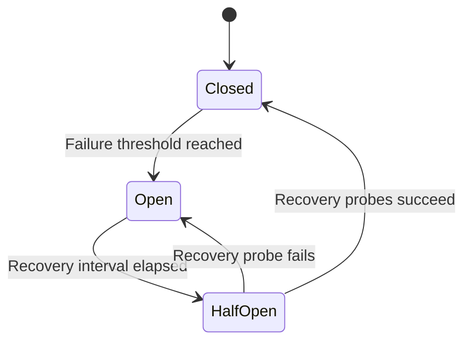

# Design Patterns Interview Cheat Sheet

[Study index](README.md) · Related: [OOP/SOLID](../Cheatsheets/OOP.md), [microservices](Microservices.md), [workflows](Workflow_Orchestration.md).

Choose a pattern to solve an observed design pressure. Examples are Python/Java fragments with domain types omitted. A pattern name does not establish thread safety, durability, or correct transactions.

## Contents

- [1. Strategy vs. a simple conditional?](#1-strategy-vs-a-simple-conditional)
- [2. Factory, abstract factory, and builder?](#2-factory-abstract-factory-and-builder)
- [3. Adapter vs. facade vs. decorator vs. proxy?](#3-adapter-vs-facade-vs-decorator-vs-proxy)
- [4. Observer vs. durable events?](#4-observer-vs-durable-events)
- [5. State vs. strategy vs. template method?](#5-state-vs-strategy-vs-template-method)
- [6. Command, chain of responsibility, and middleware?](#6-command-chain-of-responsibility-and-middleware)
- [7. Singleton vs. dependency-injected lifecycle?](#7-singleton-vs-dependency-injected-lifecycle)
- [8. Repository, unit of work, and ports/adapters?](#8-repository-unit-of-work-and-portsadapters)
- [9. Which distributed patterns should a senior engineer know?](#9-which-distributed-patterns-should-a-senior-engineer-know)
- [Circuit breaker](#circuit-breaker)
- [10. How do you answer “Which patterns have you used?”](#10-how-do-you-answer-which-patterns-have-you-used)
- [References](#references)

## 1. Strategy vs. a simple conditional?

**Scenario:** checkout supports multiple pricing rules owned and tested independently. Strategy encapsulates interchangeable behavior behind a contract.

```python
from typing import Protocol
class PriceRule(Protocol):
    def total(self, subtotal: int) -> int: ...

class FixedDiscount:
    def __init__(self, discount: int):
        self.discount = discount
    def total(self, subtotal: int) -> int:
        return max(0, subtotal - self.discount)

def checkout(subtotal: int, rule: PriceRule) -> int:
    return rule.total(subtotal)
```

| Choice | Prefer when | Tradeoff |
|---|---|---|
| Conditional | Few stable, local branches | Grows unwieldy with independent variation |
| Strategy | Real interchangeable algorithms | More objects/interfaces and selection logic |
| Function parameter | Small stateless behavior | Needs clear callable contract and error policy |

**Dig deeper:** how is strategy selected from tenant config safely? Where do currency, rounding, invalid input, and failure contracts live? Do not create a class per trivial expression without a maintenance benefit.

## 2. Factory, abstract factory, and builder?

| Pattern | Trigger | Tradeoff |
|---|---|---|
| Factory | Hide construction/provider selection | Can become a service locator with hidden global dependencies |
| Abstract factory | Create compatible families of components | Extra abstraction; useful only if family consistency matters |
| Builder | Many optional fields with validation | Required/invalid combinations must still be enforced |

```java
HttpRequest request = HttpRequest.newBuilder(URI.create("https://example.com/orders"))
    .timeout(Duration.ofSeconds(2))
    .header("Accept", "application/json")
    .GET()
    .build();
```

**Scenario:** an OCI/AWS provider factory returns matching compute/storage adapters. Avoid exposing provider-specific objects everywhere if your domain needs a stable port, but do not erase meaningful capabilities into a misleading lowest-common-denominator interface.

**Dig deeper:** who owns and closes pooled clients returned by a factory? Why is `new Client()` per request often different from a shared managed client?

## 3. Adapter vs. facade vs. decorator vs. proxy?

| Pattern | Changes | Example | Trap |
|---|---|---|---|
| Adapter | Interface/representation | Map vendor SDK errors into domain failures | Losing retryability/error details |
| Facade | Simplifies a subsystem | One provisioning entry point coordinating several services | Growing into a god object |
| Decorator | Adds behavior under same contract | Metrics around payment gateway | Wrapper order changes meaning |
| Proxy | Controls access/lifecycle/location | Spring transaction proxy / remote client | Self-invocation or remote failures differ from ordinary calls |

```python
class TimedGateway:
    def __init__(self, wrapped, clock, record):
        self.wrapped, self.clock, self.record = wrapped, clock, record
    def charge(self, request):
        start = self.clock()
        try:
            return self.wrapped.charge(request)
        finally:
            self.record(self.clock() - start)  # recorder must not mask business result
```

**Dig deeper:** retry outside metrics measures attempts differently from metrics outside retry. Authentication around a client does not mean every operation is authorized. A remote proxy cannot hide distributed failure semantics safely.

### Java adapter and decorator example

```java
interface PaymentPort { Receipt charge(PaymentRequest request); }
final class VendorAdapter implements PaymentPort {
    private final VendorClient client;
    VendorAdapter(VendorClient client) { this.client = client; }
    public Receipt charge(PaymentRequest request) {
        return mapReceipt(client.pay(mapRequest(request)));
    }
    // mapRequest/mapReceipt translate vendor types and domain semantics.
}
final class MeteredPayments implements PaymentPort {
    private final PaymentPort next;
    MeteredPayments(PaymentPort next) { this.next = next; }
    public Receipt charge(PaymentRequest request) {
        long start = System.nanoTime();
        try { return next.charge(request); }
        finally { recordDuration(System.nanoTime() - start); }
    }
}
```

The adapter changes the interface boundary; the decorator retains it while adding behavior. Metrics callbacks should not replace a successful payment with an unrelated metrics failure.

**Dig deeper:** should retry wrap metrics or metrics wrap retry? One counts whole operations; the other can count attempts. Where is the idempotency key generated and retained?

## 4. Observer vs. durable events?

Observer notifies subscribed listeners when something changes. In-process listeners are useful for local reactions but can lose work on crash and can make synchronous errors/order surprising. A broker/outbox adds a durability boundary, not merely a different callback syntax.

| Mechanism | Strength | Cost |
|---|---|---|
| Synchronous observer | Immediate local reaction | Listener latency/failure affects caller |
| Async in-process observer | Decouple local timing | Process crash can lose queued work |
| Durable event + outbox | Recoverable delivery intent | Duplicate handling, lag, schema evolution |

**Dig deeper:** listener A succeeds and listener B fails—what is the invariant? Can replay send the same email twice? Are listeners part of the same transaction or reacting after commit?

## 5. State vs. strategy vs. template method?

State changes behavior as an object's lifecycle changes; strategy selects an algorithm; template method fixes an algorithm skeleton while subclasses implement selected steps.

```python
ALLOWED = {
    "CREATED": {"RESERVED", "CANCELLED"},
    "RESERVED": {"PAID", "CANCELLED"},
    "PAID": {"CONFIRMED", "REFUND_PENDING"},
}
def validate_transition(current, target):
    if target not in ALLOWED.get(current, set()):
        raise ValueError("invalid order transition")
```

An enum/table can be enough; dedicated state classes help when behavior per state becomes substantial. Persist transitions with version/lock checks for concurrent changes.

**Dig deeper:** in-memory state cannot recover a workflow after restart. Template-method hooks couple subclasses to base lifecycle; composition often makes varying steps easier to test.

## 6. Command, chain of responsibility, and middleware?

Command represents an action as data/object; middleware/chain passes a request through ordered handlers. Useful for jobs, undoable local actions, validation pipelines, and request filters.

```text
request -> correlation -> authentication -> authorization -> rate limit -> handler
```

Order matters: tenant identity may be needed before applying a tenant quota. A command intended for durable execution needs a versioned schema, operation identity, authorization, and retry policy; serializing an arbitrary Python callable is not a safe durable API.

**Dig deeper:** undo is not always possible for external effects. Does a chain stop on failure? How are partial side effects handled? Which middleware sees an error raised before the handler?

## 7. Singleton vs. dependency-injected lifecycle?

| Scope | Meaning | Risk |
|---|---|---|
| Process singleton | One instance under that process/class-loader convention | Shared mutable state and test coupling |
| Spring singleton | One bean per definition/container | Not automatically thread-safe |
| Cluster leader | One authoritative owner under protocol | Needs election, fencing, and failure handling |

Do not use a singleton object to claim “only one scheduler runs across replicas.” Use durable coordination and idempotent work design. Explicit ownership/lifecycle injection usually makes clients and caches easier to test than global accessors.

**Dig deeper:** can a singleton hold request/tenant state? Why can tests accidentally share stale state? What happens with two application contexts or multiple worker processes?

## 8. Repository, unit of work, and ports/adapters?

A repository exposes domain-oriented persistence operations; a unit of work coordinates tracked changes within a transaction; ports/adapters separate application contracts from infrastructure implementations.

| Benefit | Cost to defend |
|---|---|
| Replace vendor details behind owned contracts | Mapping and contract maintenance |
| Test domain rules without a database | Unit fakes cannot prove SQL/locking correctness |
| Explicit transaction boundary | Generic repositories can hide inefficient queries |

**Scenario:** `reserve_inventory` can be a better repository operation than exposing generic `get/set` that encourages race-prone read-modify-write. Avoid pretending one generic abstraction can erase every SQL/NoSQL capability difference.

## 9. Which distributed patterns should a senior engineer know?

| Pattern | Problem | Key caveat | Deep dive |
|---|---|---|---|
| Outbox/inbox | DB/event boundary and duplicate effects | Delivery still needs retries/dedup | [Messaging](../Cheatsheets/Kafka.md) |
| Saga | Multi-service business workflow | Compensation can fail | [Distributed systems](Distributed_Systems.md) |
| Circuit breaker | Avoid repeated calls to unhealthy dependencies | Failure policy, probe behavior, and state scope | [Circuit breaker](#circuit-breaker) |
| Bulkhead | Isolate resource usage between workloads | Limits and queues need capacity budgets | [Microservices](Microservices.md#5-timeouts-retries-circuit-breakers-bulkheads) |
| CQRS | Different read/write needs | Projection lag and operations | [Microservices](Microservices.md) |
| Strangler migration | Incrementally replace legacy paths | Data ownership during coexistence | [Microservices](Microservices.md) |
| Cache-aside | Reuse expensive reads | Stale data and stampedes | [Caching](Caching_Performance.md) |
| Reconciliation loop | Recover desired vs. actual state | Concurrent/stale controllers | [Workflows](Workflow_Orchestration.md) |

## Circuit breaker

A Circuit Breaker is a resilience design pattern: it temporarily rejects calls to an unhealthy dependency, then probes whether calls can resume. It is commonly discussed as an architectural/distributed-systems pattern rather than one of the original Gang of Four object-design patterns.

### States and recovery

| State | Behavior | Transition |
|---|---|---|
| Closed | Allow calls and observe relevant failures | Open when the configured failure policy is met |
| Open | Reject calls quickly without calling the dependency | After a recovery interval, allow limited probes |
| Half-open | Admit a limited trial workload | Close on the configured success condition; reopen on failure |



**Example:** a failing payment provider causes requests to occupy resources until timeout. The breaker stops repeated attempts and returns an explicit unavailable/pending outcome. It must not turn a failed payment into a fabricated success. Half-open probes prevent immediately flooding a recovering dependency.

### Circuit breaker vs. related controls

| Control | Responsibility |
|---|---|
| Circuit breaker | Stop repeated calls to a dependency judged unhealthy |
| Timeout | Bound how long an attempt waits |
| Retry | Repeat a classified transient failure within a budget |
| Bulkhead | Limit resource sharing and isolate failure impact |
| Rate limiter | Bound admission over time |

Use these together where required. A breaker cannot replace an I/O timeout or a concurrency bound. Retry/breaker wrapper order affects what gets counted; do not retry an open-circuit rejection in a tight loop. Thresholds, failure classification, probe count, and state scope depend on the implementation. [Circuit Breaker pattern](https://learn.microsoft.com/en-us/azure/architecture/patterns/circuit-breaker).

### Python implementation example

Requires `pybreaker`; `payment_client` is an application collaborator. The values below are illustrative, not universal production settings.

```python
import pybreaker

# Keep one breaker per dependency, shared across requests in this process.
payment_breaker = pybreaker.CircuitBreaker(
    fail_max=3,       # open after 3 consecutive failures
    reset_timeout=30  # after 30 seconds, allow a trial call
)

@payment_breaker
def charge_payment(payment_id):
    return payment_client.charge(payment_id, timeout=2)

try:
    charge_payment("pay-123")
except pybreaker.CircuitBreakerError:
    # The breaker is open; return a fallback or report the service unavailable.
    print("Payments are temporarily unavailable")
```

Count only failures that indicate a dependency problem. For example, a bad customer request should usually not open a breaker. `pybreaker` supports excluded exception types. Always set a timeout on the underlying network/database call too; a breaker cannot help while a call hangs forever. A normal in-memory breaker is local to one process. `pybreaker` can use Redis storage when several processes need to share breaker state. Its async support is for Tornado; don't assume the decorator works directly with `asyncio` coroutines.

### What should you test and monitor?

Verify opening after the relevant failure policy, fast rejection while open, bounded half-open probes, recovery, business-error exclusion, and behavior under concurrent calls. Track state transitions, rejected calls, dependency latency/errors, and fallback outcomes. An in-process breaker is not automatically shared by every service replica.

Library API and optional shared-state support: [PyBreaker documentation](https://github.com/danielfm/pybreaker).

## 10. How do you answer “Which patterns have you used?”

Use a real problem → design pressure → chosen pattern → smallest code/architecture explanation → alternative rejected → failure case → evidence. Separate a pattern you recognize from one you personally implemented. Do not rename every ordinary class a factory or every function a strategy.

**Practice:** adapt two cloud providers, decorate a gateway with metrics, model an upgrade state machine, and explain why a durable command/outbox is needed after a crash. Test substitutability, wrapper ordering, transition races, and partial failure.

## References

- [Python protocols](https://docs.python.org/3/library/typing.html#typing.Protocol)
- [Java HttpRequest builder](https://docs.oracle.com/en/java/javase/21/docs/api/java.net.http/java/net/http/HttpRequest.Builder.html)
- [Spring AOP proxies](https://docs.spring.io/spring-framework/reference/core/aop/proxying.html)
- [Azure architecture patterns catalog](https://learn.microsoft.com/en-us/azure/architecture/patterns/)
